# 📚 Resumen completo – Lenguajes de Programación (Unidades 07 a 12 + UML)

> **Materiales incluidos:** Unidad 07 (Clase + apunte v02), Unidad 08, Semana 09, Unidad 10 (HTML y PHP), Unidad 11 (Clase + material oficial), Unidad 12 (Clase + material oficial) y la Bibliografía auxiliar *Introducción al UML*.

## 🧭 Leyenda de emojis

| Emoji | Significado |
|---|---|
| 📌 | **Lo más importante a tener en cuenta** (para el examen o la práctica) |
| 💡 | **Ejemplo práctico** (código o caso concreto) |
| 🏠 | **Analogía de la vida diaria** |
| ⚠️ | Error común / advertencia |
| 📊 | Gráfico / diagrama |

---

## 🗺️ Índice

1. [Mapa general de la materia](#️-mapa-general-de-la-materia)
2. [Unidad 07 – Introducción al Paradigma Orientado a Objetos](#unidad-07--introducción-al-paradigma-orientado-a-objetos)
3. [Unidad 08 – Principios fundamentales de la POO](#unidad-08--principios-fundamentales-de-la-poo)
4. [Bibliografía auxiliar – UML en profundidad](#bibliografía-auxiliar--uml-en-profundidad)
5. [Unidad 09 – POO avanzada: caso Carrito de compras](#unidad-09--poo-avanzada-caso-carrito-de-compras)
6. [Unidad 10 – Programación web, HTML y PHP](#unidad-10--programación-web-html-y-php)
7. [Unidad 11 – Funciones, modularización y formularios en PHP](#unidad-11--funciones-modularización-y-formularios-en-php)
8. [Unidad 12 – Programación Orientada a Objetos en PHP](#unidad-12--programación-orientada-a-objetos-en-php)
9. [Comparativa final C++ / Java / PHP](#comparativa-final-c--java--php)
10. [Guía de estudio: preguntas de examen y ejercicios resueltos](#-guía-de-estudio-preguntas-de-examen-y-ejercicios-resueltos)
11. [Glosario general de términos clave](#-glosario-general-de-términos-clave)
12. [Checklist de repaso rápido](#-checklist-de-repaso-rápido)

---

## 🗺️ Mapa general de la materia

📊 **Cómo se conectan los temas:**

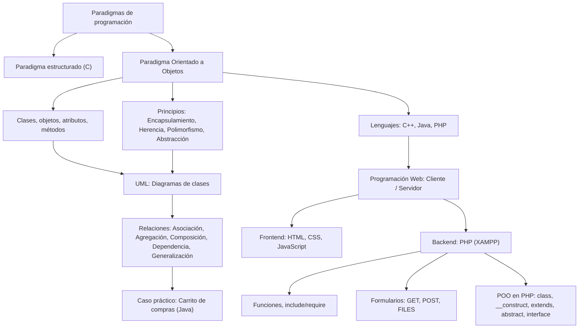

---

# Unidad 07 – Introducción al Paradigma Orientado a Objetos

## 1. ¿Qué es un paradigma de programación?

Un **paradigma** es una **forma o estilo de resolver problemas** y desarrollar programas usando determinados conceptos y estructuras. Es el conjunto de **reglas, técnicas y enfoques** que guían cómo escribimos y organizamos el código.

🏠 **Analogía (del propio material):** así como hay distintas formas de cocinar una receta (al horno, a la parrilla o al vapor), en programación hay distintos paradigmas para resolver **el mismo problema**. El resultado (la comida) puede ser parecido, pero el proceso y la organización cambian.

📌 **Importante:** un paradigma **no es un lenguaje**; es una *manera de pensar*. Un mismo lenguaje (por ejemplo C++) puede usarse en forma estructurada o en forma orientada a objetos.

---

## 2. Paradigma estructurado

Propone dividir el problema en **partes más pequeñas y controladas** (funciones), evitando saltos desordenados en el flujo y favoreciendo la claridad.

- El programa se divide en **funciones**.
- Los **datos están separados** de las funciones que los procesan.
- Se enfoca en **algoritmos y flujo de control**.

🏠 **Analogía:** una **línea de montaje** donde cada estación (función) recibe una pieza (dato), le hace algo y la pasa a la siguiente. Las piezas no "saben" nada; las estaciones hacen todo.

💡 **Ejemplo (C):**
```c
float saldo = 1000;                 // dato suelto
void depositar(float *s, float m) { *s += m; }   // función separada
depositar(&saldo, 500);
```

## 3. Paradigma Orientado a Objetos (POO)

Organiza el software a partir de **objetos que representan entidades del mundo real**, combinando **datos (estado)** y **comportamiento (métodos)** en una misma unidad. Los objetos interactúan **enviándose mensajes** (llamadas a métodos).

- El programa se divide en **clases y objetos**.
- Los datos y las funciones que los procesan **están juntos** dentro del objeto.
- Se enfoca en **modelar el mundo real**.

🏠 **Analogía (del material):** la POO es como una **cocina organizada**, donde cada elemento (chef, horno, ingrediente, receta) tiene **propiedades** y **responsabilidades** específicas. El chef no "abre" el horno por dentro: le pide que caliente a 180°.

📌 **¿Por qué es útil la POO?**
- Facilita sistemas **modulares y mantenibles**: cada clase tiene una responsabilidad clara.
- Un cambio en una parte **impacta menos** en el resto.
- Se promueve la **reutilización**: lo común se programa una vez (en forma abstracta) y el programador se concentra en las **diferencias**.
- Permite expresar relaciones naturales del dominio: *"un Pedido **tiene** Items"*, *"un Usuario **hereda** de Persona"*.
- Favorece prácticas como pruebas unitarias y separación en capas (presentación, dominio, persistencia).
- Se recomienda **priorizar composición sobre herencia** cuando se busca flexibilidad.

## 4. Estructurado vs. POO

📊 **Comparación visual:**

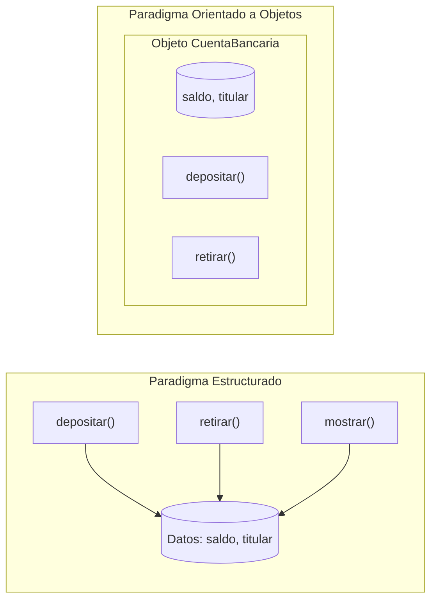

| Estructurado | POO |
|---|---|
| Se basa en **funciones** | Se basa en **clases y objetos** |
| Datos y funciones **separados** | Datos y métodos **juntos** |
| Menos intuitivo para sistemas grandes | Más natural para modelar el mundo real |
| Ejemplo: **C** | Ejemplo: **Java, C++** (y PHP) |

---

## 5. Clases e instancias (objetos)

### Clase
Es el **molde** que define cómo se crean los objetos: especifica sus **propiedades (atributos)** y sus **comportamientos (métodos)**.

### Objeto / Instancia
Es una **representación concreta** de la clase, **creada en memoria** (ocupa espacio). Cada instancia tiene **sus propios valores** de atributos —su **estado**— aunque comparte los métodos.

🏠 **Analogía:** la **clase** es el **molde de galletitas** o el **plano de una casa**; los **objetos** son cada galletita o cada casa construida. Todas tienen la misma forma, pero una puede ser de chocolate y otra de vainilla (distinto estado).

💡 **Ejemplo (del material):** clase `Auto` / `Vehículo`
- Atributos: `color`, `velocidad`, `ruedas`, `motor`, `marca`
- Métodos: `arrancar()`, `frenar()`, `doblar()`
- Objeto 1: marca = "Toyota", modelo = "Corolla", color = "Rojo"
- Objeto 2: marca = "Ford", modelo = "Focus", color = "Azul"

📊 **Una clase, muchas instancias:**

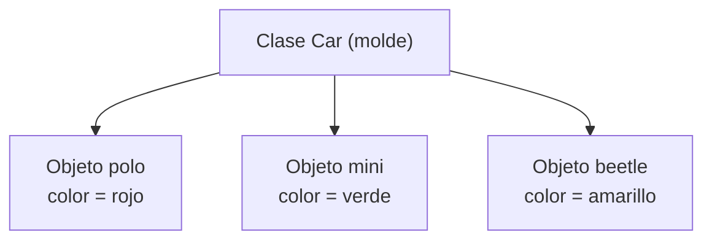

💡 **Ejemplo del Reloj (apunte v02):** 4 relojes (`reloj_1` … `reloj_4`) creados de la misma clase `Reloj`. Todos tienen `set()`, `incrementar()` y `getHora()`, pero cada uno marca su propia hora.
📌 *"En las instancias no importa cómo está construido el objeto por dentro, lo que importa es su **comportamiento observable**."*

### Propiedades y métodos
- **Propiedades:** variables que guardan el **estado**. Ej.: `persona1` → nombre = "Juan", edad = 25; `persona2` → nombre = "Ana", edad = 30.
- **Métodos:** funciones que describen el **comportamiento**. Ej.: `saludar()` → "Hola, soy Juan".

📌 **Regla de oro:** las **propiedades definen QUÉ ES** el objeto; los **métodos definen QUÉ PUEDE HACER**.

---

## 6. Introducción al UML (diagrama de clases)

**UML (Lenguaje Unificado de Modelado)** es una forma **gráfica** de representar sistemas orientados a objetos: clases, atributos, métodos y cómo se relacionan.

Una clase se dibuja como un **rectángulo con 3 secciones**:
1. **Nombre** de la clase (arriba)
2. **Atributos** (medio) → `visibilidad nombre: tipo`
3. **Métodos** (abajo) → `visibilidad nombre(parámetros): tipoRetorno`

📊 **Ejemplo Persona (del material):**

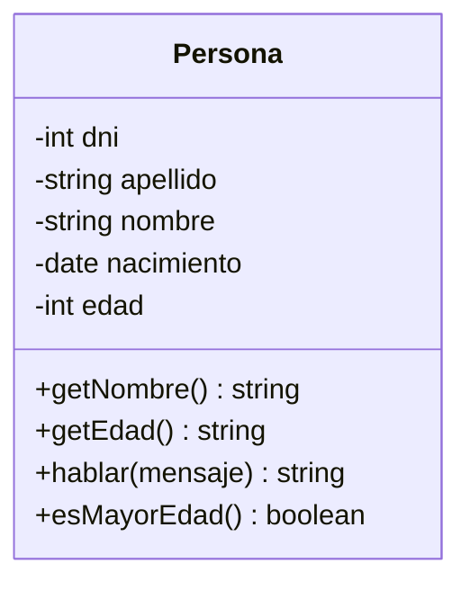

## 7. Visibilidad (modificadores de acceso)

| Símbolo UML | Modificador | Misma clase | Subclases | Otras clases | Uso típico |
|:---:|---|:---:|:---:|:---:|---|
| `+` | **public** | ✅ | ✅ | ✅ | Métodos de la "interfaz" del objeto, constantes |
| `#` | **protected** | ✅ | ✅ | ❌ | Herencia controlada |
| `-` | **private** | ✅ | ❌ | ❌ | Proteger datos sensibles (el más recomendado para atributos) |

🏠 **Analogía:** una **casa**:
- `public` → el **jardín delantero**: cualquiera lo ve.
- `protected` → el **living**: entra la familia (subclases).
- `private` → tu **caja fuerte**: solo vos (la propia clase).

📌 Para manipular atributos `private` desde afuera se usan métodos públicos **getters** (leer) y **setters** (modificar).

---

## 8. Clases e instancias en código (C++ y Java)

💡 **Ejemplo en C++** (clase `Persona`, reconstruido del material):

```cpp
#include <iostream>
#include <string>
using namespace std;

class Persona {
private:
    string nombre;
    string apellido;
    int edad;
public:
    // Constructor
    Persona(string nom, string ape, int e) {
        nombre = nom;
        apellido = ape;
        edad = e;
    }
    // Método saludo
    void saludo() {
        cout << "Hola, mi nombre es " << nombre << " " << apellido
             << " y tengo " << edad << " años." << endl;
    }
};

int main() {
    Persona p1("Ana", "Gonzalez", 29);   // instancia
    p1.saludo();
    return 0;
}
```

💡 **El mismo ejemplo en Java:**

```java
class Persona {
    private String nombre;
    private String apellido;
    private int edad;

    public Persona(String nombre, String apellido, int edad) {
        this.nombre = nombre;      // "this" distingue atributo de parámetro
        this.apellido = apellido;
        this.edad = edad;
    }

    public void saludo() {
        System.out.println("Hola, mi nombre es " + nombre + " " + apellido
                           + " y tengo " + edad + " años.");
    }
}

public class Main {            // debe coincidir con el archivo Main.java
    public static void main(String[] args) {
        Persona p1 = new Persona("Ana", "Gonzalez", 29);
        p1.saludo();
    }
}
```

📌 **Diferencias clave:**
- C++ agrupa visibilidad en bloques (`private:` / `public:`); Java la pone **en cada miembro**.
- Java crea objetos con **`new`**; en C++ se puede crear directamente en la pila (`Persona p1(...)`).
- En Java la clase pública debe llamarse **igual que el archivo** (`Main` → `Main.java`).
- Imprimir: C++ `cout << ...`; Java `System.out.println(...)`.

---

# Unidad 08 – Principios fundamentales de la POO

> *"La POO organiza mejor el código mediante principios clave que facilitan reutilización, mantenimiento y legibilidad."*

📊 **Los pilares de la POO:**

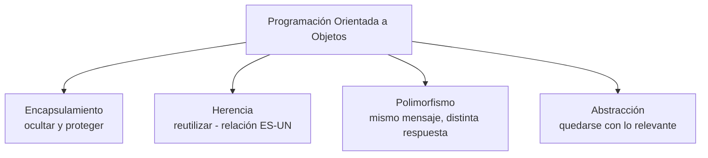

## 1. Encapsulamiento

**Ocultar los detalles internos** de una clase y **exponer solo lo necesario**. Protege los atributos con modificadores de acceso y permite **mantener control sobre los datos**.

> *"Encapsular = ocultar atributos y controlar el acceso mediante métodos (get/set)."*

🏠 **Analogía:** un **cajero automático**. No podés meter la mano y sacar billetes del depósito (atributo privado); tenés que usar los botones (métodos públicos) que validan tu PIN y tu saldo.

💡 **Ejemplo (del material):** en `CuentaBancaria`, `saldo` no se modifica desde afuera; se usa `depositar()` y `retirar()`, que aseguran que **no se deposite un valor negativo** ni se retire más de lo disponible.

💡 **Código C++ / Java:**

```cpp
// C++
class Persona {
private:
    string nombre;            // oculto
public:
    void setNombre(string n) { nombre = n; }
    string getNombre() { return nombre; }
};
int main() {
    Persona p;
    p.setNombre("Ana");
    cout << "Nombre: " << p.getNombre() << endl;
}
```

```java
// Java
class Persona {
    private String nombre;    // oculto
    public void setNombre(String n) { nombre = n; }
    public String getNombre() { return nombre; }
}
class Main {
    public static void main(String[] args) {
        Persona p = new Persona();
        p.setNombre("Seba");
        System.out.println("Nombre: " + p.getNombre());
    }
}
```

📌 **Beneficios:** seguridad, coherencia de los datos y **mantenibilidad** (lo interno puede cambiar sin afectar a quien usa la clase).

## 2. Herencia

Una clase (**hija / subclase**) **extiende** de otra (**padre / superclase**), heredando sus atributos y métodos, y puede **agregar los suyos**. Es una relación **"ES-UN"**.

🏠 **Analogía:** heredás de tus padres el apellido y el color de ojos (atributos), pero además tenés tus propios gustos y habilidades. Un **estudiante ES UNA persona**: tiene nombre y edad, y además legajo y carrera.

📊 **Jerarquías de herencia del material:**

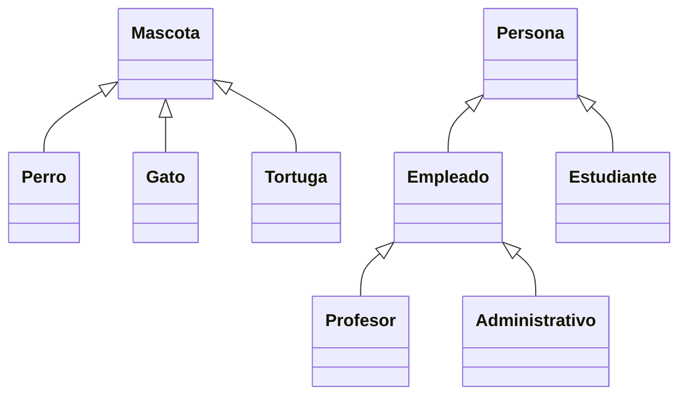

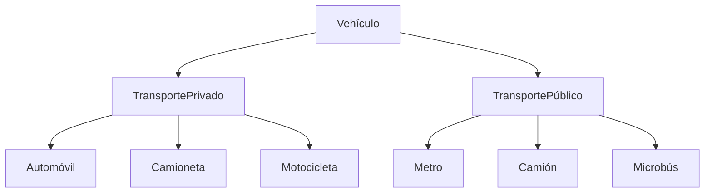

💡 **Diagrama UML Persona → Estudiante:**

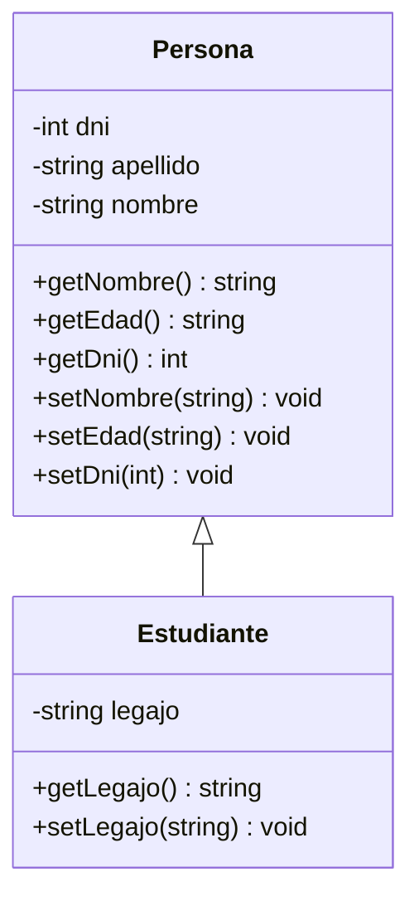

💡 **Código:**

```cpp
// C++
class Persona {
public:
    string nombre;
    void saludo() { cout << "Hola, soy " << nombre << endl; }
};
class Estudiante : public Persona {   // hereda de Persona
public:
    int legajo;
};
int main() {
    Estudiante e;
    e.nombre = "Juan";
    e.legajo = 123;
    e.saludo();          // método heredado
}
```

```java
// Java
class Persona {
    String nombre;
    void saludo() { System.out.println("Hola, soy " + nombre); }
}
class Estudiante extends Persona {     // hereda de Persona
    int legajo;
}
class Main {
    public static void main(String[] args) {
        Estudiante e = new Estudiante();
        e.nombre = "Juan";
        e.legajo = 123;
        e.saludo();      // hereda de Persona
    }
}
```

📌 **Clave:** C++ usa `: public Padre`; Java (y PHP) usan **`extends`**. En UML la herencia se dibuja con una **flecha de línea continua y triángulo vacío** apuntando al padre.

⚠️ Solo usar herencia si se cumple *"ES UN"*. Un `Auto` **no ES un** `Motor` (lo **tiene** → composición).

## 3. Polimorfismo

Capacidad de los objetos de **responder de forma distinta e independiente al mismo mensaje**. Un mismo método **se comporta diferente según el objeto que lo use**; se logra **sobrescribiendo (override)** métodos en las clases hijas.

🏠 **Analogía:** el mensaje *"¡hacé tu sonido!"* a distintos animales: el perro dice "Guau", el gato "Miau", el león "Grr". O la orden *"¡Abrir!"*: una puerta gira, una ventana corrediza se desliza, un frasco se desenrosca.

📊 **Formas geométricas (del material):**

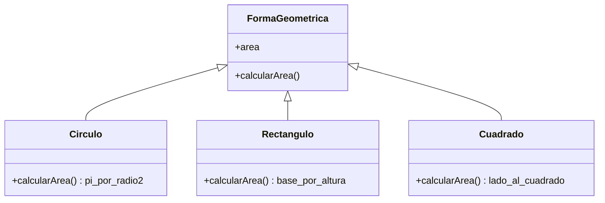

> *"Un mismo mensaje (`calcularArea()`) puede producir diferentes comportamientos dependiendo del objeto que lo reciba."*

💡 **Código:**

```cpp
// C++
class Animal {
public:
    virtual void sonido() { cout << "Un animal hace un sonido\n"; }
};
class Perro : public Animal {
public:
    void sonido() override { cout << "El perro dice: Guau!\n"; }
};
int main() {
    Animal* a = new Perro();
    a->sonido();   // polimorfismo: llama a la versión de Perro
}
```

```java
// Java
class Animal {
    void sonido() { System.out.println("Un animal hace un sonido"); }
}
class Perro extends Animal {
    void sonido() { System.out.println("El perro dice: Guau!"); }
}
class Main {
    public static void main(String[] args) {
        Animal a = new Perro();
        a.sonido();   // polimorfismo: llama a la versión de Perro
    }
}
```

📌 **MUY importante:** en **C++** hay que marcar el método con **`virtual`** para que se resuelva **dinámicamente en tiempo de ejecución**. En **Java** esto ocurre **automáticamente**. Sin `virtual`, C++ ejecutaría la versión de `Animal`.

## 4. Abstracción y ventajas de la POO

**Abstracción:** simplificar la representación de un objeto **centrándose en sus aspectos más relevantes** para el problema.

🏠 **Analogía:** un **mapa del subte**: no muestra calles ni edificios, solo estaciones y líneas, porque es lo que importa para viajar.

**Ventajas de la POO:**
- ♻️ Reutilización de atributos y métodos
- 🎯 Abstracción
- 🧩 Modularidad
- 📈 Mayor flexibilidad y escalabilidad
- 🏗️ Permite crear sistemas complejos
- ⚡ Agiliza el desarrollo de software

**¿Para qué sirve UML?**
- **Planificación:** estructurar clases, atributos y métodos.
- **Relaciones:** visualizar cómo interactúan los objetos (herencia, asociación, dependencia).
- **Documentación:** registro visual que facilita mantenimiento y escalabilidad.

### 📌 Resumen U08

| Principio | Idea clave |
|---|---|
| Encapsulamiento | Oculta atributos y expone solo métodos de acceso → organización y seguridad |
| Herencia | La hija reutiliza atributos y métodos del padre → evita duplicar y permite extender |
| Polimorfismo | Un mismo método se comporta diferente según el objeto |
| UML | Visualiza clases, atributos, métodos y relaciones. **Flecha con triángulo vacío = herencia** |

---

# Bibliografía auxiliar – UML en profundidad

## 1. ¿Qué es UML?

El **Lenguaje de Modelado Unificado** es un lenguaje **basado en diagramas** para **especificar, visualizar, construir y documentar** sistemas complejos (sobre todo software; también procesos de negocio, p. ej. cómo trabaja el Departamento de Compras).

- Un **modelo** es una **simplificación de la realidad** para comprender mejor el sistema: son los **"planos"** del sistema.
- UML es **independiente** de la metodología y del lenguaje, pero se basa en el **paradigma orientado a objetos**.
- Ofrece distintos **puntos de vista** (el usuario final necesita otra visión que el programador).
- El documento se centra en el **modelado estático** → **diagramas de clases** (estructura estática: qué elementos hay, su estructura interna y cómo se relacionan). Se complementa con la **estructura dinámica** (dimensión temporal), no tratada.
- Un diagrama es **una vista** del modelo: una clase puede aparecer en varios diagramas.

🏠 **Analogía (del texto):** como los **planos de un edificio o un auto** (distintas vistas: eléctrica, sanitaria, estructural) o el **storyboard** de una película (viñetas dibujadas antes de filmar).

📌 Los diagramas son **herramientas de comunicación**: deben ser **legibles y completos**.

## 2. Clases, atributos y operaciones

Una **clase** describe un conjunto de objetos que comparten **estructura, semántica, comportamiento y relaciones**. Rectángulo de 3 compartimentos: **nombre / atributos / operaciones** (en Java, "métodos").

📊 **Ejemplo Complejo:**

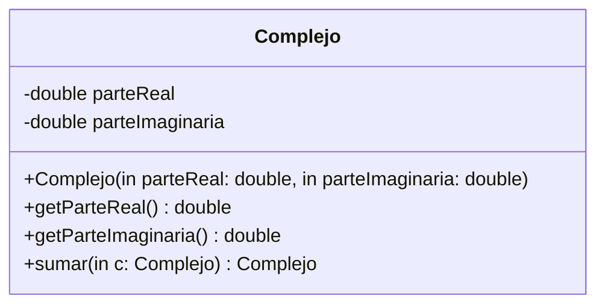

📌 **Convenciones de nombrado:**
- **Clase:** sustantivo en **singular**, empieza con **Mayúscula**, significativo y simple (`CuentaBancaria`, no `Cuentas` ni `cb`).
- **Atributo:** significativo, empieza con **minúscula**. Nombre y tipo separados por `:`.

**Signatura de una operación:**
```
visibilidad nombreMetodo(parámetro, parámetro, ...) [: tipoRetorno]
parámetro → [dirección] nombre : tipo [= valorPorDefecto]
```

| Dirección | Significado |
|---|---|
| `in` | Parámetro de **entrada**, no se puede modificar |
| `out` | Parámetro de **salida**, se modifica para devolver información al invocador |
| `inout` | **Entrada** que **puede modificarse** |

🏠 **Analogía:** `in` = te presto un libro para leer; `out` = te doy un cuaderno vacío para que lo completes; `inout` = te presto un cuaderno con apuntes y me lo devolvés corregido.

💡 **Ejemplo bancario:**

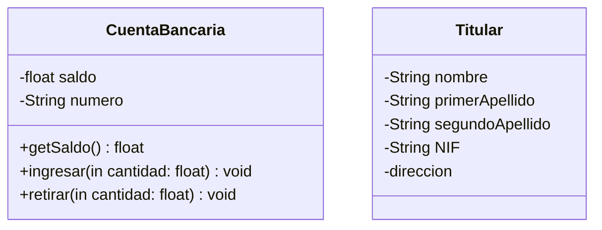

📌 Se pueden **ocultar** compartimentos o detalles si no aportan, y dejar decisiones (tipos, constructores) para la fase de codificación.

### Diagramas de objetos y notas
- **Diagrama de objetos:** muestra **instancias** con valores concretos (nombre **subrayado**, `complejo1 : Complejo`, `parteReal = 2.0`). Es un diagrama de clases donde solo aparecen objetos.
- **Notas:** texto asociado a cualquier elemento (pseudocódigo, restricciones, "pendiente de revisión"…). Se dibujan como una hoja con la esquina doblada.

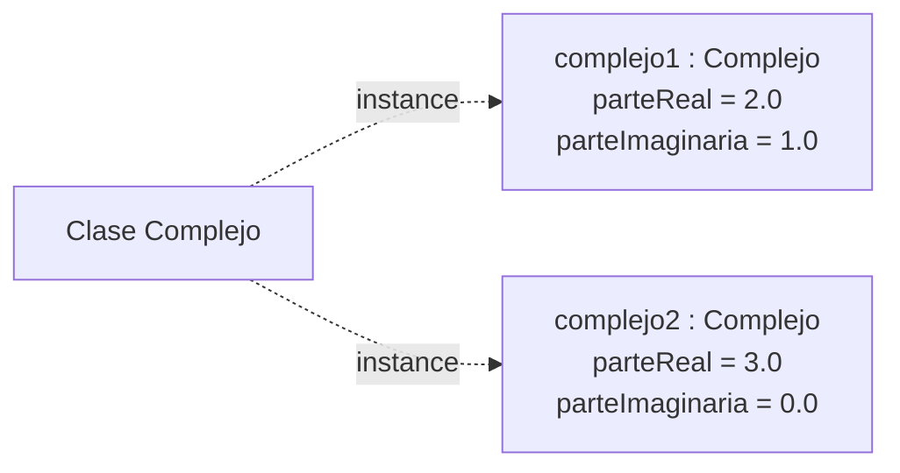

## 3. Implementación de una clase UML en Java

Casi todas las herramientas UML **generan el esqueleto** del código; el programador completa el **cuerpo de los métodos** y los **comentarios javadoc**.

💡 **Ejemplo completo:**

```java
/** La clase Complejo permite crear y manipular números complejos. */
public class Complejo {
    private double parteReal;
    private double parteImaginaria;

    public Complejo(double parteReal, double parteImaginaria) {
        this.parteReal = parteReal;
        this.parteImaginaria = parteImaginaria;
    }
    public double parteReal() { return parteReal; }
    public double parteImaginaria() { return parteImaginaria; }

    /** Devuelve un nuevo Complejo resultado de sumar este con c. */
    public Complejo sumar(Complejo c) {
        double nuevaParteReal = this.parteReal() + c.parteReal();
        double nuevaParteImaginaria = this.parteImaginaria() + c.parteImaginaria();
        return new Complejo(nuevaParteReal, nuevaParteImaginaria);
    }
    /** Convierte el complejo a cadena con la notación (a + bi). */
    public String toString() {
        return "(" + parteReal + " + " + parteImaginaria + "i)";
    }
}
```

```java
public class CuentaBancaria {
    private String numero;
    protected float saldo;    // protected: futuras subclases podrán usarlo

    public CuentaBancaria(String numero, float saldoInicial) {
        this.numero = numero;
        saldo = saldoInicial;
    }
    public float getSaldo() { return saldo; }
    public String getNumero() { return numero; }
    public void ingresar(float cantidad) { saldo += cantidad; }
    public void retirar(float cantidad) throws SaldoResultanteNoPermitido {
        saldo -= cantidad;
    }
}
```

📌 `public class` → disponible para todas las clases (sin `public`, solo para las del **mismo paquete**). El orden de atributos/métodos es libre, pero conviene seguir una convención. **Siempre documentar con javadoc.**

## 4. Atributos y operaciones **de clase** (static)

Pertenecen a **la clase**, no a cada instancia. En UML se **subrayan**. En Java se marcan con **`static`** y se invocan con el nombre de la clase: `CuentaBancaria.getNumeroCuentas()`.

🏠 **Analogía:** en un colegio, cada alumno tiene su **nota** (atributo de instancia), pero el **contador total de alumnos inscriptos** es uno solo y lo comparten todos (atributo de clase).

💡 **Ejemplo:**
```java
public class CuentaBancaria {
    private static int numeroCuentas = 0;   // atributo de clase
    static {
        numeroCuentas = 0;                  // bloque de inicialización estático
    }
    public CuentaBancaria(String numero, float saldoInicial) {
        this.numero = numero;
        saldo = saldoInicial;
        numeroCuentas++;                    // cada cuenta nueva suma 1
    }
    public static int getNumeroCuentas() { return numeroCuentas; }
}
```

📌 **Concepto avanzado de la bibliografía:** En Java existe la clase `java.lang.Class`, cuyas instancias en memoria representan a las clases mismas durante la ejecución. Los atributos y métodos `static` pertenecen a esa "instancia especial" de la clase, por eso son visibles **desde todas las instancias**, pero **no a la inversa** (un método `static` no puede usar `this` ni acceder directamente a atributos de instancia como `saldo` sin especificar de qué objeto).

## 5. Relaciones entre clases

Una relación es una **conexión entre dos o más clases**. Las principales: **generalización (herencia), asociación, agregación (y composición) y dependencia (uso)**.

📊 **Resumen visual de todas las relaciones (de más débil a más fuerte):**

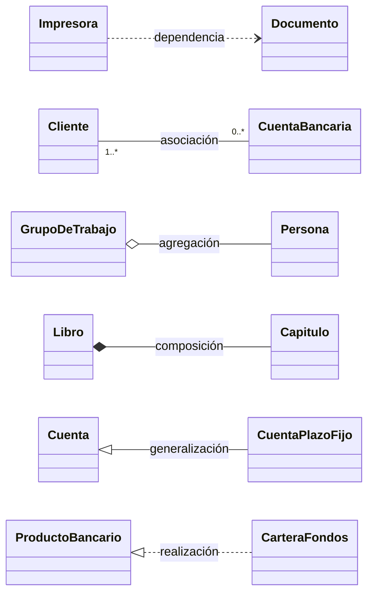

| Relación | Notación UML | Significado | Frase clave |
|---|---|---|---|
| **Dependencia** | Línea **discontinua** con flecha abierta `- - ->` | A **usa** a B temporalmente | "usa un" |
| **Asociación** | Línea **continua** (flecha si es unidireccional) | Las instancias se **conocen** | "conoce a" |
| **Agregación** | Línea con **rombo vacío** ◇ en el "todo" | Todo/parte **débil**: las partes sobreviven | "tiene un" |
| **Composición** | Línea con **rombo relleno** ◆ en el "todo" | Todo/parte **fuerte**: las partes mueren con el todo | "está compuesto por" |
| **Generalización** | Línea **continua** + **triángulo vacío** △ al padre | Herencia | "es un tipo de" |
| **Realización** | Línea **discontinua** + **triángulo vacío** | Una clase **implementa** una interfaz | "cumple el contrato de" |

### 5.1 Asociaciones

Relaciones **estructurales**: describen **enlaces** entre instancias. Las instancias de una clase "**conocen**" a las de la otra.
- **Binarias:** entre **2** clases.
- **n-arias:** entre **3 o más** clases.

**Navegabilidad:** por defecto es **bidireccional** (de A a B y de B a A). Si es **unidireccional**, se agrega una **flecha abierta** que indica el sentido.

**Roles:** nombres en cada extremo que indican el papel de la clase (ej.: un `Cliente` juega el rol de **titular**; la `CuentaBancaria` el rol de **cuentas**).

**Cardinalidad (multiplicidad):** cuántas instancias participan.

| Notación | Significado | Ejemplo del texto |
|:---:|---|---|
| `1` | Exactamente uno | Una persona tiene un único país de origen |
| `0..1` | Cero o uno | Un empleado tiene un responsable directo (excepto el director: cero) |
| `0..*` o `*` | Cero o más | Una persona puede no tener casa, tener una o varias |
| `1..*` | Uno o más | Un alumno está matriculado en una o más asignaturas |
| `n` (ej. `2`) | Número exacto | Un segmento tiene 2 puntos (origen y destino) |
| combinaciones | `0..1, 4..6, 8..*` | Cualquier número excepto 2, 3 y 7 |

📊 **Los tres casos del banco:**

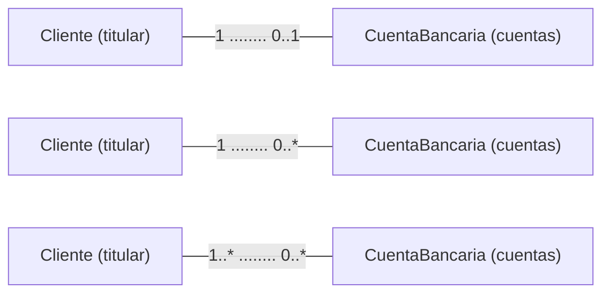

📊 **Diagrama de objetos del caso "muchos a muchos"** (cuenta2 tiene 2 titulares y cliente2 tiene 2 cuentas):

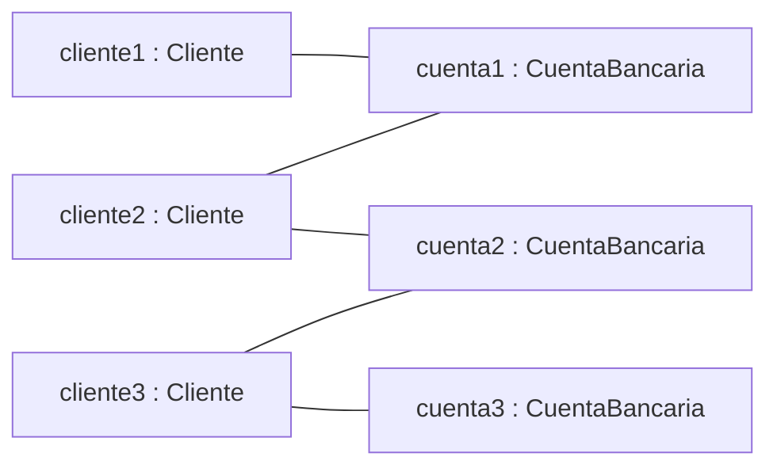

1. **Uno a uno:** cada cuenta tiene un único titular; un cliente tiene una cuenta o ninguna.
2. **Uno a muchos:** un cliente puede tener varias cuentas; cada cuenta tiene un solo titular.
3. **Muchos a muchos** (el caso real): cuentas con varios titulares y clientes con varias cuentas.

🏠 **Analogía:** 1 a 1 = persona ↔ DNI; 1 a muchos = madre → hijos biológicos; muchos a muchos = alumnos ↔ materias.

#### Implementación de asociaciones en Java
- Extremo **"muchos"** → un **atributo colección** (ej. `Set`, `List`) del tipo de la clase del otro extremo.
- Extremo **"uno"** → un **atributo referencia** a un objeto de la otra clase.
- Agregar métodos para **añadir y eliminar enlaces**.
- El atributo suele llamarse como el **rol** del diagrama.

💡 **Ejemplo (uno a muchos):**
```java
public class CuentaBancaria {
    private Cliente titular;     // extremo "uno"
    public CuentaBancaria(Cliente titular) throws Exception {
        if (titular == null)
            throw new Exception("No se puede crear cuentas sin titular");
        this.titular = titular;
    }
    public Cliente obtenerTitular() { return titular; }
    public boolean cambiarTitular(Cliente c) {
        if (c != null) titular = c;      // nunca dejar la cuenta sin titular
        return c != null;
    }
}

import java.util.*;
public class Cliente {
    private Set cuentas;         // extremo "muchos"
    public Cliente() { cuentas = new HashSet(); }
    public void nuevaCuenta(CuentaBancaria c) { cuentas.add(c); }
    public void eliminarCuenta(CuentaBancaria c) { cuentas.remove(c); }
    public Iterator obtenerCuentas() { return cuentas.iterator(); }
}
```

📌 Se usó un **Set** porque las cuentas de un titular **no requieren orden ni pueden repetirse**. Las **reglas de negocio** (ej. "una cuenta nunca sin titular") se aseguran en los métodos.

### 5.2 Asociaciones reflexivas
La clase origen y destino es **la misma**.

💡 **Ejemplo:** `Empleado` *"es responsable de"* `Empleado`. Cada empleado tiene `0..1` responsable y puede tener `0..*` subordinados → forma un **árbol** (organigrama).

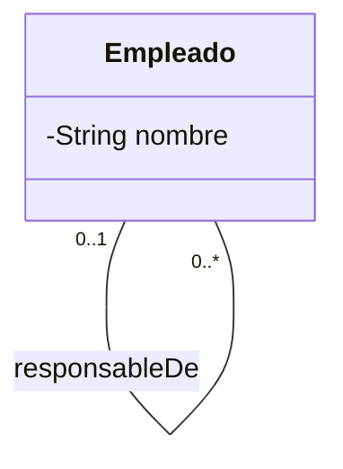

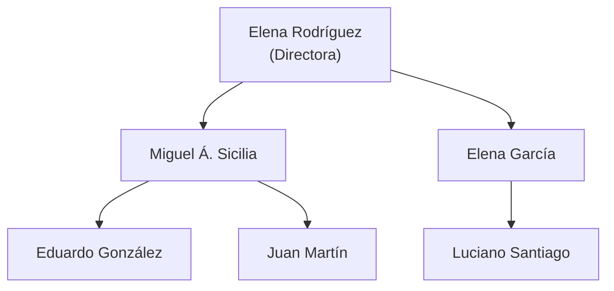

📌 Si fuera "muchos" en ambos lados (ej. "conoce a") formaría un **grafo** (puede tener ciclos).

### 5.3 Clase de asociación
Cuando **la propia asociación tiene atributos** que no pertenecen a ninguna de las dos clases.

💡 **Ejemplo:** `Pedido` – `Producto`. La **cantidad** pedida no es del pedido (como la fecha) ni del producto (como el precio): es **del vínculo**. Se dibuja con una **línea discontinua** a la asociación. En código se implementa con una **tercera clase** (`LineaPedido`).

🏠 **Analogía:** en un **ticket del supermercado**, "3 × Leche" — el "3" no es una propiedad de la leche ni del ticket, sino de **esa línea** del ticket.

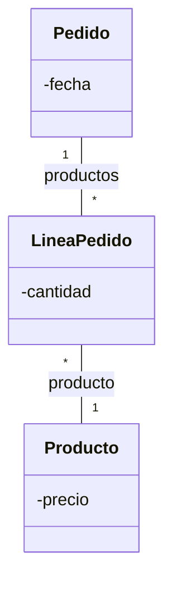

### 5.4 Asociaciones n-arias
Entre **3 o más clases**, representadas con un **rombo**.

💡 **Ejemplo:** goles de **Jugador** en un **Equipo** durante una **Temporada** → clase de asociación `Registro` (goles). En Java se agrega una clase adicional y se usan enlaces binarios.

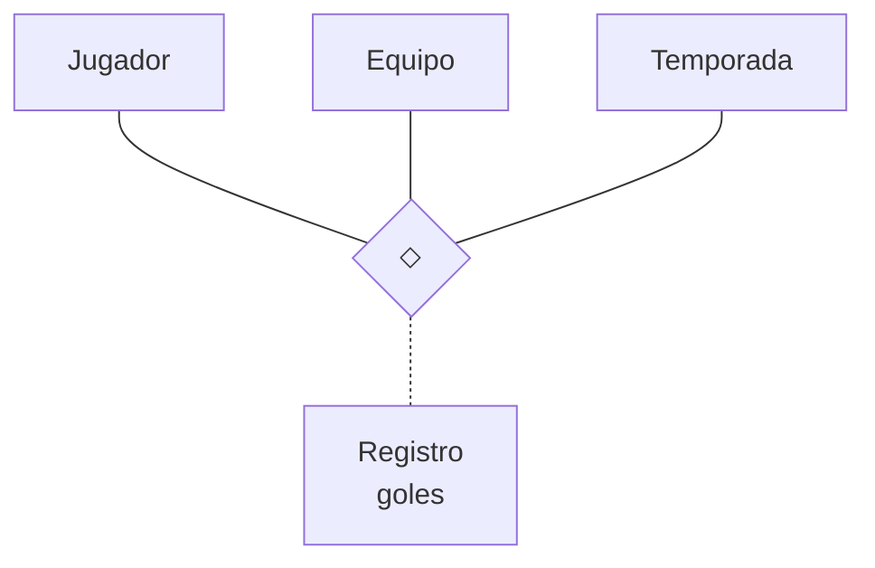

### 5.5 Agregación y composición
Tipos especiales de asociación con subordinación **"todo/parte"** o **"tiene un"**.

| | **Agregación** ◇ | **Composición** ◆ |
|---|---|---|
| Fuerza | Débil | Fuerte |
| ¿Las partes sobreviven al todo? | ✅ Sí | ❌ No, mueren con él |
| ¿Una parte puede estar en varios todos? | Sí | **No** (como máximo en uno) |
| Estructura | Grafo dirigido **acíclico** | **Árbol** |
| Ejemplo del texto | `GrupoDeTrabajo` ◇— `Persona` | `Documento` ◆— `Página` ◆— `Párrafo` |

🏠 **Analogías:**
- **Agregación:** un **equipo de fútbol** y sus jugadores: si el club se disuelve, los jugadores siguen existiendo y pueden ir a otro equipo.
- **Composición:** una **casa** y sus **habitaciones**: si demolés la casa, las habitaciones dejan de existir. O un **directorio** y sus archivos: borrás la carpeta → se borran los archivos.

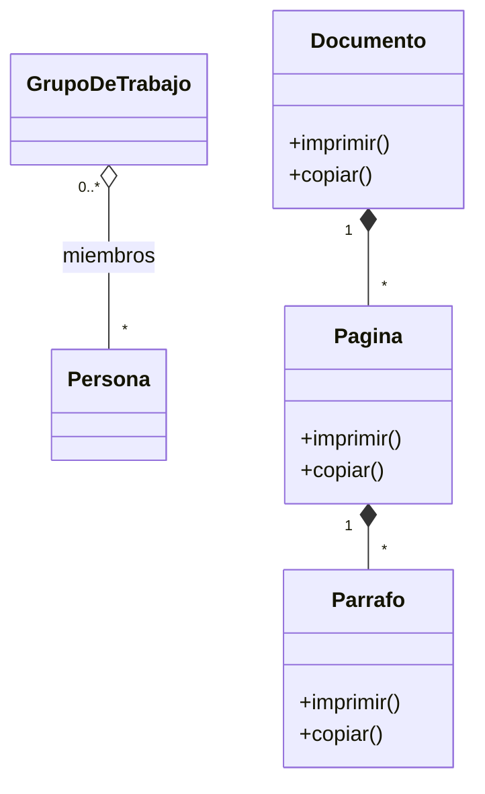

📌 En la **composición**:
- El "todo" **gestiona en exclusiva** sus partes (las crea y las borra; no cede referencias).
- En Java, borrar = **perder la referencia**; el **recolector de basura** elimina la página y, en cascada, sus párrafos.
- Las operaciones **se propagan**: imprimir el documento → imprime páginas → imprimen párrafos.

### 5.6 Dependencia (uso)
La relación **más débil**: A **usa** a B (por ejemplo, B es **parámetro** o variable local de un método de A). Si B cambia, puede que A deba cambiar.

💡 **Ejemplo:** `Impresora.imprimir(d : Documento)` usa `obtenerCabecera()`, `obtenerCuerpo()`, `obtenerPie()`. La impresora **no recuerda** los documentos que imprimió. Si se elimina `obtenerPie()`, hay que cambiar `imprimir`.

🏠 **Analogía:** vos y el **cajero del supermercado**: lo "usás" para pagar, pero no guardás un vínculo permanente con él.

📌 Toda **asociación implica dependencia**, pero **no al revés**. En Java se refleja en los `import`. Mostrarla solo si aporta información.

### 5.7 Generalización (herencia)
Relación **taxonómica** "**es un tipo de**" entre superclase (padre) y subclase (hija).
- Las instancias de la hija pueden usarse **donde se espera la padre**, **no al revés**.
- La hija **hereda** propiedades, comportamiento y relaciones, y puede agregar los suyos.
- Es **transitiva**: si C es un B y B es un A → C es un A.
- Sin herencia múltiple → **árbol**; con herencia múltiple → **grafo**.
- **Clase abstracta:** nombre en *cursiva* (también los métodos abstractos). En Java: `abstract class`.

💡 **Ejemplo:**

```mermaid
classDiagram
    class CuentaBancaria {
        <<abstract>>
        +retirar()
    }
    class CuentaCreditoLimitado {
        -float limiteCredito
        +retirar()
    }
    class CuentaPlazoFijo {
        -float penalizacion
        +retirar()
    }
    CuentaBancaria <|-- CuentaCreditoLimitado
    CuentaBancaria <|-- CuentaPlazoFijo
```

```java
public class CuentaPlazoFijo extends CuentaBancaria {
    private float penalizacion;   // porcentaje entre 0 y 1
    public CuentaPlazoFijo(String numero, float saldoInicial, float penalizacion) {
        super(numero, saldoInicial);          // llama al constructor del padre
        this.penalizacion = penalizacion;
    }
    /** Redefinición de retirar: aplica penalización y no permite saldo negativo. */
    public void retirar(float cantidad) throws SaldoResultanteNoPermitido {
        if (saldo - cantidad - cantidad * penalizacion >= 0)
            saldo = saldo - cantidad - cantidad * penalizacion;
        else
            throw new SaldoResultanteNoPermitido();
    }
}
```

💡 **Resolución del ejercicio propuesto en la bibliografía (`CuentaCreditoLimitado`):**
```java
public class CuentaCreditoLimitado extends CuentaBancaria {
    private float limiteCredito;   // máximo nivel de "números rojos" permitido

    public CuentaCreditoLimitado(String numero, float saldoInicial, float limiteCredito) {
        super(numero, saldoInicial);
        this.limiteCredito = limiteCredito;
    }

    /** Redefinición de retirar: permite saldo negativo hasta -limiteCredito. */
    public void retirar(float cantidad) throws SaldoResultanteNoPermitido {
        if (saldo - cantidad >= -limiteCredito)
            saldo -= cantidad;
        else
            throw new SaldoResultanteNoPermitido();
    }
}
```

💡 **Resolución del ejercicio de Composición propuesto en la bibliografía (Directorio y Ficheros):**
> *"Un Directorio y las entradas de directorio que contiene (ficheros, otros directorios), que se deben eliminar cuando se elimina el directorio. Por otro lado, un fichero está en un solo directorio."*

```mermaid
classDiagram
    class EntradaDirectorio {
        <<abstract>>
        -String nombre
        +eliminar()*
    }
    class Fichero {
        -int tamano
        +eliminar()
    }
    class Directorio {
        +añadirEntrada(e: EntradaDirectorio)
        +eliminar()
    }
    EntradaDirectorio <|-- Fichero
    EntradaDirectorio <|-- Directorio
    Directorio "0..1" *-- "0..*" EntradaDirectorio : contiene en exclusiva
```

## 6. Otros elementos de modelado

### 6.1 Interfaces
Especificación de un **conjunto de operaciones** (un servicio) que una clase puede implementar. **Separa la especificación de la implementación**. Se dibuja como clase con el estereotipo **`«interface»`**; solo tiene **operaciones abstractas**. Las clases que la implementan se unen con **línea discontinua + triángulo**.

🏠 **Analogía:** un **enchufe estándar**: cualquier aparato (heladera, TV, cargador) que cumpla la forma del enchufe puede conectarse, sin importar cómo funciona por dentro.

💡 **Ejemplo:** `CalculoImponibles` necesita saber la base imponible de cualquier producto bancario. Se diseña la interfaz `ProductoBancario` con `getValor()`, y clases de jerarquías **distintas** (`CuentaBancaria`, `CarteraFondos`) la implementan → **polimorfismo**. En el futuro, nuevos productos solo deben implementar la interfaz.

```mermaid
classDiagram
    class ProductoBancario {
        <<interface>>
        +getValor() float
    }
    class CalculoImponibles {
        +añadirImponible(in i: ProductoBancario)
    }
    CalculoImponibles ..> ProductoBancario
    ProductoBancario <|.. CuentaBancaria
    ProductoBancario <|.. CarteraFondos
```

```java
public interface ProductoBancario {
    public float getValor();
}
public class CuentaPlazoFijo extends CuentaBancaria implements ProductoBancario {
    // ... incluye la implementación de getValor()
}
```

### 6.2 Excepciones
Clases con el estereotipo **`«exception»`**; pueden tener **atributos (parámetros de la excepción)** y operaciones. Se vinculan a la operación que las lanza con el estereotipo **`«send»`**.

💡 **Ejemplo:** `CreditoSuperado` con `cantidadExceso : int`.

```mermaid
classDiagram
    class Throwable {
        <<exception>>
    }
    class Error {
        <<exception>>
    }
    class VirtualMachineError {
        <<exception>>
    }
    class Exception {
        <<exception>>
    }
    class CreditoSuperado {
        <<exception>>
        -int cantidadExceso
    }
    Throwable <|-- Error
    Throwable <|-- Exception
    Error <|-- VirtualMachineError
    Exception <|-- CreditoSuperado
```

```java
public class CreditoSuperado extends Exception {
    private int cantidadExceso;
    public CreditoSuperado(int cantidad) { cantidadExceso = cantidad; }
    // se suele redefinir al menos getMessage() y toString()
}
```

📌 En Java, las excepciones **propias** derivan de **`Exception`**; las de la máquina virtual (ej. sin memoria) derivan de **`Error`**.

## 7. Paquetes
Agrupan elementos del modelo (clases, relaciones, otros paquetes) → jerarquía en **árbol**. Se dibujan como una **carpeta**.

📌 **Regla de oro:** **máxima cohesión** dentro del paquete y **mínimo acoplamiento** entre paquetes.

🏠 **Analogía:** las **secciones de un supermercado**: lácteos juntos, limpieza junta (cohesión). Y que la sección limpieza no dependa de la de lácteos (bajo acoplamiento).

💡 **Ejemplo:** paquete "Cuentas Bancarias" y paquete "Gestión Hacienda" (con `DeclaracionRenta`, que depende de `CuentaBancaria`) → **dependencia entre paquetes**.

```mermaid
flowchart LR
    subgraph H["📁 Gestión Hacienda"]
        DR["DeclaracionRenta"]
    end
    subgraph CB["📁 Cuentas Bancarias"]
        C["CuentaBancaria"]
    end
    subgraph IO["📁 java.io"]
    end
    H -.-> CB
    CB -.-> IO
```

📌 **Paquete UML ≠ paquete Java:** el UML agrupa elementos del **modelo**; el de Java agrupa **clases Java** (no hay correspondencia 1 a 1 obligatoria). Ejemplo Java: `es.uoc.iti.bancario.cuentas`, `es.uoc.iti.bancario.hacienda`.

```java
package es.uoc.iti.bancario.hacienda;
import java.io.*;
import es.uoc.iti.bancario.cuentas.CuentaBancaria;   // CuentaBancaria debe ser public
public class DeclaracionRenta { /* ... */ }
```

---

# Unidad 09 – POO avanzada: caso Carrito de compras

## Objetivos
- Aplicar POO al modelado de un sistema real simplificado.
- Diseñar clases con **asociación, composición y herencia**.
- Aplicar **encapsulamiento** con `public`, `private`, `protected`.
- Representar todo en un **diagrama UML** claro.
- Traducir **requerimientos funcionales** en clases y métodos.
- Herramientas: **Lucidchart** (diagramas) y **OnlineGDB** (compilar online).

## Requerimientos del sistema
1. Listar productos disponibles (nombre, precio, stock).
2. Agregar productos al carrito indicando cantidad.
3. Ver el carrito con productos y cantidades.
4. Incrementar o decrementar la cantidad de un producto.
5. Eliminar un producto del carrito.
6. Finalizar la compra: mostrar total y vaciar el carrito.

📌 **Técnica para encontrar clases:** buscar los **sustantivos** del enunciado (Producto, Carrito, Usuario, ítem) → **clases**; los **verbos** (agregar, eliminar, finalizar) → **métodos**.

🏠 **Analogía:** es exactamente un **carrito de supermercado**: el **usuario** empuja *su* carrito; el carrito contiene **ítems** (cada ítem = un producto + cuántas unidades); el **producto** está en la góndola con su precio y stock.

## 📊 Diagrama de clases final

```mermaid
classDiagram
    class Producto {
        -int id
        -String nombre
        -float precio
        -int stock
        +getPrecio() float
        +setPrecio(precio: float) void
        +getStock() int
        +setStock(stock: int) void
        +getNombre() String
        +setNombre(nom: String) void
        +getId() int
    }
    class ItemCarrito {
        -Producto producto
        -int cantidad
        -float subtotal
        +getSubtotal() float
        +incrementarCantidad() void
        +getCantidad() int
        +getProducto() Producto
    }
    class Carrito {
        -List~ItemCarrito~ items
        +agregarProducto(producto: Producto, cantidad: int) void
        +eliminarProducto(producto: Producto) void
        +eliminarItem(item: ItemCarrito) void
        +modificarCantidad(producto: Producto, nuevaCantidad: int) void
        +mostrarCarrito() void
        +calcularTotal() float
        +vaciarCarrito() void
    }
    class Usuario {
        -int id
        -String username
        -String password
        -Carrito carrito
        +getCarrito() Carrito
        +vaciarCarrito() void
    }
    Usuario "1" *-- "1" Carrito : composición
    Carrito "1" *-- "0..*" ItemCarrito : composición
    ItemCarrito "*" o-- "1" Producto : agregación
```

📌 **¿Por qué esas relaciones?**
- **Usuario ◆ Carrito (composición):** el carrito pertenece a ese usuario y no tiene sentido sin él.
- **Carrito ◆ ItemCarrito (composición):** al vaciar/eliminar el carrito, los ítems desaparecen.
- **ItemCarrito ◇ Producto (agregación):** si se borra el ítem, el **producto sigue existiendo** en el catálogo.

## 💡 Código Java (reconstruido de las diapositivas)

```java
class Producto {
    private int id;
    private String nombre;
    private float precio;
    private int stock;

    public Producto(int id, String nombre, float precio, int stock) {
        this.id = id; this.nombre = nombre; this.precio = precio; this.stock = stock;
    }
    public int getId() { return id; }
    public String getNombre() { return nombre; }
    public float getPrecio() { return precio; }
    public int getStock() { return stock; }
    public void setPrecio(float precio) { this.precio = precio; }
    public void setStock(int stock) { this.stock = stock; }
    public void setNombre(String nombre) { this.nombre = nombre; }
    public void mostrarProducto() {
        System.out.println("Producto: " + nombre + ", Precio: $" + precio + ", Stock: " + stock);
    }
}

class ItemCarrito {
    private Producto producto;
    private int cantidad;
    private float subtotal;

    public ItemCarrito(Producto producto, int cantidad) {
        this.producto = producto;
        this.cantidad = cantidad;
        this.subtotal = calcularSubtotal();
    }
    private float calcularSubtotal() { return producto.getPrecio() * cantidad; }  // método privado auxiliar
    public float getSubtotal() { return subtotal; }
    public void incrementarCantidad() { cantidad++; subtotal = calcularSubtotal(); }
    public int getCantidad() { return cantidad; }
    public Producto getProducto() { return producto; }
    public void mostrarItem() {
        System.out.println("- " + producto.getNombre() + " x" + cantidad + " -> $" + subtotal);
    }
}

import java.util.*;
class Carrito {
    private List<ItemCarrito> items;
    public Carrito() { items = new ArrayList<>(); }

    public void agregarProducto(Producto producto, int cantidad) {
        for (ItemCarrito item : items) {
            if (item.getProducto().getId() == producto.getId()) {
                item.incrementarCantidad();   // si ya está, incrementa cantidad
                return;
            }
        }
        items.add(new ItemCarrito(producto, cantidad));
    }
    public void eliminarProducto(Producto producto) {
        items.removeIf(item -> item.getProducto().getId() == producto.getId());
    }
    public void vaciarCarrito() { items.clear(); }
    public float total() {
        float total = 0;
        for (ItemCarrito item : items) total += item.getSubtotal();
        return total;
    }
    public void mostrarCarrito() {
        System.out.println("Carrito de compras:");
        for (ItemCarrito item : items) item.mostrarItem();
        System.out.println("Total: $" + total());
    }
}

class Usuario {
    private String nombre;
    private String email;
    private Carrito carrito;

    public Usuario(String nombre, String email) {
        this.nombre = nombre; this.email = email;
        this.carrito = null;            // no tiene carrito al inicio
    }
    public void iniciarCarrito() {
        if (carrito == null) { carrito = new Carrito(); System.out.println("Carrito iniciado para " + nombre); }
        else System.out.println("Ya tienes un carrito activo.");
    }
    public void agregarAlCarrito(Producto producto, int cantidad) {
        if (carrito == null) System.out.println("Debes iniciar tu carrito primero.");
        else carrito.agregarProducto(producto, cantidad);
    }
    public void verCarrito() {
        if (carrito != null) carrito.mostrarCarrito();
        else System.out.println("No tienes un carrito activo.");
    }
    public void finalizarCompra() {
        System.out.println("Compra finalizada. Total a pagar: $" + carrito.total());
        carrito.vaciarCarrito();
    }
}

public class Main {
    public static void main(String[] args) {
        Producto prod1 = new Producto(1, "Mouse", 45000.99f, 10);
        Producto prod2 = new Producto(2, "Teclado", 75000.70f, 5);
        Producto prod3 = new Producto(3, "Memoria USB", 12000.00f, 5);

        prod1.mostrarProducto();
        prod2.mostrarProducto();
        prod3.mostrarProducto();

        // Cambiamos el stock del producto
        prod1.setStock(8);
        System.out.println("Stock actualizado de " + prod1.getNombre() + ": " + prod1.getStock());

        Usuario usuario = new Usuario("Ana", "ana@mail.com");
        usuario.verCarrito();                  // No tiene aún ("No tienes un carrito activo.")
        usuario.iniciarCarrito();              // "Carrito iniciado para Ana"
        usuario.agregarAlCarrito(prod1, 1);
        usuario.agregarAlCarrito(prod2, 2);
        usuario.verCarrito();                  // Muestra Mouse x1, Teclado x2, Total: $195002.39
        usuario.agregarAlCarrito(prod1, 3);    // Ya está en el carrito -> incrementa cantidad
        usuario.verCarrito();                  // Muestra Mouse x2, Teclado x2, Total: $240003.38
        usuario.finalizarCompra();             // "Compra finalizada. Total a pagar: $240003.38"
    }
}
```

📊 **Flujo de ejecución del `main` (salida real del material):**

```mermaid
sequenceDiagram
    participant M as main
    participant U as usuario (Ana)
    participant C as Carrito
    participant I as ItemCarrito
    M->>U: verCarrito()
    U-->>M: "No tienes un carrito activo."
    M->>U: iniciarCarrito()
    U->>C: new Carrito()
    M->>U: agregarAlCarrito(Mouse, 1)
    U->>C: agregarProducto(Mouse, 1)
    C->>I: new ItemCarrito(Mouse, 1)
    M->>U: agregarAlCarrito(Teclado, 2)
    U->>C: agregarProducto(Teclado, 2)
    M->>U: verCarrito()
    C-->>M: Mouse x1 $45000.99 / Teclado x2 $150001.4 / Total $195002.39
    M->>U: agregarAlCarrito(Mouse, ...)
    C->>I: incrementarCantidad()
    M->>U: verCarrito()
    C-->>M: Mouse x2 $90001.98 / Total $240003.38
    M->>U: finalizarCompra()
    U->>C: total() y vaciarCarrito()
```

⚠️ **Detalle interesante:** al agregar el Mouse por segunda vez (aunque se pidan 3), `incrementarCantidad()` suma **solo 1** → queda "Mouse x2". Es un buen ejemplo de cómo la **lógica de negocio** vive dentro de los métodos (y de un posible "bug" a mejorar: debería sumar la cantidad recibida).

---

# Unidad 10 – Programación web, HTML y PHP

## 1. Programación web y arquitectura cliente-servidor

> *"La programación web no es solo 'hacer páginas', es crear aplicaciones accesibles desde cualquier dispositivo conectado a Internet."*

- **Cliente:** el **navegador** (Chrome, Firefox…) que muestra la interfaz.
- **Servidor:** **procesa las solicitudes**, ejecuta código y envía respuestas.
- Se combinan **lenguajes, tecnologías y protocolos** (HTTP).

🏠 **Analogía:** un **restaurante**. Vos (cliente) mirás el menú y hacés un **pedido** (petición HTTP) al mozo; la **cocina** (servidor) prepara el plato (procesa) y te lo trae (respuesta). Vos nunca ves la cocina, solo el plato terminado.

📊 **Petición / respuesta:**

```mermaid
sequenceDiagram
    participant C as Cliente (Navegador)
    participant S as Servidor Web
    C->>S: Petición HTTP (GET /index.php)
    S->>S: Procesa / ejecuta código
    S-->>C: Respuesta HTTP (HTML, CSS, JS)
    C->>C: Renderiza la página
```

## 2. Frontend vs Backend

> *"El backend procesa y responde, mientras el frontend muestra la interfaz."*

📊 **Quién hace qué:**

```mermaid
flowchart LR
    subgraph FE["FRONTEND - lógica en el cliente"]
        H["HTML - estructura"]
        CS["CSS - estilo"]
        JS["JavaScript - interactividad"]
        V["Validaciones, interfaz web"]
    end
    subgraph BE["BACKEND - lógica en el servidor"]
        P["PHP, Java, Python, C#, Node.js, Ruby, Go..."]
        DB[("Bases de datos / SQL")]
        SEG["Seguridad, rendimiento, microservicios"]
    end
    FE <-->|"API (REST / GraphQL)"| BE
```

🏠 **Analogía:** en un **teatro**, el **frontend** es el escenario, la escenografía y las luces que ve el público; el **backend** son los técnicos, el guion y la utilería detrás del telón.

### HTML (HyperText Markup Language)
**Lenguaje de marcado** estándar que define la **estructura y el contenido** de una página (texto, imágenes, videos). **No es un lenguaje de programación**: no tiene lógica.

📌 *"HTML organiza el contenido, pero no tiene lógica de programación."*

💡 **Ejemplo:**
```html
<!DOCTYPE html>
<html>
<head>
    <title>My First Webpage</title>
</head>
<body>
    <h1>My First Webpage</h1>
    <p>This is a paragraph.</p>
</body>
</html>
```

### CSS (Cascading Style Sheets)
Describe la **presentación** de un documento HTML/XML: color, fuente, diseño. *"El CSS indica cómo debe verse el HTML."*

💡 **Ejemplo:**
```css
body {
    font-family: 'Open Sans', sans-serif;
    color: #666;
    background-color: #ddd;
    font-size: 16px;
    line-height: 1.6em;
}
```

### JavaScript (JS)
Lenguaje de programación de **alto nivel** que se ejecuta **en el navegador**. Es **interpretado** (no se compila antes). Permite cambiar la página **sin recargarla** (agregar contenido, animaciones, modificar HTML y CSS).

🏠 **Analogía para los tres:** construir una **casa**: **HTML** = paredes y estructura; **CSS** = pintura y decoración; **JavaScript** = la instalación eléctrica (las luces que se prenden, el portón automático).

### Lenguajes backend

| Lenguaje / Framework | Característica destacada |
|---|---|
| **PHP** | Fácil de integrar en HTML, muy usado (WordPress) |
| **Python** (Django, Flask) | Rápido para desarrollar |
| **Java** (JSP, Spring) | Robusto para aplicaciones grandes |
| **C#** (.NET) | Popular en entornos Microsoft |
| **Node.js** | Permite usar JavaScript en el backend |
| **Ruby on Rails** | Desarrollo ágil |
| Otros | Kotlin, Go (Golang), Perl, SQL para bases de datos |

## 3. PHP

**PHP = PHP Hypertext Preprocessor** (Preprocesador de Hipertexto).
- Se ejecuta **en un servidor web**.
- Puede hacer operaciones complejas y **acceder a bases de datos**.
- 📌 **El resultado de ejecutar PHP es un archivo HTML.**
- Permite crear **páginas web dinámicas**.

### Páginas estáticas vs dinámicas

| Estática | Dinámica |
|---|---|
| El contenido está escrito en un archivo `.html` | El contenido **no** está en un archivo HTML fijo |
| Siempre muestra lo mismo | Se **arma en tiempo de ejecución** |
| Solo HTML, CSS, JS | Es resultado de un lenguaje en el servidor (PHP) |

🏠 **Analogía:** una página **estática** es un **cartel impreso**: dice siempre lo mismo. Una **dinámica** es un **cartel LED** del aeropuerto que se actualiza según los vuelos.

📊 **Cómo se genera una página dinámica:**

```mermaid
flowchart LR
    N["🌐 Navegador"] -->|"1. Petición HTTP"| SW["Servidor Web (Apache)"]
    SW -->|"2. Archivo .php"| IP["Intérprete PHP"]
    IP <-->|"3. Consultas SQL"| BD[("Base de Datos MariaDB/MySQL")]
    IP <-->|"Interacción"| OP["Otros programas"]
    IP -->|"4. Genera HTML"| SW
    SW -->|"5. Documento HTML"| N
```

### Entorno de trabajo
- **XAMPP** = **A**pache + **M**ariaDB + **P**HP + **P**erl (X = multiplataforma). Su *Control Panel* permite **iniciar/detener** Apache, MySQL y ProFTPD. Se prueba entrando a `http://localhost/`.
- ⚠️ XAMPP es **solo para desarrollo**: su configuración es insegura para exponer a Internet (para producción: WAMP, MAMP, LAMP).
- **Editores:** Visual Studio Code, Sublime Text, NetBeans, Eclipse.

### Primer script PHP

```php
<?php
    echo "Hola Mundo";
?>
```
Guardado como `hola.php` y abierto en `http://localhost/hola.php` → muestra **Hola Mundo**.

| Elemento | Función |
|---|---|
| `<?php ... ?>` | Delimita el bloque de código PHP |
| `echo` | Envía texto como respuesta al navegador |
| `;` | Marca el fin de una sentencia |

### Cómo funciona (📌 muy importante)
1. El navegador **solicita** `index.php`.
2. El servidor **ejecuta** el código PHP.
3. Solo **envía el resultado** (HTML/texto).
4. 📌 **El navegador NUNCA ve el código PHP**, solo el resultado (si hacés "Ver código fuente" no aparece el PHP).

💡 **PHP mezclado con HTML:**
```php
<html>
  <h1>Ejemplo PHP y HTML</h1>
  <?php
     echo "Esto es contenido dinámico con PHP";
  ?>
</html>
```

## 4. Conceptos básicos de PHP

### Variables
Espacio en memoria para guardar un dato.
- 📌 Todas empiezan con **`$`**.
- El nombre empieza con **letra o guion bajo**.
- PHP **distingue mayúsculas y minúsculas** (`$nombre` ≠ `$NOMBRE`).
- Concatenación de cadenas con **`.` (punto)**.

💡 **Ejemplos:**
```php
$nombre = 'Juan';
$apellido = 'Perez';
$nombreCompleto = $apellido . ', ' . $nombre;   // "Perez, Juan"

$IVA = 0.21;
$total = $subtotal + $subtotal * $IVA;
```

### PHP es **débilmente tipado**
- **No** se declara el tipo.
- El tipo se asigna **automáticamente** según el valor.
- Puede **cambiar de tipo** en tiempo de ejecución.

```php
<?php
$variable = 10;                              // entero
$variable = "Hola";                          // ahora es string
$variable = 3.14;                            // ahora es decimal (float)
$variable = ["Rojo", "Azul", "Amarillo"];    // ahora es array
?>
```

🏠 **Analogía:** una variable en PHP es como una **caja sin etiqueta**: podés guardar zapatos hoy y libros mañana. En Java/C++ la caja tiene etiqueta fija ("solo zapatos").

### Operadores
| Tipo | Operadores |
|---|---|
| Aritméticos | `+  -  *  /  %` |
| Asignación | `=` (y `+=`, `-=`, …) |
| Comparación | `==  !=  <  >  <=  >=` (y `===` idéntico en valor y tipo) |
| Lógicos | `&&` (y), `\|\|` (o), `!` (no) |

### Estructuras de control
Las instrucciones dentro de una estructura se delimitan con **`{}` (llaves)**.

💡 **if / else:**
```php
if ($a < $b) {
    echo "a es menor que b";
} else {
    echo "a no es menor que b";
}
```

💡 **switch / case:**
```php
<?php
$i = 0;
switch ($i) {
    case 0:
        echo "i es igual a 0";
        break;
    case 1:
        echo "i es igual a 1";
        break;
    case 2:
        echo "i es igual a 2";
        break;
}
?>
```
⚠️ Sin `break`, la ejecución "cae" al siguiente `case`.

💡 **while y for:**
```php
<?php
$cantidad = 0;
while ($cantidad < 10) {
    echo "El valor de cantidad es " . $cantidad . "<br>";
    $cantidad++;
}

for ($i = 0; $i < 10; $i++) {
    echo "El valor de i es " . $i . "<br>";
}
?>
```

🏠 **Analogía:** `while` = "**mientras** haya platos sucios, lavá uno"; `for` = "hacé **10** abdominales contando de 0 a 9".

---

# Unidad 11 – Funciones, modularización y formularios en PHP

## 1. Funciones

Bloque de código **con nombre** que puede **recibir datos (parámetros)**, realizar operaciones y **devolver un resultado (o no)**.

📌 **Para qué sirven:** **Reutilización** (escribir una vez, usar muchas), **Organización** (bloques lógicos), **Mantenimiento** (se cambia en un solo lugar), **Claridad**.

🏠 **Analogía:** una función es como una **licuadora**: le ponés ingredientes (parámetros), apretás el botón (la llamás) y te devuelve un licuado (return). No necesitás saber cómo gira el motor.

```php
function foo($arg_1, $arg_2, /* ..., */ $arg_n) {
    echo "Función de ejemplo.\n";
    return $valordevuelto;
}
```
- El nombre comienza con **letra o guion bajo**, seguido de letras, números o guiones bajos.
- Puede contener **cualquier código PHP**, incluso otras funciones y clases.

### Argumentos
Lista de expresiones separadas por comas. PHP soporta: **por valor (por defecto)**, **por referencia** y **valores predeterminados**.

💡 **Arrays como argumento:**
```php
function tomar_matriz($entrada) {
    echo "$entrada[0] + $entrada[1] = ", $entrada[0] + $entrada[1];
}
```

#### Por valor vs por referencia (📌 clave)
- **Por valor:** la función trabaja con una **copia**; los cambios **no** afectan afuera.
- **Por referencia (`&`):** la función trabaja con **la variable original**; los cambios **sí** se ven afuera.

🏠 **Analogía:** **por valor** = le das a alguien una **fotocopia** de tu apunte; si la raya, tu original queda intacto. **Por referencia** = le das **tu cuaderno original**; si escribe, lo verás vos también.

📊

```mermaid
flowchart LR
    subgraph V["Por valor"]
        A1["$x = 5"] -->|copia| B1["función recibe 5<br/>y lo cambia a 10"]
        B1 -.->|"afuera $x sigue 5"| A1
    end
    subgraph R["Por referencia (&)"]
        A2["$x = 5"] <-->|"misma variable"| B2["función cambia a 10"]
    end
```

```php
<?php
function añadir_algo(&$cadena) {
    $cadena .= 'y algo más.';
}
$cad = 'Esto es una cadena, ';
añadir_algo($cad);
echo $cad;   // imprime 'Esto es una cadena, y algo más.'
?>
```

#### Valores predeterminados
```php
<?php
function hacercafé($tipo = "capuchino") {
    return "Hacer una taza de $tipo.\n";
}
echo hacercafé();            // Hacer una taza de capuchino.
echo hacercafé(null);        // Hacer una taza de .
echo hacercafé("espresso");  // Hacer una taza de espresso.
?>
```
🏠 **Analogía:** en la cafetería, si no decís nada te dan el café "de la casa" (valor por defecto).

### Devolver valores
- Con **`return`** (opcional): puede devolver **cualquier tipo** (arrays, objetos).
- `return` **finaliza la función inmediatamente** y vuelve a la línea que la llamó.
- Si se omite, devuelve **`NULL`**.
- ⚠️ No puede devolver **múltiples valores**, pero se logra algo similar devolviendo un **array**.

### Funciones anónimas
Funciones **sin nombre**, generalmente pasadas como argumento (*callback*).

💡 **`array_map`** → aplica la función a cada elemento y devuelve un **nuevo array**:
```php
<?php
$dias = ["lunes", "martes", "miercoles", "jueves", "viernes"];
$mayusculas = array_map(function($dia) {
    return strtoupper($dia);
}, $dias);
print_r($mayusculas);   // [LUNES, MARTES, MIERCOLES, JUEVES, VIERNES]
?>
```

💡 **`array_walk`** → ejecuta una función sobre **cada elemento** del array (recorre todo, sin importar el puntero interno). Firma: `array_walk(array|object &$array, callable $callback, mixed $arg = null): true`
```php
<?php
$numeros = [1, 2, 3, 4];
array_walk($numeros, function($n) {
    echo $n * $n . " ";    // 1 4 9 16
});
?>
```

🏠 **Analogía:** `array_map` = una **máquina etiquetadora** en una cinta: entra cada frasco y sale etiquetado (nuevo array). `array_walk` = un **inspector** que pasa por cada frasco y hace algo con él.

## 2. Modularización

Dividir un programa en **partes más pequeñas y manejables (módulos)**. En PHP: guardar código en **archivos separados** e **incluirlos** en el principal.

**Ventajas:** trabajo en equipo (cada uno un módulo), reutilización entre proyectos, mantenimiento simplificado, claridad.

🏠 **Analogía:** un **mueble de IKEA**: viene en piezas (módulos) que se ensamblan; si se rompe una pata, cambiás solo la pata.

### include vs require (📌 pregunta típica de examen)

| Función | Si el archivo NO existe | ¿Evita incluir dos veces? |
|---|---|---|
| `include` | ⚠️ **Warning** – el script **continúa** | No |
| `require` | ❌ **Error fatal** – el script **se detiene** | No |
| `include_once` | Warning, continúa | ✅ Sí |
| `require_once` | Error fatal, se detiene | ✅ Sí |

📌 Usar **`require`** para archivos **imprescindibles** (conexión a BD, configuración) e **`include`** para partes **opcionales** (un banner). Las versiones **`_once`** evitan **redefinir funciones o variables**.

🏠 **Analogía:** `require` = la **llave del auto**: sin ella no arrancás. `include` = la **radio**: si no anda, igual podés manejar.

💡 **Ejemplo:**
```php
<?php
// index.php
require 'header.php';
include 'funciones.php';
echo "<h1>Bienvenidos a DAW</h1>";
require_once 'footer.php';
?>
```

📊

```mermaid
flowchart TD
    I["index.php"] -->|require| H["header.php"]
    I -->|include| F["funciones.php"]
    I -->|require_once| FT["footer.php"]
    I --> R["Página HTML final"]
```

## 3. Formularios HTML

Mecanismo para que el **usuario (frontend) interactúe con el servidor**. Los usamos todo el tiempo: login, registro, contacto, búsquedas, compras.

📌 **Atributos clave de `<form>` y sus campos:**

| Atributo | Función |
|---|---|
| `action` | **Dónde** enviar la información (el script PHP que la procesa) |
| `method` | **Método** HTTP para enviar los datos (`get` o `post`) |
| `name` | **Nombre** del campo → será la **clave** en `$_POST` / `$_GET` |
| `id` | Identificador único del elemento (para CSS/JS y `<label>`) |
| `enctype` | Codificación de los datos (necesario para subir archivos) |

💡 **Ejemplo:**
```html
<form action="accion.php" method="post" name="formularioEjemplo">
    <input type="text" name="nombre" id="nombre" />
    <input type="text" name="apellido" id="apellido" />
    <select name="categoria" id="categoria">
        <option value="1">Categoria 1</option>
        <option value="2">Categoria 2</option>
    </select>
</form>
```

🏠 **Analogía:** un formulario es como un **formulario en papel del banco**: `name` es el título de cada casillero ("Nombre:", "DNI:"), `action` es la **ventanilla** a la que lo entregás, y `method` es **cómo** lo entregás (GET = postal abierta; POST = sobre cerrado).

### Métodos GET y POST

| | **GET** | **POST** |
|---|---|---|
| Dónde viajan los datos | En la **URL** (`?nombre=Ana&edad=20`) | En el **cuerpo** (body) de la petición HTTP |
| Visibilidad | **Visible** para todos | **No visible** en la URL |
| Límite | ~**2000 caracteres** | **Sin límite** práctico |
| Marcadores | Se puede **guardar en favoritos** | No |
| Archivos | ❌ | ✅ (multipart binary) |
| Uso | Información reducida y **no sensible** (búsquedas, filtros) | Datos **sensibles** o grandes (login, registro, archivos) |
| En PHP | `$_GET` | `$_POST` |

🏠 **Analogía:** **GET** es una **postal**: cualquiera que la tome lee el mensaje. **POST** es una **carta en sobre cerrado**.

⚠️ POST **no cifra** los datos: solo los oculta de la URL. Para seguridad real se necesita **HTTPS**.

**Métodos de codificación (`enctype`):**
- `application/x-www-form-urlencoded` → **predeterminado**
- `multipart/form-data` → **obligatorio para subir archivos**
- `text/plain`

📊 **Ciclo completo de un formulario:**

```mermaid
sequenceDiagram
    participant U as Usuario
    participant N as Navegador
    participant S as Servidor (Apache + PHP)
    U->>N: Completa nombre y email, clic en Enviar
    alt method="get"
        N->>S: GET /formpost.php?nombre=Ana&email=ana@mail.com
        S->>S: $_GET["nombre"], $_GET["email"]
    else method="post"
        N->>S: POST /formpost.php (datos en el body)
        S->>S: $_POST["nombre"], $_POST["email"]
    end
    S-->>N: HTML: "Hola Ana, tu email es ana@mail.com"
    N-->>U: Muestra la respuesta
```

💡 **Ejemplo GET/POST:**
```html
<!-- formulario.html -->
<form action="formpost.php" method="post">
    Nombre: <input type="text" name="nombre"><br>
    Email: <input type="text" name="email"><br>
    <input type="submit">
</form>
```
```php
<!-- formpost.php -->
<body>
    Hola <?php echo $_POST["nombre"]; ?><br>
    Tu email es: <?php echo $_POST["email"]; ?>
</body>
```
Si el formulario usa `method="get"`, se lee con `$_GET["nombre"]` y `$_GET["email"]`.

## 4. Variables superglobales

**Arrays especiales** siempre disponibles en **cualquier parte** del código (funciones, clases, scripts) **sin usar `global`**. Comienzan con **`$_`** + nombre en MAYÚSCULAS. Permiten la comunicación **cliente ↔ servidor**.

| Superglobal | Contenido |
|---|---|
| `$_GET` | Datos enviados por la **URL** (método GET) |
| `$_POST` | Datos enviados desde formularios (método POST) |
| `$_REQUEST` | Combina **`$_GET` + `$_POST` + `$_COOKIE`** |
| `$_FILES` | Archivos subidos por formulario |
| `$_SERVER` | Información del **servidor** y la petición HTTP |
| `$_SESSION` | Datos que **persisten mientras dura la sesión** del usuario |
| `$_COOKIE` | Datos **almacenados en el navegador** del usuario |

📌 `$_GET` y `$_POST` son **arrays asociativos**: la **clave** es el atributo **`name`** del campo y el **valor** es lo que escribió el usuario.

🏠 **Analogía:** las superglobales son como el **tablero de anuncios del edificio**: cualquier vecino (función, clase) puede leerlo desde cualquier piso, sin pedir permiso. `$_SESSION` es tu **pulsera de un recital** (te identifica mientras estés adentro) y `$_COOKIE` es la **tarjeta de cliente frecuente** que guardás en tu billetera (navegador).

## 5. Subida de archivos (`$_FILES`)

El formulario necesita **`method="POST"`** y **`enctype="multipart/form-data"`**:
```html
<form action="upload.php" method="POST" enctype="multipart/form-data">
    <input type="file" name="imagen" />
    <input type="submit" name="submit" />
</form>
```

| Clave | Contenido |
|---|---|
| `$_FILES["imagen"]["name"]` | Nombre **original** del archivo en el cliente |
| `$_FILES["imagen"]["type"]` | **MIME type** (ej. `image/png`) |
| `$_FILES["imagen"]["size"]` | **Tamaño** en bytes |
| `$_FILES["imagen"]["tmp_name"]` | Nombre del archivo **temporal** en el servidor |
| `$_FILES["imagen"]["error"]` | **Código de error** de la subida |

📌 Todo archivo subido queda primero en un **directorio temporal**; hay que **moverlo** con **`move_uploaded_file()`** a la carpeta de la aplicación para conservarlo.

🏠 **Analogía:** es como un **paquete que llega al correo**: primero queda en la **sucursal** (carpeta temporal); si no lo vas a buscar y lo llevás a tu casa (`move_uploaded_file`), se pierde.

📊

```mermaid
flowchart LR
    A["Formulario<br/>enctype multipart"] -->|POST| B["Servidor: carpeta temporal<br/>tmp_name"]
    B -->|"move_uploaded_file()"| C["Carpeta de la app<br/>uploads/foto.png"]
    B -.->|"si no se mueve"| D["🗑️ Se elimina al terminar el script"]
```

💡 **Código del material:**
```php
<?php
if (isset($_POST["submit"]) && isset($_FILES['imagen'])) {
    $nombreArchivo  = $_FILES['imagen']['name'];
    $filesize       = $_FILES['imagen']['size'];
    $directorioTemp = $_FILES['imagen']['tmp_name'];
    $tipoArchivo    = $_FILES['imagen']['type'];
    $arrayArchivo   = pathinfo($nombreArchivo);
    $extension      = $arrayArchivo['extension'];

    $nombreCompleto = $directorioSubida . $nombreArchivo . "." . $extension;
    move_uploaded_file($directorioTemp, $nombreCompleto);
    print "El archivo se ha subido correctamente";
}
?>
```
- `isset()` → verifica que la variable **exista** (que se haya enviado el formulario).
- `pathinfo()` → devuelve partes de una ruta (`dirname`, `basename`, `extension`, `filename`).

⚠️ **Ciberseguridad (relevante para la carrera):** validar siempre **tipo, extensión y tamaño** del archivo; nunca confiar en `type` (lo manda el cliente) y no permitir subir `.php` ejecutables.

## 6. Procesamiento completo de un formulario

💡 **Formulario de saludo:**
```html
<html>
<head><title>Primer Formulario</title></head>
<body>
  <h1>Formulario de saludo</h1>
  <form action="procesar.php" method="post">
    <label>Nombre: <input type="text" name="nombre" required></label><br><br>
    <label>Edad: <input type="number" name="edad" required></label><br><br>
    <button type="submit">Enviar</button>
  </form>
</body>
</html>
```
```php
<?php
// procesar.php — Capturar datos del formulario usando $_POST
$nombre = $_POST['nombre'];
$edad   = $_POST['edad'];

// Mostrar mensaje personalizado
echo "Hola, $nombre. ";
echo "Tienes $edad años.<br>";

// Pequeña lógica
if ($edad >= 18) {
    echo "Eres mayor de edad.";
} else {
    echo "Eres menor de edad.";
}
?>
```

📌 Fijate que dentro de comillas **dobles** PHP **reemplaza** las variables (`"Hola, $nombre"`); con comillas **simples** no.

## 7. El mismo formulario en otros lenguajes backend

| Lenguaje | Cómo leer el campo `nombre` | Cómo responder |
|---|---|---|
| **PHP** | `$_POST['nombre']` | `echo` |
| **ASP.NET (C#)** | `Request.Form["nombre"]` (en `Page_Load`, si `IsPostBack`) | `Response.Write(...)` |
| **Python + Flask** | `request.form['nombre']` (ruta `@app.route('/procesar', methods=['POST'])`) | `return mensaje` |
| **JSP (Java)** | `request.getParameter("nombre")` | `<%= nombre %>` |
| **Node.js + Express** | `req.body.nombre` (con `express.urlencoded`) | `res.send(mensaje)` |

📌 La **lógica es idéntica** en todos: **recibir** → **convertir** (ej. `int(...)`, `Integer.parseInt`, `parseInt`) → **decidir** (if edad ≥ 18) → **responder**. Solo cambia la sintaxis.

💡 **Código completo de los 4 lenguajes (tal como aparece en la Unidad 11, pág. 15):**

```csharp
// 1. ASP.NET (C#)
protected void Page_Load(object sender, EventArgs e) {
    if (IsPostBack) {
        string nombre = Request.Form["nombre"];
        int edad = int.Parse(Request.Form["edad"]);
        Response.Write($"Hola, {nombre}. Tienes {edad} años. ");
        if (edad >= 18) Response.Write("Eres mayor de edad.");
        else Response.Write("Eres menor de edad.");
    }
}
```

```python
# 2. Python con Flask
from flask import Flask, request
app = Flask(__name__)

@app.route('/procesar', methods=['POST'])
def procesar():
    nombre = request.form['nombre']
    edad = int(request.form['edad'])
    mensaje = f"Hola, {nombre}. Tienes {edad} años. "
    if edad >= 18:
        mensaje += "Eres mayor de edad."
    else:
        mensaje += "Eres menor de edad."
    return mensaje

if __name__ == '__main__':
    app.run(debug=True)
```

```jsp
<%-- 3. JSP (Java Server Pages) --%>
<%@ page contentType="text/html;charset=UTF-8" language="java" %>
<%
    String nombre = request.getParameter("nombre");
    String edad = request.getParameter("edad");
    int edadNum = Integer.parseInt(edad);
%>
Hola, <%= nombre %>. Tienes <%= edad %> años.
<% if (edadNum >= 18) { %>
    Eres mayor de edad.
<% } else { %>
    Eres menor de edad.
<% } %>
```

```javascript
// 4. Node.js con Express
const express = require('express');
const app = express();
app.use(express.urlencoded({ extended: true }));

app.post('/procesar', (req, res) => {
    const nombre = req.body.nombre;
    const edad = parseInt(req.body.edad);
    let mensaje = `Hola, ${nombre}. Tienes ${edad} años. `;
    mensaje += (edad >= 18) ? "Eres mayor de edad." : "Eres menor de edad.";
    res.send(mensaje);
});

app.listen(3000, () => console.log('Servidor en http://localhost:3000'));
```

---

# Unidad 12 – Programación Orientada a Objetos en PHP

📌 Todo lo visto en Java/C++ se aplica en PHP con su propia sintaxis.

## 1. Clase, propiedades y métodos

```php
class Persona {
    // Propiedades
    public $nombre;
    public $edad;
    private $legajo;

    // Métodos
    public function saludar() {
        echo "Hola, mi nombre es " . $this->nombre;
    }
}
```
- Se define con **`class`**.
- **Propiedades:** con modificador de acceso y **siempre con `$`**.
- **Métodos:** con **`function`**.
- 📌 **Buena práctica:** **una clase por archivo**, con el mismo nombre (`Persona.php` o `persona.class.php`).

## 2. Instanciación (`new`) y operador `->`

```php
$persona1 = new Persona();
$persona1->nombre = "Ana";
$persona1->edad = 25;

$persona2 = new Persona();
$persona2->nombre = "Juan";
$persona2->edad = 30;

$persona1->saludar();   // Hola, mi nombre es Ana
$persona2->saludar();   // Hola, mi nombre es Juan
```
📌 Se accede a propiedades y métodos con **`->`** (en Java/C++ es el punto `.`). Ambos objetos vienen del **mismo molde**, pero cada uno tiene **su propio estado**.

## 3. Encapsulamiento en PHP

`$legajo` es `private`: no se puede acceder con `$persona1->legajo` desde afuera; se usan getters/setters.

```php
class Persona {
    public $nombre;
    public $edad;
    private $legajo;

    public function setLegajo($legajo) { $this->legajo = $legajo; }
    public function getLegajo() { return $this->legajo; }
}
```

| Modificador | Acceso |
|---|---|
| `public` | Desde cualquier parte del código |
| `private` | Solo dentro de la clase donde se declaró |
| `protected` | La propia clase y las que heredan de ella |

## 4. Constructores y destructores

- **Constructor `__construct()`** (método mágico, con **dos guiones bajos**): se ejecuta **automáticamente al crear** el objeto; inicializa las propiedades en un **estado válido**.
- **Destructor `__destruct()`**: se ejecuta cuando el objeto **deja de existir** (fin del script o se libera). Útil para **cerrar conexiones** a BD o liberar recursos.

🏠 **Analogía:** el **constructor** es el **check-in** de un hotel (te asignan habitación, llave, datos); el **destructor** es el **check-out** (devolvés la llave y se limpia la habitación).

💡 **Ejemplos:**
```php
class Persona {
    public $nombre;
    public $edad;
    public function __construct($nombre, $edad) {
        $this->nombre = $nombre;
        $this->edad = $edad;
    }
    public function saludar() {
        echo "Hola, me llamo " . $this->nombre . " y tengo " . $this->edad . " años.";
    }
}
$persona1 = new Persona("Ana", 25);
$persona2 = new Persona("Luis", 30);
$persona1->saludar();  // Hola, me llamo Ana y tengo 25 años.
$persona2->saludar();  // Hola, me llamo Luis y tengo 30 años.
```
```php
class Conexion {
    public function __construct() { echo "Conexión iniciada<br>"; }
    public function __destruct()  { echo "Conexión cerrada<br>"; }
}
$conexion = new Conexion();
// Cuando el script finaliza o se libera el objeto, se llama a __destruct()
```

⚠️ Error común: escribir `_construct` con **un** solo guion bajo → no funciona como constructor.

## 5. `$this` – contexto de objeto

`$this` es una **referencia al propio objeto** desde dentro de la clase: *"este objeto en particular"* que ejecuta el método. Sirve para **acceder a sus propiedades** e **invocar otros métodos** de la misma clase.

🏠 **Analogía:** cuando decís "**mi** nombre", "**mi** edad": `$this` es el "**yo / mi**" del objeto.

```php
class Persona {
    public $nombre;
    public $edad;
    public function presentarse() {
        echo "Hola, soy " . $this->nombre . " y tengo " . $this->edad . " años.";
    }
    public function cumplirAnios() {
        $this->edad++;
    }
}
$persona1 = new Persona();
$persona1->nombre = "Ana";
$persona1->edad = 25;
$persona1->presentarse();   // Hola, soy Ana y tengo 25 años.
$persona1->cumplirAnios();
$persona1->presentarse();   // Hola, soy Ana y tengo 26 años.
```

## 6. Herencia (`extends`)

```php
class Persona {
    public $nombre;
    public $edad;
    public function presentarse() { echo "Hola, soy " . $this->nombre; }
}
class Estudiante extends Persona {
    public $carrera;
    public function estudiar() {
        echo $this->nombre . " está estudiando " . $this->carrera;
    }
}
$estudiante = new Estudiante();
$estudiante->nombre = "Ana";
$estudiante->carrera = "TUTI";
$estudiante->presentarse();   // Hola, soy Ana        (heredado)
$estudiante->estudiar();      // Ana está estudiando TUTI   (propio)
```
📌 Permite construir **jerarquías** donde las hijas **especializan** el comportamiento del padre.

## 7. Sobrescritura de métodos (overriding)

La clase hija **redefine** un método del padre declarándolo **con el mismo nombre**. Se ejecuta la versión de la clase del objeto.

```php
class Estudiante extends Persona {
    public $carrera;
    // Sobrescritura del método presentarse()
    public function presentarse() {
        echo "Hola, soy " . $this->nombre . " y estudio " . $this->carrera;
    }
}
// Muestra: Hola, soy Ana y estudio TUTI
```
- Objeto `Persona` → versión **original**.
- Objeto `Estudiante` → versión **sobrescrita**.

## 8. Polimorfismo en PHP

Objetos de **distintas clases** responden al **mismo mensaje** de forma distinta. Se logra con:
- **Herencia + sobrescritura**.
- **Interfaces y clases abstractas**.

```php
class Persona {
    public $nombre;
    public function presentarse() { echo "Hola, soy " . $this->nombre; }
}
class Estudiante extends Persona {
    public function presentarse() { echo "Hola, soy estudiante y me llamo " . $this->nombre; }
}
class Profesor extends Persona {
    public function presentarse() { echo "Buenos días, soy el profesor " . $this->nombre; }
}

$personas = [new Estudiante(), new Profesor()];
$personas[0]->nombre = "Ana";
$personas[1]->nombre = "Sebastián";

foreach ($personas as $p) {
    $p->presentarse();
    echo "<br>";
}
// Hola, soy estudiante y me llamo Ana
// Buenos días, soy el profesor Sebastián
```
📌 *"Aunque ambos objetos se guardan en el mismo arreglo como Persona, cada uno ejecuta su propia versión de `presentarse()`: **un mismo mensaje, diferentes respuestas**."*

🏠 **Analogía:** en un acto escolar se dice *"¡Preséntense!"*: el alumno dice "soy estudiante…", el profesor "buenos días, soy el profesor…". Misma orden, distinta respuesta.

## 9. `parent::`

Se usa **dentro de la clase hija** para referirse a la **clase padre**. Dos usos:
1. **Invocar el constructor del padre** (reutilizar su inicialización).
2. **Llamar a un método del padre que fue sobrescrito** (extender en vez de reemplazar).

💡 **Constructor:**
```php
class Persona {
    public $nombre;
    public function __construct($nombre) { $this->nombre = $nombre; }
}
class Estudiante extends Persona {
    public $carrera;
    public function __construct($nombre, $carrera) {
        parent::__construct($nombre);   // reutiliza el constructor de Persona
        $this->carrera = $carrera;
    }
}
$estudiante = new Estudiante("Ana", "TUTI");
echo $estudiante->nombre;   // Ana
```

💡 **Método sobrescrito:**
```php
class Persona {
    public function presentarse() { echo "Hola, soy una persona."; }
}
class Profesor extends Persona {
    public function presentarse() {
        parent::presentarse();                 // llama al método original
        echo " Soy profesor de programación.";
    }
}
$prof = new Profesor();
$prof->presentarse();
// Hola, soy una persona. Soy profesor de programación.
```

🏠 **Analogía:** es como una **receta familiar**: usás la receta de la abuela (`parent::`) y le agregás tu toque personal.

📌 Equivalencias: `parent::` en PHP = `super` en Java.

## 10. Clases abstractas

Clase que **no puede instanciarse directamente**; sirve de **modelo** para que otras hereden. Puede tener:
- Métodos **con implementación completa**.
- Métodos **abstractos** (solo firma, **sin cuerpo**).

📌 Las hijas están **obligadas** a implementar los métodos abstractos.

```php
abstract class Persona {
    public $nombre;
    public function __construct($nombre) { $this->nombre = $nombre; }
    // Método abstracto (sin cuerpo)
    abstract public function presentarse();
}
class Estudiante extends Persona {
    public function presentarse() {
        echo "Hola, soy estudiante y me llamo " . $this->nombre;
    }
}
$est = new Estudiante("Ana");
$est->presentarse();   // Hola, soy estudiante y me llamo Ana
// $p = new Persona("X");  ❌ Error: no se puede instanciar una clase abstracta
```

🏠 **Analogía:** "**Instrumento musical**" es abstracto: nadie compra "un instrumento" genérico, compra una guitarra o un piano. Todos deben saber `tocar()`, pero cada uno lo hace distinto.

## 11. Interfaces

Conjunto de **métodos abstractos** que define un **contrato** que las clases deben cumplir.

```php
interface Notificable {
    public function enviarNotificacion($mensaje);
}
class Usuario implements Notificable {
    public $email;
    public function __construct($email) { $this->email = $email; }
    public function enviarNotificacion($mensaje) {
        echo "Enviando a " . $this->email . ": " . $mensaje;
    }
}
$user = new Usuario("ana@mail.com");
$user->enviarNotificacion("¡Bienvenida!");
```

### Clase abstracta vs Interfaz (📌 muy preguntado)

| | Clase abstracta | Interfaz |
|---|---|---|
| Palabra clave | `abstract class` + `extends` | `interface` + `implements` |
| ¿Tiene código implementado? | ✅ Puede tener métodos completos y propiedades | ❌ Solo firmas de métodos |
| ¿Cuántas puede usar una clase? | **Una sola** (herencia simple) | **Varias** a la vez |
| ¿Se puede instanciar? | ❌ | ❌ |
| Relación | "ES UN" | "PUEDE HACER" / "cumple el contrato" |

🏠 **Analogía:** la **clase abstracta** es un **formulario semi-completo** (algunas partes ya llenas). La **interfaz** es un **contrato laboral**: dice qué tareas debés hacer, pero no cómo. Y podés firmar varios contratos (ser `Notificable`, `Imprimible`, `Exportable`…).

📊 **Resumen POO en PHP:**

```mermaid
classDiagram
    class Notificable {
        <<interface>>
        +enviarNotificacion(mensaje)
    }
    class Persona {
        <<abstract>>
        +nombre
        +__construct(nombre)
        +presentarse()*
    }
    class Estudiante {
        +carrera
        +__construct(nombre, carrera)
        +presentarse()
        +estudiar()
    }
    class Profesor {
        +presentarse()
    }
    class Usuario {
        +email
        +__construct(email)
        +enviarNotificacion(mensaje)
    }
    Persona <|-- Estudiante
    Persona <|-- Profesor
    Notificable <|.. Usuario
```

---

# Comparativa final C++ / Java / PHP

| Concepto | C++ | Java | PHP |
|---|---|---|---|
| Definir clase | `class Persona { ... };` | `class Persona { ... }` | `class Persona { ... }` |
| Atributo | `string nombre;` | `private String nombre;` | `private $nombre;` |
| Visibilidad | bloques `private:` / `public:` | por miembro | por miembro |
| Constructor | `Persona(...)` | `Persona(...)` | `__construct(...)` |
| Destructor | `~Persona()` | (garbage collector) | `__destruct()` |
| Crear objeto | `Persona p("Ana");` o `new Persona(...)` | `new Persona(...)` | `new Persona(...)` |
| Acceso a miembros | `p.nombre` / `ptr->nombre` | `p.nombre` | `$p->nombre` |
| Referencia a sí mismo | `this->` | `this.` | `$this->` |
| Herencia | `class E : public Persona` | `class E extends Persona` | `class E extends Persona` |
| Llamar al padre | `Persona::metodo()` | `super.metodo()` / `super(...)` | `parent::metodo()` / `parent::__construct(...)` |
| Polimorfismo | requiere **`virtual`** | automático | automático |
| Clase abstracta | método virtual puro `= 0` | `abstract class` | `abstract class` |
| Interfaz | (clase abstracta pura) | `interface` / `implements` | `interface` / `implements` |
| Tipado | Fuerte, estático | Fuerte, estático | **Débil, dinámico** |
| Imprimir | `cout << ...` | `System.out.println(...)` | `echo ...` |

---

# 🎯 Guía de estudio: preguntas de examen y ejercicios resueltos

### 1. ¿Cuál es la diferencia fundamental entre el paradigma estructurado y el orientado a objetos?
- **Estructurado:** divide el programa en **funciones** y mantiene los **datos separados** de las funciones que los procesan. Se enfoca en el algoritmo y flujo de control (Ej.: C).
- **POO:** organiza el software en **clases y objetos**, donde los **datos (estado)** y los **métodos (comportamiento)** viajan juntos dentro de la misma entidad, modelando conceptos del mundo real (Ej.: Java, C++, PHP).

### 2. ¿Qué diferencia hay entre Agregación (◇) y Composición (◆) en UML?
Ambas representan una relación *"todo/parte"* ("tiene un"), pero difieren en la **fuerte dependencia del ciclo de vida**:
- **Agregación (◇, rombo vacío):** relación débil. Si se elimina el "todo", las "partes" **siguen existiendo** y pueden ser compartidas por varios "todos" (Ej.: `GrupoDeTrabajo` ◇— `Persona`, o `ItemCarrito` ◇— `Producto`).
- **Composición (◆, rombo relleno):** relación fuerte y exclusiva. Una "parte" pertenece a **un único** "todo" a la vez, y si se destruye el "todo", sus "partes" **se destruyen con él** (Ej.: `Documento` ◆— `Página` ◆— `Párrafo`, o `Carrito` ◆— `ItemCarrito`).

### 3. ¿Por qué en C++ se necesita la palabra clave `virtual` para el polimorfismo y en Java/PHP no?
Porque en **C++** el enlace de los métodos es **estático por defecto** (en tiempo de compilación mira el tipo del puntero, ej. `Animal*`), por lo que hay que agregar `virtual` en la clase base para activar el **enlace dinámico** en tiempo de ejecución. En **Java y PHP**, los métodos de instancia tienen enlace dinámico **automáticamente**.

### 4. ¿Cuándo conviene usar `include`, `require`, `include_once` o `require_once` en PHP?
- **`require` / `require_once`:** cuando el archivo es **indispensable** para el funcionamiento (configuración, conexión a BD, clases base); si falta, lanza un **error fatal** y detiene el script.
- **`include` / `include_once`:** cuando el archivo es **opcional** (un bloque visual secundario); si falta, lanza un **warning** pero el script continúa.
- Las variantes **`_once`** verifican si el archivo ya fue cargado antes, evitando errores fatales por **redefinición de funciones o clases**.

### 5. ¿Por qué para subir un archivo en HTML no alcanza con `method="POST"`?
Porque por defecto los formularios codifican los datos como texto plano en pares clave-valor (`application/x-www-form-urlencoded`), lo cual sólo transmite el nombre del archivo pero no su contenido binario. Es obligatorio agregar **`enctype="multipart/form-data"`** en la etiqueta `<form>`, recibirlo en PHP mediante la superglobal **`$_FILES`** y moverlo de la carpeta temporal (`tmp_name`) al destino definitivo con **`move_uploaded_file()`**.

### 6. ¿Qué diferencias hay entre una Clase Abstracta y una Interfaz en PHP/Java?
- Una **clase abstracta** (`abstract class`) representa una relación **"ES UN"**, puede tener **atributos y métodos ya implementados** junto con métodos abstractos, y una clase hija solo puede heredar de **una** clase abstracta (`extends`).
- Una **interfaz** (`interface`) representa un **contrato de comportamiento** ("PUEDE HACER"), solo contiene **firmas de métodos sin cuerpo**, y una clase puede implementar **múltiples interfaces** a la vez (`implements`).

### 7. 💡 Ejercicio integrador resuelto (HTML + Formulario POST + POO en PHP)

> **Enunciado:** Crear una jerarquía de clases en PHP con una clase abstracta `ProductoBancario`, una interfaz `Imponible` y una subclase `CuentaPlazoFijo`, que reciba los datos desde un formulario HTML por `POST` y muestre el cálculo.

```php
<?php
// 1. Interfaz (contrato)
interface Imponible {
    public function calcularImpuesto();
}

// 2. Clase padre abstracta
abstract class ProductoBancario {
    protected $titular;
    protected $saldo;

    public function __construct($titular, $saldo) {
        $this->titular = $titular;
        $this->saldo   = $saldo;
    }

    abstract public function descripcion();
}

// 3. Clase hija que hereda e implementa la interfaz
class CuentaPlazoFijo extends ProductoBancario implements Imponible {
    private $interes;

    public function __construct($titular, $saldo, $interes) {
        parent::__construct($titular, $saldo); // reutiliza constructor padre
        $this->interes = $interes;
    }

    public function descripcion() {
        return "Plazo Fijo de {$this->titular} - Saldo: \${$this->saldo}";
    }

    public function calcularImpuesto() {
        return ($this->saldo * $this->interes) * 0.15;
    }
}

// 4. Procesamiento del formulario enviado por POST
if (isset($_POST['titular']) && isset($_POST['saldo'])) {
    $cuenta = new CuentaPlazoFijo($_POST['titular'], (float)$_POST['saldo'], 0.20);
    echo $cuenta->descripcion() . "<br>";
    echo "Impuesto estimado: $" . $cuenta->calcularImpuesto();
}
?>
```

---

# 📖 Glosario general de términos clave

| Término | Definición concisa |
|---|---|
| **Abstracción** | Principio de POO que consiste en simplificar una entidad quedándose solo con los atributos y métodos relevantes para el sistema. |
| **Agregación (◇)** | Relación "todo/parte" débil en UML donde las partes pueden existir independientemente del todo. |
| **Argumento por referencia (`&`)** | Parámetro que recibe la dirección de la variable original; cualquier modificación dentro de la función afecta a la variable externa. |
| **Argumento por valor** | Comportamiento por defecto en PHP donde la función recibe una copia del dato y no modifica la variable original. |
| **Asociación** | Relación estructural entre clases que indica que sus instancias están conectadas ("se conocen"). |
| **Atributo / Propiedad** | Variable declarada dentro de una clase que almacena parte del estado de un objeto. |
| **Atributo de clase (`static`)** | Atributo compartido por todas las instancias de una clase; en UML se representa **subrayado**. |
| **Backend** | Capa de una aplicación web que se ejecuta en el servidor (procesa lógica de negocio, seguridad y acceso a base de datos). |
| **Cardinalidad / Multiplicidad** | Rango (`1`, `0..1`, `0..*`, `1..*`) que indica cuántas instancias de una clase se relacionan con una instancia de otra en UML. |
| **Clase** | Molde o plantilla que define la estructura (atributos) y el comportamiento (métodos) de un conjunto de objetos. |
| **Clase abstracta** | Clase que no puede ser instanciada con `new` y que sirve de base para sus subclases (en UML su nombre va en *cursiva*). |
| **Clase de asociación** | Clase que modela atributos propios del vínculo entre dos clases (ej. `LineaPedido` con `cantidad` entre `Pedido` y `Producto`). |
| **Composición (◆)** | Relación "todo/parte" fuerte y exclusiva en UML: el ciclo de vida de las partes depende totalmente del "todo". |
| **Constructor** | Método especial (`__construct()` en PHP, mismo nombre de la clase en Java/C++) que se ejecuta automáticamente al instanciar un objeto. |
| **Dependencia (`..>`)** | Relación más débil en UML ("usa un"): una clase utiliza temporalmente a otra (por ejemplo, como parámetro de un método). |
| **Destructor** | Método especial (`__destruct()` en PHP, `~Clase()` en C++) que se ejecuta al eliminarse el objeto de la memoria para liberar recursos. |
| **Encapsulamiento** | Principio de POO que oculta el estado interno del objeto (`private`) y controla su acceso mediante métodos públicos (*getters/setters*). |
| **Estereotipo UML (`«...»`)** | Etiqueta entre comillas angulares que extiende el significado de un elemento UML (`«interface»`, `«exception»`, `«send»`, `«instance»`). |
| **Frontend** | Capa de la aplicación web que se ejecuta en el navegador del cliente y muestra la interfaz de usuario (HTML, CSS, JavaScript). |
| **Función anónima** | Función sin nombre definida en línea, comúnmente pasada como *callback* a funciones como `array_map` o `array_walk`. |
| **Generalización / Herencia** | Relación taxonómica "ES UN" (flecha con triángulo vacío △) donde una subclase hereda atributos y métodos de una superclase. |
| **Getter / Setter** | Métodos públicos destinados a leer (`get`) o modificar (`set`) de forma controlada un atributo privado. |
| **Instancia / Objeto** | Entidad concreta creada en memoria a partir de una clase mediante `new`, con sus propios valores de atributos (estado). |
| **Interfaz (`interface`)** | Contrato compuesto únicamente por firmas de métodos abstractos que una o varias clases se comprometen a implementar (`implements`). |
| **Método / Operación** | Función definida dentro de una clase que describe una acción o comportamiento que sus objetos pueden realizar. |
| **Modularización** | División de un programa en archivos o módulos independientes reutilizables (en PHP mediante `include`, `require`, `include_once`, `require_once`). |
| **`parent::` / `super`** | Palabra clave para invocar el constructor o métodos de la clase padre desde una subclase. |
| **Polimorfismo** | Capacidad de objetos de distintas clases de responder de manera diferente e independiente a un mismo mensaje (llamada a método). |
| **Sobrescritura (*Override*)** | Redefinición en la clase hija de un método heredado de la clase padre, manteniendo el mismo nombre y firma. |
| **Superglobales (`$_POST`, `$_GET`, `$_FILES`...)** | Arrays asociativos nativos de PHP accesibles desde cualquier ámbito del script sin necesidad de declararlos con `global`. |
| **`$this` / `this`** | Referencia implícita al propio objeto que está ejecutando el método en ese instante. |
| **Tipado débil / dinámico** | Característica de PHP por la cual no se declara el tipo de la variable y este puede cambiar durante la ejecución según el valor asignado. |

---

## ✅ Checklist de repaso rápido

- [ ] Sé explicar qué es un **paradigma** y diferenciar **estructurado vs POO**.
- [ ] Distingo **clase** (molde) de **objeto/instancia** (galletita) y qué es el **estado**.
- [ ] Conozco los símbolos UML **`+` `-` `#`** y qué permite cada uno.
- [ ] Puedo explicar **encapsulamiento, herencia, polimorfismo y abstracción** con un ejemplo.
- [ ] Sé por qué en C++ se usa **`virtual`** para el polimorfismo.
- [ ] Reconozco en UML: **asociación, agregación ◇, composición ◆, dependencia, generalización △, realización**.
- [ ] Interpreto **cardinalidades** (`1`, `0..1`, `*`, `1..*`).
- [ ] Sé qué es una **clase de asociación** y cómo se implementa.
- [ ] Puedo modelar el **carrito de compras** y justificar sus relaciones.
- [ ] Entiendo **cliente-servidor**, **frontend/backend**, **HTML/CSS/JS**.
- [ ] Sé que **el navegador nunca ve el código PHP**.
- [ ] Manejo variables (`$`), concatenación (`.`), tipado débil, `if`, `switch`, `for`, `while`.
- [ ] Diferencio parámetros **por valor y por referencia (`&`)**.
- [ ] Sé la diferencia entre **`include`, `require` y sus versiones `_once`**.
- [ ] Diferencio **GET vs POST** y conozco las **superglobales**.
- [ ] Sé subir archivos con **`enctype="multipart/form-data"`**, `$_FILES` y `move_uploaded_file()`.
- [ ] Manejo en PHP: `class`, `new`, `->`, `$this`, `__construct`, `__destruct`, `extends`, `parent::`, `abstract`, `interface`.
