# 🖥️ Resumen Maestro: Sistemas Operativos II (Unidades 4, 5 y 6)

**Institución:** Universidad de la Defensa Nacional (UNDEF) — Facultad de la Defensa Nacional (FADENA)  
**Carrera:** Licenciatura en Ciberdefensa  
**Cátedra:** Sistemas Operativos II (Lic. Gustavo Drapañoti) — Ciclo Lectivo 2026  
**Material Integrado:**
* 📄 **Unidad 4 (Semana 9):** Interbloqueos (*Deadlock*): Modelo, Condiciones, Recursos, Prevención, Predicción, Detección y Recuperación.
* 📄 **Unidad 4 (Semana 10) + Bibliografía W. Stallings (Cap. 6):** Predicción del Interbloqueo y Algoritmo del Banquero.
* 📄 **Unidad 5 (Semana 11 - 1ra Parte):** Sistemas Operativos Centralizados y Distribuidos. Arquitecturas Cliente-Servidor, P2P y Multi-Nivel.
* 📄 **Unidad 5 (Semana 11 - 2da Parte):** Software y Arquitectura de Red, Modelos OSI y TCP/IP, Direccionamiento IPv4/IPv6, CIDR, Transporte (TCP/UDP, Puertos) y Aplicación.
* 📄 **Unidad 6 (Semana 12):** Seguridad de la Información (Tríada CID, ISO 27000), Seguridad Informática, Malware, Criptografía (Simétrica, Asimétrica, Esteganografía), VPN, Firma y Certificado Digital, Autenticación (IAM, MFA).
* 📄 **Unidad 6 (Semana 13):** Firewalls (5 tipos), IDS/IPS, Gestión de Usuarios y Grupos en Linux, Políticas de Cuentas y Contraseñas (ISO 27002), Roles, Permisos y Modelos de Control de Acceso (DAC, MAC, RBAC).

---

## 🧭 Guía de Emojis y Marcadores Visuales

A lo largo de todo el documento encontrarás los siguientes marcadores para identificar rápidamente cada dimensión de estudio:

* 🚨 **LO MÁS IMPORTANTE A TENER EN CUENTA:** Definiciones críticas, reglas fundamentales, diferencias sutiles y puntos clave que suelen evaluarse en exámenes.
* 💡 **EJEMPLO PRÁCTICO:** Casos técnicos reales, ejercicios paso a paso desarrollados en los apuntes de cátedra y aplicaciones concretas en sistemas operativos.
* 🌍 **ANALOGÍA DEL DÍA A DÍA:** Comparaciones con situaciones cotidianas para comprender de forma intuitiva cómo funciona cada mecanismo interno.
* 🧮 **FÓRMULA / CÁLCULO:** Expresiones matemáticas, matrices y operaciones binarias explicadas paso a paso.

---

## 📑 Índice General

1. [Unidad 4 (Semana 9): Interbloqueos (Deadlocks) — Modelo, Condiciones y Estrategias](#1-unidad-4-semana-9-interbloqueos-deadlocks--modelo-condiciones-y-estrategias)
2. [Unidad 4 (Semana 10) y Stallings: Predicción del Interbloqueo y Algoritmo del Banquero](#2-unidad-4-semana-10-y-stallings-predicción-del-interbloqueo-y-algoritmo-del-banquero)
3. [Unidad 5 (Semana 11 - Parte 1): Sistemas Distribuidos y Arquitecturas (Cliente-Servidor, P2P, Multi-Nivel)](#3-unidad-5-semana-11---parte-1-sistemas-distribuidos-y-arquitecturas-cliente-servidor-p2p-multi-nivel)
4. [Unidad 5 (Semana 11 - Parte 2): Software de Red, Modelos OSI y TCP/IP, Direccionamiento IP y Capas](#4-unidad-5-semana-11---parte-2-software-de-red-modelos-osi-y-tcpip-direccionamiento-ip-y-capas)
5. [Unidad 6 (Semana 12): Seguridad de la Información, Malware, Criptografía, VPN, Firma Digital y Autenticación](#5-unidad-6-semana-12-seguridad-de-la-información-malware-criptografía-vpn-firma-digital-y-autenticación)
6. [Unidad 6 (Semana 13): Firewalls, IDS/IPS, Gestión de Usuarios en Linux, Políticas y Control de Acceso (DAC, MAC, RBAC)](#6-unidad-6-semana-13-firewalls-idsips-gestión-de-usuarios-en-linux-políticas-y-control-de-acceso-dac-mac-rbac)
7. [Anexo General: Tabla de Comandos y Herramientas de Linux y Windows](#7-anexo-general-tabla-de-comandos-y-herramientas-de-linux-y-windows)

---

# 1. Unidad 4 (Semana 9): Interbloqueos (Deadlocks) — Modelo, Condiciones y Estrategias

## 1.1. Definición y Naturaleza del Interbloqueo

El **interbloqueo**, **bloqueo mutuo** o ***deadlock*** es una situación en la que un conjunto de dos o más procesos quedan bloqueados de forma **permanente**, porque cada uno de ellos espera la liberación de un recurso que está siendo retenido por otro proceso del mismo conjunto.

* 🚨 **LO MÁS IMPORTANTE A TENER EN CUENTA:** El bloqueo es **permanente (espera infinita)** porque el único evento capaz de despertar a cualquiera de los procesos involucrados (la liberación del recurso que necesita) **sólo puede ser generado por otro proceso que también está bloqueado** dentro del mismo conjunto. Ninguno puede avanzar ni liberar lo que ya tiene. Ocurre tanto sobre recursos de *hardware* (impresoras, cintas, memoria) como de *software* (archivos, registros de bases de datos, semáforos).

* 🌍 **ANALOGÍA DEL DÍA A DÍA (El Cruce de Cuatro Caminos — W. Stallings):**
  Imaginá una intersección de calles sin semáforos donde confluyen 4 caminos y se divide en 4 cuadrantes (`a`, `b`, `c`, `d`). Llegan 4 autos al mismo tiempo:
  * **Auto 1** (va hacia el norte): necesita cruzar los cuadrantes `a` y `b`.
  * **Auto 2** (va hacia el oeste): necesita los cuadrantes `b` y `c`.
  * **Auto 3** (va hacia el sur): necesita los cuadrantes `c` y `d`.
  * **Auto 4** (va hacia el este): necesita los cuadrantes `d` y `a`.
  1. **Posible interbloqueo (por cortesía):** La regla de tránsito dice *"ceder el paso al de la derecha"*. Como los 4 llegan a la vez, cada uno espera al de su derecha y ninguno avanza.
  2. **Interbloqueo efectivo:** Si los 4 avanzan simultáneamente un paso y entran a la intersección, el Auto 1 ocupa `a` (y espera `b`), el Auto 2 ocupa `b` (y espera `c`), el Auto 3 ocupa `c` (y espera `d`), y el Auto 4 ocupa `d` (y espera `a`). Como además tienen otros autos pegados atrás, **ninguno puede dar marcha atrás**. ¡Quedan trabados para siempre!

```text
                 Camino Norte (Auto 3 ↓)
                      |   [3]   |
                      |    ↓    |
          ------------+----+----+------------
                      | c  |  b |
          ────────────┼────┼────┼────────────
          [4] →       | d  |  a |       ← [2]
          ------------+----+----+------------
                      |    ↑    |
                      |   [1]   |
                 Camino Sur (Auto 1 ↑)

  Estado de Interbloqueo:
  • Auto 1 retiene [a] y espera [b] (ocupado por Auto 2)
  • Auto 2 retiene [b] y espera [c] (ocupado por Auto 3)
  • Auto 3 retiene [c] y espera [d] (ocupado por Auto 4)
  • Auto 4 retiene [d] y espera [a] (ocupado por Auto 1)
```

* 💡 **EJEMPLO PRÁCTICO (Oficina con Escáner e Impresora):**
  En un sistema informático hay dos recursos únicos (**Escáner** e **Impresora**) y dos procesos (**Proceso A** y **Proceso B**) que necesitan digitalizar e imprimir un documento siguiendo esta secuencia cronológica de 9 pasos:
  1. `A` solicita el **Escáner** y se bloquea hasta que esté listo.
  2. `B` solicita la **Impresora** y se bloquea.
  3. El SO le otorga el **Escáner** a `A` y lo pone en ejecución.
  4. `A` procesa durante su ráfaga y termina su período de tiempo (*quantum*).
  5. El SO le otorga la **Impresora** a `B` y lo pone en ejecución.
  6. `B` ahora necesita escanear: solicita el **Escáner** y se bloquea.
  7. El SO ve que el Escáner está ocupado por `A`, mantiene a `B` bloqueado y le devuelve la CPU a `A`.
  8. `A` ahora intenta imprimir lo que escaneó: solicita la **Impresora** y se bloquea.
  9. El SO ve que la Impresora la tiene `B`. Mantiene bloqueados tanto a `A` como a `B`. **Resultado:** ni `A` ni `B` podrán desbloquearse jamás.

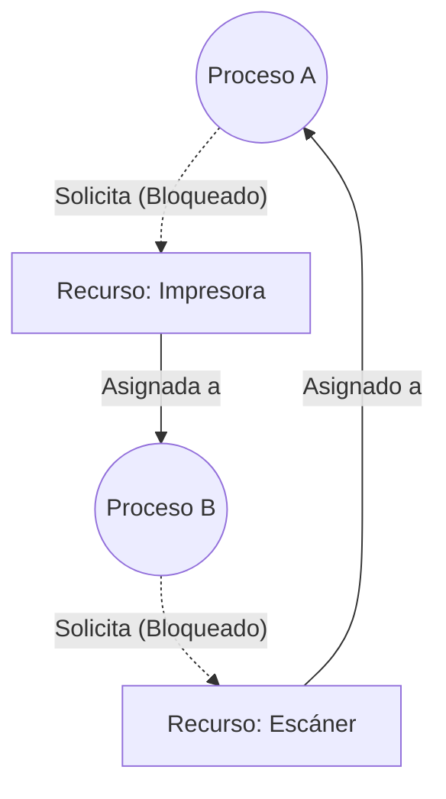

---

## 1.2. Las 4 Condiciones para el Interbloqueo (Condiciones de Coffman)

Formuladas por Coffman, Elphick y Shoshani (1971), determinan cuándo puede ocurrir y cuándo ocurre efectivamente un interbloqueo. Se dividen en **3 condiciones de gestión (necesarias pero no suficientes)** y **1 condición adicional (consecuencia potencial que hace efectivo el deadlock)**:

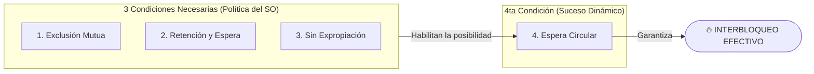

1. **Exclusión mutua:** Sólo un proceso puede utilizar un recurso a la vez. Ningún otro proceso puede acceder a una unidad de recurso que ya fue asignada a otro.
2. **Retención y espera (*Hold and Wait*):** Un proceso puede mantener retenidos los recursos que ya se le asignaron mientras solicita y espera la asignación de nuevos recursos adicionales.
3. **Sin expropiación (*No Preemption*):** Ningún recurso puede ser quitado por la fuerza a un proceso que lo posee; sólo el propio proceso puede liberarlo voluntariamente cuando termina de usarlo.
4. **Espera circular (*Circular Wait*):** Existe una cadena o lista cerrada de procesos ($P_1 \rightarrow P_2 \rightarrow \dots \rightarrow P_n \rightarrow P_1$) donde cada proceso retiene al menos un recurso que es solicitado por el siguiente proceso de la lista.

* 🚨 **LO MÁS IMPORTANTE A TENER EN CUENTA:**
  * Las primeras **3 condiciones son necesarias pero NO suficientes**: que existan en el sistema significa que el interbloqueo *es posible*, pero no garantiza que vaya a ocurrir.
  * La **4ta condición (Espera Circular)** es una consecuencia potencial de las tres primeras. Cuando se cumplen **las 4 condiciones simultáneamente**, se asegura al 100% la existencia de un interbloqueo.
* 🌍 **ANALOGÍA DEL DÍA A DÍA:** Dos niños dibujando: hay un solo lápiz y una sola goma (**Exclusión mutua**). Juan agarra el lápiz y no lo suelta mientras pide la goma (**Retención y espera**). La maestra tiene prohibido sacarles los útiles de la mano (**Sin expropiación**). Como Pedro tiene la goma y pide el lápiz que tiene Juan, mientras Juan tiene el lápiz y pide la goma de Pedro, se forma el círculo cerrado (**Espera circular**).

---

## 1.3. Clasificación de los Recursos

Un **recurso** es cualquier objeto de hardware o software que debe adquirirse, utilizarse y liberarse a lo largo del tiempo.

### 1.3.1. Según A. Tanenbaum: Apropiativos vs. No Apropiativos

| Tipo de Recurso | Descripción | Ejemplos | Impacto en el Interbloqueo |
| :--- | :--- | :--- | :--- |
| **Apropiativo** (*Preemptable*) | Puede retirarse temporalmente del proceso que lo posee y reasignarse a otro sin dañar la integridad ni perder trabajo intermedio. | Memoria RAM, Procesador (CPU). | **Riesgo Bajo:** Si hay conflicto, el SO redistribuye el recurso guardando el estado. |
| **No Apropiativo** (*Non-preemptable*) | No puede quitarse a la fuerza sin dañar la operación en curso o corromper la salida. | Impresoras, grabadoras de CD, semáforos. | **Riesgo Alto:** Protagonizan la mayoría de los interbloqueos reales. |

* 💡 **EJEMPLO PRÁCTICO (Memoria RAM como recurso apropiativo):**
  Supongamos un sistema con $256\text{ MB}$ de RAM disponibles, una impresora y dos procesos (`A` y `B`) de $256\text{ MB}$ cada uno.
  * `A` pide la impresora (se le otorga) y ocupa los $256\text{ MB}$ de RAM.
  * Expira el *quantum* de `A` y el SO lo lleva al disco (*swapping*), liberando la RAM.
  * Entra `B` a los $256\text{ MB}$ de RAM y pide la impresora, pero está ocupada por `A`.
  * ¿Hay interbloqueo? **No**, porque la memoria RAM es **apropiativa**: el SO puede sacar temporalmente a `B` de la RAM (enviarlo a disco) y devolverle la RAM a `A` para que termine de imprimir y libere la impresora.
* 🌍 **ANALOGÍA DEL DÍA A DÍA:**
  * **Recurso Apropiativo:** Un sillón de lectura con un señalador en el libro. Podés levantarte, cederle el sillón a otra persona una hora y, cuando volvés, retomás la lectura exactamente en la página donde estabas.
  * **Recurso No Apropiativo:** Un horno con un soufflé a mitad de cocción. Si sacás el soufflé a la fuerza para meter una pizza de otro cocinero, el soufflé se arruina por completo.

### 1.3.2. Según W. Stallings: Reutilizables vs. Consumibles

| Tipo de Recurso | Descripción | Ejemplos | Causa típica de bloqueo |
| :--- | :--- | :--- | :--- |
| **Reutilizable** | No se agota con el uso: un proceso lo adquiere, lo usa, lo libera y otro proceso vuelve a usar el mismo recurso. | CPU, RAM, archivos, impresoras, semáforos. | Retención cruzada de recursos no apropiativos. |
| **Consumible** | Se crea (produce) y desaparece al ser consumido por el proceso receptor. | Señales de E/S, mensajes de red, interrupciones, *buffers*. | Error de sincronización (ej. dos procesos esperando recibir un mensaje del otro antes de enviar). |

### 1.3.3. Matriz Combinada de Riesgo de Interbloqueo

| Categoría Combinada | Ejemplo Tecnológico | ¿Riesgo Típico de Interbloqueo? |
| :--- | :--- | :---: |
| **Reutilizable + No Apropiativo** | Impresora, semáforo, bloqueo de registro (*lock*) | 🔴 **ALTO** |
| **Reutilizable + Apropiativo** | Memoria principal (RAM), CPU, Disco | 🟢 **Bajo** |
| **Consumible + No Apropiativo** | Señales de E/S, tokens de acceso, eventos de hardware | 🟢 **Bajo** |
| **Consumible + Apropiativo** | Mensajes de red, tareas en cola, trabajos en *spool* | 🟢 **Bajo** |

* 🚨 **LO MÁS IMPORTANTE A TENER EN CUENTA:** Los interbloqueos clásicos de los sistemas operativos se concentran casi exclusivamente en los **recursos reutilizables y no apropiativos**, ya que no se pueden quitar por la fuerza y su cantidad es fija.

---

## 1.4. Estrategias para Tratar el Interbloqueo

Existen **cuatro estrategias** (tres activas y una pasiva):
1. **Prevención del interbloqueo (Activa - Conservadora):** Diseñar políticas para que **nunca se cumpla al menos una** de las 4 condiciones de Coffman.
2. **Predicción o Evasión del interbloqueo (Activa - Intermedia):** Permitir las 3 condiciones necesarias, pero evaluar dinámicamente cada solicitud en tiempo real para concederla sólo si el sistema queda en un **estado seguro** (ej. *Algoritmo del Banquero*).
3. **Detección y Recuperación (Activa - Liberal):** Conceder cualquier recurso disponible sin restricciones; ejecutar periódicamente un algoritmo para detectar ciclos de espera y, si hay interbloqueo, aplicar recuperación.
4. **Omisión del problema / Estrategia del Avestruz (Pasiva):** Ignorar el problema asumiendo que es rarísimo y muy costoso de controlar automáticamente.

---

## 1.5. Detalle de la Prevención del Interbloqueo (Atacar a Coffman)

Se divide en métodos **Indirectos** (atacan las condiciones 1, 2 o 3) y métodos **Directos** (atacan la condición 4):

| Condición Atacada | Tipo | Cómo se elimina / previene | Limitaciones y Problemas |
| :--- | :---: | :--- | :--- |
| **1. Exclusión Mutua** | Indirecta | Convertir recursos en **modo compartido** (ej. lectura simultánea de archivos o *spooling*). | **Casi imposible de eliminar** en general: si un recurso (o escritura en archivo) requiere exclusividad física o lógica, el SO debe respetarla. |
| **2. Retención y Espera** | Indirecta | Exigir que el proceso **solicite todos los recursos de golpe al inicio** y se bloquee hasta que estén todos disponibles. | 1) Bloqueo prolongado aunque pudiera avanzar con parte de ellos.<br>2) Recursos ociosos retenidos por mucho tiempo.<br>3) En programación modular/multihilo no se sabe de antemano todo lo que se va a necesitar. |
| **3. Sin Expropiación** | Indirecta | **Opción A:** Si pide un recurso ocupado, debe liberar todos los que ya tiene y reintentar luego.<br>**Opción B:** El SO expropia el recurso a otro proceso de menor prioridad guardando su estado. | Posible pérdida de trabajo intermedio; sólo es viable en recursos cuyo estado se pueda guardar y restaurar fácilmente (como CPU o RAM). |
| **4. Espera Circular** | **Directa** | Imponer un **orden global lineal de numeración** a todos los tipos de recursos ($R_1 < R_2 < \dots < R_m$). Todo proceso debe pedirlos en orden creciente (ej. siempre primero *Escáner* $\rightarrow$ luego *Impresora*, nunca al revés). | En procesos reales no siempre se conoce el orden de necesidad con anticipación; provoca subutilización de recursos y posible **inanición (*starvation*)**. |

* 💡 **EJEMPLO PRÁCTICO (Prevención Directa por Orden Global):**
  Si asignamos el número `#1` al **Escáner** y el número `#2` a la **Impresora**, y obligamos por regla a que ningún proceso pueda pedir un recurso de número menor al que ya posee:
  * El Proceso `B` **no tiene permitido** pedir primero la Impresora (`#2`) y después el Escáner (`#1`).
  * Tanto `A` como `B` están obligados a pedir primero el Escáner (`#1`). El que gane el Escáner podrá luego pedir la Impresora (`#2`), que estará libre porque nadie pudo tomarla sin tener antes el Escáner. ¡El ciclo desaparece!

---

## 1.6. Detección, Omisión (Avestruz) y Recuperación

### 1.6.1. Detección del Interbloqueo
No restringe el acceso a los recursos. Periódicamente (en cada solicitud no satisfecha, a intervalos fijos de tiempo, o cuando cae el uso de CPU/rendimiento del sistema) ejecuta:
* **Análisis de grafos de asignación de recursos:** Busca **ciclos cerrados** en el grafo dirigido.
* **Representación matricial (similar al Banquero):** Analiza matrices de asignación, demanda y disponibilidad actual para comprobar si las necesidades restantes pueden cubrirse.

### 1.6.2. Omisión del Problema (Algoritmo del Avestruz — A. Tanenbaum)
* 🚨 **LO MÁS IMPORTANTE A TENER EN CUENTA:** Es la estrategia que utilizan **Linux, UNIX y Windows** en sus configuraciones generales de usuario. ¿Por qué? Porque sufrir un bloqueo total esporádico una vez al año tiene un costo mucho menor que perder rendimiento constantemente ejecutando algoritmos pesados de prevención o detección en cada petición de recursos. La responsabilidad queda en manos de los programadores de aplicaciones (usando bien los semáforos/locks) y del administrador del sistema (matando el proceso o reiniciando manualmente si ocurre).
* 🌍 **ANALOGÍA DEL DÍA A DÍA:** Esconder la cabeza bajo la tierra como el mito del avestruz cuando hay peligro: preferís no contratar un guardia de seguridad las 24 hs para cuidar una lapicera de \$100 porque te sale muchísimo más caro el guardia que comprar otra lapicera si un día se pierde.

### 1.6.3. Recuperación del Interbloqueo (Una vez detectado)
Cuando el detector confirma un interbloqueo, el SO puede recuperarse mediante 3 vías:
1. **Eliminar (abortar) procesos involucrados:** Es la más drástica pero **la más utilizada**. Se puede matar a todos los procesos del ciclo o ir matando de a uno hasta romper el ciclo.
2. **Apropiar (expropiar) algún recurso:** Quitarle forzosamente un recurso a un proceso y dárselo a otro (no siempre es posible sin corromper datos).
3. **Realizar un *Rollback* (marcha atrás):** Retroceder el proceso a un punto de control previo (*checkpoint*) anterior a la toma del recurso. Es común en motores de bases de datos, pero raro en procesos generales del SO.

**¿Cómo se elige a la "víctima" (qué proceso abortar o expropiar)?**
* El proceso que **menos trabajo** (tiempo de CPU) haya realizado hasta el momento.
* El que **consuma más recursos** (para liberar más de golpe).
* El que tenga **menor prioridad**.
* El que tenga **mayor tiempo restante estimado** para terminar.

* 🚨 **LO MÁS IMPORTANTE A TENER EN CUENTA (Problemas de la recuperación):** Además de la pérdida de trabajo computado e inconsistencias en archivos, existe el riesgo de **inanición (*starvation*)** si el criterio de selección (por ejemplo, "el de menor prioridad") elige **siempre al mismo proceso como víctima** cada vez que se reinicia y vuelve a caer en interbloqueo.

### 1.6.4. Tabla Comparativa Oficial de Estrategias (Tabla 6.1 de Stallings)

| Estrategia | Política de Reserva de Recursos | Esquemas Alternativos | Principales Ventajas | Principales Desventajas |
| :--- | :--- | :--- | :--- | :--- |
| **Prevención** | Conservadora; infrautiliza recursos. | **Solicitud simultánea de todos los recursos** | • Adecuada para procesos que realizan una sola ráfaga de actividad.<br>• No es necesaria la expropiación. | • Ineficiente.<br>• Retrasa la iniciación del proceso.<br>• Los procesos deben conocer sus futuros requisitos. |
| **Prevención** | Conservadora; infrautiliza recursos. | **Expropiación** | • Conveniente en recursos cuyo estado se puede guardar y restaurar fácilmente. | • Expropia con más frecuencia de lo necesario. |
| **Prevención** | Conservadora; infrautiliza recursos. | **Ordenamiento de recursos** | • Es posible asegurarlo mediante comprobaciones en tiempo de compilación.<br>• No necesita cálculos en tiempo de ejecución. | • Impide solicitudes graduales de recursos. |
| **Predicción (Evasión)** | A medio camino entre la detección y la prevención. | **Asegura que existe al menos un camino seguro (Banquero)** | • No es necesaria la expropiación.<br>• Mayor concurrencia que la prevención. | • El SO debe conocer los futuros requisitos máximos.<br>• Los procesos se pueden bloquear por largos períodos. |
| **Detección** | Muy liberal; se conceden recursos siempre que sea posible. | **Se invoca periódicamente para comprobar si hay ciclo** | • Nunca retrasa la iniciación del proceso.<br>• Facilita la gestión en línea. | • Pérdidas inherentes por expropiación o aborto de procesos. |

---

# 2. Unidad 4 (Semana 10) y Stallings: Predicción del Interbloqueo y Algoritmo del Banquero

## 2.1. Dos Técnicas de Predicción del Interbloqueo (Stallings, Cap. 6.3)

Mientras la prevención prohíbe alguna condición de Coffman de forma estática, la **predicción (o evasión)** permite las tres condiciones necesarias pero evalúa dinámicamente cada decisión para nunca entrar en un **estado inseguro**. Según el texto de William Stallings, existen dos técnicas:

### Técnica 1: Denegación de la Iniciación del Proceso
En un sistema con $n$ procesos actuales y $m$ tipos de recursos, sólo se permite iniciar un nuevo proceso $P_{n+1}$ si para todo recurso $j$ la cantidad total existente en el sistema ($R_j$) alcanza para cubrir la demanda máxima de todos los procesos actuales más la del nuevo proceso:

> 🧮 **FÓRMULA — Condición de Iniciación de un Nuevo Proceso ($P_{n+1}$):**
> $$R_j \ge N_{(n+1)j} + \sum_{i=1}^{n} N_{ij} \quad \text{para todo recurso } j$$
> *Donde $R_j$ es el total de recursos de tipo $j$, y $N_{ij}$ (o $\text{Max}_{ij}$) es la demanda máxima declarada por el proceso $i$ para el recurso $j$.*

* 🚨 **LO MÁS IMPORTANTE A TENER EN CUENTA:** Esta primera técnica es muy poco óptima porque asume el peor caso simultáneo: que absolutamente todos los procesos van a reclamar el 100% de su demanda máxima al mismo tiempo.

### Técnica 2: Denegación de Asignación de Recursos (El Algoritmo del Banquero)
Propuesto por **Edsger W. Dijkstra en 1965** (en su nota técnica *EWD108* durante el diseño del sistema operativo por capas **THE** en Eindhoven).

* 🌍 **ANALOGÍA DEL DÍA A DÍA (El Banquero de un Pueblo Pequeño — Dijkstra):**
  Imaginá un banquero que tiene un capital total de **\$10 millones** en su bóveda (**Recursos Totales**) y 4 clientes constructores (**Procesos**). Antes de empezar una obra, cada cliente firma cuál es el **crédito máximo total** que va a necesitar para terminar su edificio (**Demanda Máxima / Max**).
  Los clientes van pidiendo préstamos en cuotas (**Solicitudes**) y **no devuelven un solo peso hasta que terminan toda su obra** (recién cuando reciben el 100% de su crédito máximo terminan el edificio, lo venden y devuelven todo el dinero al banco).
  * **¿Qué hace el banquero ante un nuevo pedido de dinero?** Antes de darle la plata, hace una cuenta en un borrador (*Simulación*): *"Si le doy este millón ahora, ¿me queda suficiente plata en la caja fuerte para ayudar al menos a UNO de los clientes a completar su obra, cobrarle todo de vuelta, y con esa plata ayudar al siguiente hasta que todos terminen?"*
  * Si la respuesta es **SÍ**, el banco está en un **Estado Seguro** y le presta el dinero.
  * Si al darle ese millón resulta que en la bóveda quedan monedas que no alcanzan para que **ningún** cliente termine su edificio, el banco quedaría en **Estado Inseguro** (riesgo de quiebra/interbloqueo), por lo que el banquero le dice: *"Esperá un poquito a que otro cliente termine y me devuelva efectivo"*.

---

## 2.2. Estructuras de Datos, Vectores, Matrices y Fórmulas del Algoritmo

Consideremos un sistema con $n$ procesos ($P_0, P_1, \dots$) y $m$ tipos de recursos ($A, B, C$ o $R_1, R_2, R_3$):

| Estructura | Nombre en Cátedra | Nombre en Stallings | Qué representa |
| :--- | :--- | :--- | :--- |
| **Vector** $(1 \times m)$ | **Total Recursos** | **Recursos ($R$)** | Cantidad total de unidades de cada recurso existentes en el sistema. |
| **Vector** $(1 \times m)$ | **Available** | **Disponibles ($D$)** | Cantidad de unidades de cada recurso que están **libres** actualmente. |
| **Matriz** $(n \times m)$ | **Max** | **Necesidad ($N$ o $C$)** | Demanda máxima total que cada proceso declaró que podría llegar a pedir. |
| **Matriz** $(n \times m)$ | **Allocation** | **Asignación ($A$)** | Cantidad de unidades que cada proceso **tiene retenidas actualmente**. |
| **Matriz** $(n \times m)$ | **Need** | **$N - A$ (o $C - A$)** | **Necesidad restante:** cuántos recursos *adicionales* le faltan a cada proceso para poder terminar. |
| **Vector** $(1 \times n)$ | **Finish** | **Posible** | Vector booleano (`0`/`1` o `false`/`true`) que indica qué procesos ya finalizaron en la simulación. |

> 🧮 **FÓRMULAS FUNDAMENTALES DEL ALGORITMO DEL BANQUERO:**
> 1. **Conservación de Recursos Totales:** Todos los recursos están o bien disponibles o bien asignados:
>    $$\text{Total}_j = \text{Available}_j + \sum_{i=1}^{n} \text{Allocation}_{ij} \iff \text{Available} = \text{Total} - \sum \text{Allocation}$$
> 2. **Cálculo de la Matriz de Necesidad Restante ($\text{Need}$):**
>    $$\text{Need}_{ij} = \text{Max}_{ij} - \text{Allocation}_{ij}$$
> 3. **Condición para que el proceso $i$ pueda ejecutarse y finalizar en la simulación:**
>    $$\text{Need}_i \le \text{Available} \quad (\text{es decir, } \text{Need}_{ij} \le \text{Available}_j \text{ para todo recurso } j)$$
> 4. **Liberación de recursos cuando el proceso $i$ finaliza en la simulación:**
>    $$\text{Available}_{\text{nuevo}} = \text{Available}_{\text{actual}} + \text{Allocation}_i$$

* 🚨 **LO MÁS IMPORTANTE A TENER EN CUENTA (Estado Seguro vs. Estado Inseguro):**
  * **Estado Seguro:** Existe al menos una **Secuencia Segura** de ejecución $\langle P_a, P_b, \dots, P_z \rangle$ tal que todos los procesos pueden obtener sus recursos faltantes ($\text{Need}$), terminar y liberar su $\text{Allocation}$ para los siguientes. Garantiza **cero interbloqueos**.
  * **Estado Inseguro:** No existe ninguna secuencia que garantice que todos los procesos puedan terminar con los recursos disponibles actuales. **¡CUIDADO EN EL EXAMEN!** Un **Estado Inseguro NO significa que ya haya un interbloqueo**, sino que el sistema perdió el control y *podría* producirse un interbloqueo si todos los procesos reclaman su máximo antes de liberar algo. Por precaución, el Algoritmo del Banquero **jamás permite entrar en un estado inseguro**.
  * **4 Restricciones del Algoritmo del Banquero (por qué no se usa en SO modernos):**
    1. Cada proceso debe conocer y declarar su demanda máxima ($\text{Max}$) antes de arrancar.
    2. Los procesos deben ser totalmente independientes (sin requisitos de sincronización entre ellos).
    3. La cantidad total de recursos debe ser fija (no pueden sumarse ni caerse dispositivos dinámicamente).
    4. Ningún proceso puede finalizar mientras retenga recursos.

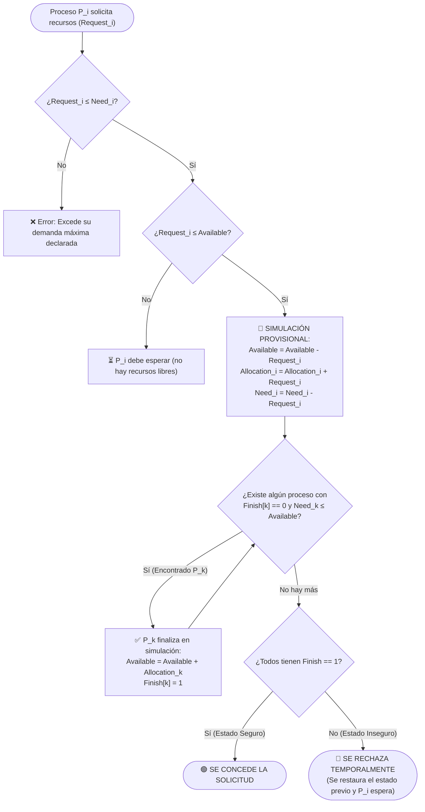

---

## 2.3. Ejemplos Prácticos Resueltos Paso a Paso (Cátedra y Stallings)

### 💡 EJEMPLO PRÁCTICO 1 (Semana 10 - Caso Estado Seguro)
* **Datos Iniciales del Sistema:**
  * 4 Procesos: `P0`, `P1`, `P2`, `P3`
  * 3 Recursos (`A`, `B`, `C`) con **Total Recursos = `[10, 5, 7]`**

| Proceso | Matriz `Max` (A B C) | Matriz `Allocation` (A B C) | Cálculo de `Need = Max - Allocation` (A B C) |
| :---: | :---: | :---: | :---: |
| **P0** | `7  5  3` | `0  1  0` | `[7-0, 5-1, 3-0]` = **`7  4  3`** |
| **P1** | `3  2  2` | `2  0  0` | `[3-2, 2-0, 2-0]` = **`1  2  2`** |
| **P2** | `9  0  2` | `3  0  2` | `[9-3, 0-0, 2-2]` = **`6  0  0`** |
| **P3** | `2  2  2` | `2  1  1` | `[2-2, 2-1, 2-1]` = **`0  1  1`** |
| **Suma Asignados** | — | **`7  2  3`** | — |

1. **Paso 1 — Calcular el Vector `Available` inicial:**
   * $\text{Suma de Allocation} = [0+2+3+2,\; 1+0+0+1,\; 0+0+2+1] = [7, 2, 3]$
   * $\text{Available} = \text{Total} - \text{Suma Allocation} = [10-7,\; 5-2,\; 7-3] =$ **`[3, 3, 4]`**
   * Vector de finalización inicial: `Finish = [0, 0, 0, 0]`.
2. **Paso 2 — Simulación de Verificación de Estado Seguro:**
   * **Evaluamos `P0`:** ¿$\text{Need}_{P0} [7, 4, 3] \le \text{Available} [3, 3, 4]$? **No** ($7 > 3$ y $4 > 3$). `P0` espera.
   * **Evaluamos `P1`:** ¿$\text{Need}_{P1} [1, 2, 2] \le \text{Available} [3, 3, 4]$? **¡SÍ!** ($1 \le 3$, $2 \le 3$, $2 \le 4$).
     * `P1` se ejecuta, termina y libera su `Allocation` (`[2, 0, 0]`).
     * Nuevo `Available` $= [3, 3, 4] + [2, 0, 0] =$ **`[5, 3, 4]`**.
     * `Finish = [0, 1, 0, 0]`.
   * **Evaluamos `P3`:** ¿$\text{Need}_{P3} [0, 1, 1] \le \text{Available} [5, 3, 4]$? **¡SÍ!**
     * `P3` termina y libera su `Allocation` (`[2, 1, 1]`).
     * Nuevo `Available` $= [5, 3, 4] + [2, 1, 1] =$ **`[7, 4, 5]`**.
     * `Finish = [0, 1, 0, 1]`.
   * **Volvemos a evaluar `P0`:** ¿$\text{Need}_{P0} [7, 4, 3] \le \text{Available} [7, 4, 5]$? **¡SÍ!**
     * `P0` termina y libera su `Allocation` (`[0, 1, 0]`).
     * Nuevo `Available` $= [7, 4, 5] + [0, 1, 0] =$ **`[7, 5, 5]`**.
     * `Finish = [1, 1, 0, 1]`.
   * **Evaluamos `P2`:** ¿$\text{Need}_{P2} [6, 0, 0] \le \text{Available} [7, 5, 5]$? **¡SÍ!**
     * `P2` termina y libera su `Allocation` (`[3, 0, 2]`).
     * Nuevo `Available` $= [7, 5, 5] + [3, 0, 2] =$ **`[10, 5, 7]`** (¡coincide exactamente con el Total de Recursos del sistema!).
     * `Finish = [1, 1, 1, 1]`.
3. **Conclusión:** Existe la secuencia segura **$\langle P_1, P_3, P_0, P_2 \rangle$**. El sistema está en **ESTADO SEGURO** y la asignación se **ACEPTA**.

---

### 💡 EJEMPLO PRÁCTICO 2 (Semana 10 - Caso Estado Inseguro)
Con los mismos recursos totales **`[10, 5, 7]`** y la misma matriz `Max`, supongamos ahora la siguiente matriz `Allocation`:

| Proceso | Matriz `Max` (A B C) | Matriz `Allocation` (A B C) | Matriz `Need = Max - Allocation` (A B C) | ¿Puede finalizar con `Available = [0, 0, 3]`? |
| :---: | :---: | :---: | :---: | :--- |
| **P0** | `7  5  3` | `3  1  0` | **`4  4  3`** | ❌ No (`[4, 4, 3] > [0, 0, 3]`) |
| **P1** | `3  2  2` | `2  1  1` | **`1  1  1`** | ❌ No (`[1, 1, 1] > [0, 0, 3]`, falta A y B) |
| **P2** | `9  0  2` | `3  0  2` | **`6  0  0`** | ❌ No (`[6, 0, 0] > [0, 0, 3]`, falta A) |
| **P3** | `2  2  2` | `2  3  1` | **`0  1  1`** | ❌ No (`[0, 1, 1] > [0, 0, 3]`, falta B) |
| **Suma** | — | **`10  5  4`** | — | **Disponibles: `[10-10, 5-5, 7-4] = [0, 0, 3]`** |

* **Conclusión:** Con `Available = [0, 0, 3]` (0 unidades libres de `A` y 0 de `B`), **ningún proceso puede satisfacer su `Need`**. El vector queda clavado en `Finish = [0, 0, 0, 0]`. El estado es **INSEGURO** y la solicitud que lleva a este estado se **RECHAZA TEMPORALMENTE**.

---

### 💡 EJEMPLO PRÁCTICO 3 (Libro de Stallings, Figuras 6.7 y 6.8)
En el texto de Stallings hay 4 procesos (`P1`, `P2`, `P3`, `P4`) y 3 recursos con vector total **$R = [9, 3, 6]$**.
* En el estado de la **Figura 6.8a**, la asignación actual deja disponibles **$D = [1, 1, 2]$**, y la matriz de necesidad restante ($C - A$) es:
  * `P1`: `[2, 2, 2]` | `P2`: `[1, 0, 2]` | `P3`: `[1, 0, 3]` | `P4`: `[4, 2, 0]`
* **Caso A (Solicitud aceptada):** Si `P2` pide `[1, 0, 1]`, al concederlo provisionalmente quedan disponibles **$D = [0, 1, 1]$** y a `P2` sólo le resta necesitar `[0, 0, 1]`. Como `[0, 0, 1] ≤ [0, 1, 1]`, `P2` puede terminar completo, devolver sus `[6, 1, 2]` asignados (dejando $D = [6, 2, 3]$) y luego terminan en cadena `P1`, `P3` y `P4` (Secuencia segura $\langle P_2, P_1, P_3, P_4 \rangle$, Figura 6.7). **Se concede la petición de `P2`**.
* **Caso B (Solicitud denegada):** Si partiendo de la Figura 6.8a es **`P1`** quien pide `[1, 0, 1]`, al simular dárselo quedan disponibles **$D = [0, 1, 1]$**, pero las necesidades restantes quedan: `P1=[1, 2, 1]`, `P2=[1, 0, 2]`, `P3=[1, 0, 3]`, `P4=[4, 2, 0]`. Como todos necesitan al menos 1 unidad de $R_1$ y en $D$ hay `0` unidades de $R_1$, nadie puede terminar. El estado es **inseguro**, por lo que **la petición de `P1` se deniega y `P1` se bloquea**.

---

# 3. Unidad 5 (Semana 11 - Parte 1): Sistemas Distribuidos y Arquitecturas (Cliente-Servidor, P2P, Multi-Nivel)

## 3.1. Sistemas Operativos Centralizados vs. Sistemas Distribuidos

Un **Sistema Distribuido (SD)** es un conjunto de componentes de hardware o software ubicados en diferentes computadoras autónomas conectadas en red que trabajan de manera coordinada, comunicándose mediante el **envío de mensajes**, para funcionar como un sistema único.

* 🚨 **LO MÁS IMPORTANTE A TENER EN CUENTA:** La característica definitoria de un Sistema Distribuido (según Tanenbaum) es que **para el usuario la división física es totalmente transparente**: el usuario siente que está interactuando con una única computadora o entidad coherente, aunque por detrás haya decenas de nodos colaborando (como ocurre hoy en Kubernetes, Hadoop o la Nube).

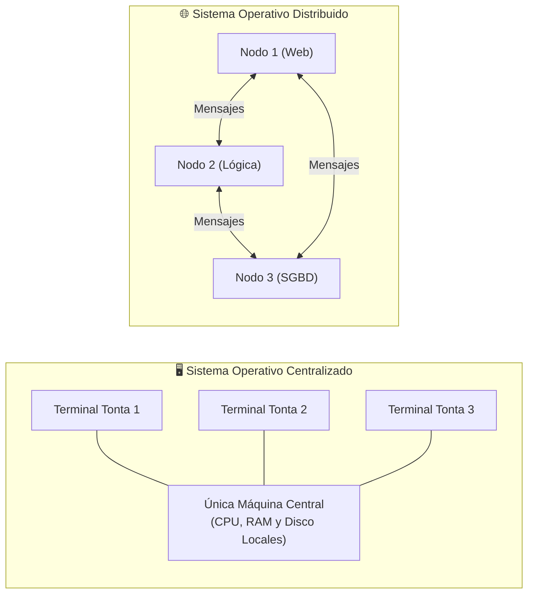

### Cuadro Comparativo: Centralizados vs. Distribuidos

| Característica | Sistemas Centralizados | Sistemas Distribuidos |
| :--- | :--- | :--- |
| **Ubicación de recursos** | Concentrados localmente en una única máquina (CPU, RAM, HD). | Repartidos entre múltiples nodos, regiones o canales interconectados. |
| **Terminales conectadas** | Terminales remotas pasivas ("terminales de conexión") que no procesan. | Nodos activos que colaboran en la ejecución de tareas. |
| **Trabajo colaborativo** | Sin trabajo colaborativo ni objetivo común entre procesos; típico de *time sharing*. | Trabajo colaborativo coordinado mediante paso de mensajes hacia un objetivo común. |
| **Escalabilidad** | Muy difíciles y costosos de escalar (escalado vertical limitado). | Escalan fácilmente añadiendo más nodos para distribuir trabajo y recursos. |

---

## 3.2. Objetivos y Tipos de Sistemas Distribuidos

### Los 4 Objetivos Principales de un Sistema Distribuido
1. **Facilitar el acceso y compartir recursos remotos:** Permitir que usuarios y aplicaciones compartan hardware (impresoras, discos) y software (archivos, bases de datos SGBD) de forma eficiente.
2. **Transparencia:** Ocultar al usuario que el sistema está repartido en varias máquinas. Se desglosa en **4 tipos de transparencia**:
   * 🔍 **Transparencia de acceso:** Oculta las diferencias en la representación de datos y el modo en que se accede a un recurso local frente a uno remoto.
   * 📍 **Transparencia de ubicación:** El usuario accede al recurso por su nombre lógico sin necesitar saber en qué servidor físico o ciudad se encuentra.
   * 👥 **Transparencia de concurrencia:** Varios usuarios pueden usar el mismo recurso al mismo tiempo sin notar interferencias entre sí.
   * 🚚 **Transparencia de migración:** Un recurso o servicio puede mudarse de un servidor a otro sin que cambie la forma en que el usuario lo utiliza.
3. **Fiabilidad (Tolerancia a fallos):** Si un nodo se apaga o falla, los demás nodos continúan operando gracias a la redundancia y replicación de datos.
4. **Rendimiento:** Procesamiento en paralelo repartiendo la carga entre múltiples CPUs.

* 🌍 **ANALOGÍA DEL DÍA A DÍA (Las 4 Transparencias en un Pedido de Comida por App):**
  Cuando pedís una pizza por una app:
  * **Acceso:** Tocás el mismo botón "Pedir" sin importar si el restaurante usa un sistema Windows o Linux.
  * **Ubicación:** No sabés en cuál de las 5 sucursales de la pizzería la están amasando.
  * **Concurrencia:** Otras 200 personas están pidiendo al mismo tiempo y vos sentís que la app te atiende solo a vos.
  * **Migración:** Si la sucursal del centro se queda sin luz y derivan tu pedido a la sucursal norte a mitad de camino, a vos te llega igual a tu casa sin que tengas que hacer nada distinto.

### 1.1. Tipos de Sistemas Distribuidos según su Arquitectura Subyacente
1. **Sistemas de Redes de Computadoras:** Cada máquina tiene su propio sistema operativo local independiente. Los usuarios inician sesión en su máquina y usan la red explícitamente para acceder a servicios remotos (ej. copiar un archivo de un servidor en la LAN).
2. **Sistemas Multiprocesadores:** Múltiples procesadores (CPUs) **comparten la misma memoria principal (RAM)** y operan bajo el control de **un único sistema operativo**. La comunicación es ultrarrápida porque no pasa por una red externa, sino por el bus de memoria compartida.

### Ventajas y Desventajas de los Sistemas Distribuidos

| ✅ Ventajas | ❌ Desventajas |
| :--- | :--- |
| **Mayor fiabilidad:** La falla de un nodo no detiene todo el sistema. | **Complejidad:** Diseñar, sincronizar y depurar un SOD es mucho más complejo. |
| **Mejor rendimiento:** El trabajo se reparte entre varias máquinas en paralelo. | **Seguridad:** La red introduce múltiples puntos de vulnerabilidad e intercepción. |
| **Escalabilidad:** Fácil agregar nuevos nodos según crezca la demanda. | **Costo de comunicación:** Requiere infraestructura extra de red (switches, routers, enlaces). |
| **Compartir recursos:** Uso eficiente de periféricos y bases de datos. | **Latencia:** Viajar por la red es órdenes de magnitud más lento que leer memoria local. |
| **Comunicación:** Facilita el trabajo colaborativo entre usuarios. | **Gestión de software:** Instalar y actualizar versiones en cientos de nodos es desafiante. |

---

## 3.3. Arquitecturas Distribuidas: Cliente-Servidor, P2P y Multi-Nivel

Las **Arquitecturas Distribuidas (AD)** establecen el marco de diseño buscando tres metas: **1) Simplificar el diseño**, **2) Optimizar los costos** y **3) Fomentar la reutilización** de componentes modulares.

### 3.3.1. Arquitectura Cliente-Servidor
Divide las tareas en dos procesos con roles asimétricos bien definidos que se comunican mediante el esquema **Petición/Respuesta (*Request/Response*)** a través de una red utilizando un **Protocolo** común (y pudiendo auditarse con un **Inspector** de flujo de datos):

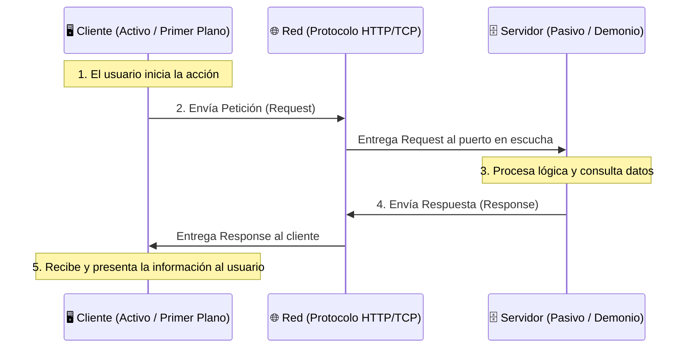

#### Comparativa de Roles: Cliente vs. Servidor

| Atributo | 🖥️ Cliente | 🗄️ Servidor |
| :--- | :--- | :--- |
| **Qué hace** | Inicia el diálogo solicitando un recurso o servicio remoto. | Escucha peticiones y provee el servicio solicitado. |
| **Modo de ejecución** | **Interactivo** (se ejecuta en **primer plano** con interfaz para el usuario). | **No interactivo** (corre en **segundo plano** como *demonio* o *servicio* desde el arranque del SO). |
| **Actitud en la conexión** | **Activo:** toma la iniciativa y abre la conexión hacia el servidor. | **Pasivo:** espera en modo escucha (*listening*) a que lleguen pedidos. |
| **Tiempo de vida** | **Temporal:** vive sólo mientras el usuario lo necesita (ej. mientras tenés abierto el navegador). | **Permanente/Continuo:** queda encendido indefinidamente atendiendo a múltiples clientes. |
| **Entorno físico** | Corre localmente en la estación de trabajo o móvil del usuario. | Corre en un equipo con recursos compartidos entre varios procesos del mismo tipo. |

* 🚨 **LO MÁS IMPORTANTE A TENER EN CUENTA:**
  * Sus 4 características clave son: **Separación de responsabilidades**, **Centralización de datos** (facilita backups y seguridad en el servidor), **Escalabilidad** y **Interoperabilidad** (un cliente en Android/Java puede hablar sin problemas con un servidor en Linux/C++ si ambos respetan el protocolo HTTP).
  * **La frontera entre Cliente y Servidor es relativa:** Un mismo proceso puede ser servidor y cliente a la vez. Por ejemplo, un **servidor de base de datos distribuida** actúa como *servidor* frente al usuario que le envía una consulta, pero inmediatamente actúa como *cliente* al pedirle a distintos servidores de archivos las tablas necesarias para armar la respuesta.

---

### 3.3.2. Modelo Peer-to-Peer (P2P / Entre Pares)
En un sistema **Peer-to-Peer (P2P)** no hay servidores dedicados: **todos los nodos interconectados (*peers* o pares) desempeñan un papel idéntico** (actúan como cliente y servidor al mismo tiempo, llamadas entidades *servent*).

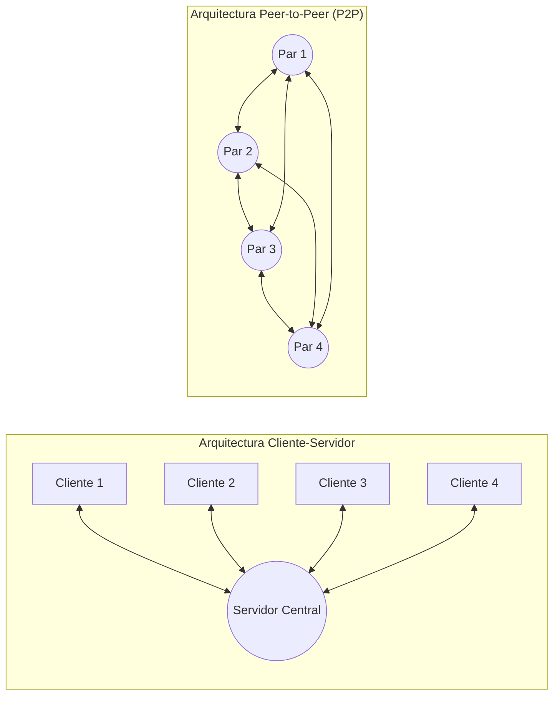

* 🚨 **LO MÁS IMPORTANTE A TENER EN CUENTA (Las 5 Características Esenciales de P2P):**
  1. **Contribución Universal:** Todo nodo que entra aporta sus propios recursos al sistema (disco, ancho de banda, CPU).
  2. **Igualdad Funcional:** Todos los nodos tienen las mismas capacidades y responsabilidades.
  3. **Autonomía y Resiliencia:** No depende de ningún administrador ni servidor central; si se caen varios nodos, la red se auto-organiza y sigue funcionando.
  4. **Anonimato (Opcional):** Puede diseñarse para brindar privacidad a proveedores y consumidores de recursos.
  5. **Eficiencia Algorítmica:** Como los datos no están en un servidor central, el corazón técnico de una red P2P es su **algoritmo de búsqueda y ubicación de datos** para equilibrar dinámicamente las cargas.

#### Ventajas, Desventajas y Casos de Uso de Redes P2P

| ✅ Ventajas de P2P | ❌ Desventajas de P2P | 🛠️ Casos de Uso y Sectores |
| :--- | :--- | :--- |
| **Escalabilidad inversa al costo:** En Cliente-Servidor, más usuarios saturan al servidor; en P2P, **cada nuevo usuario suma más ancho de banda y capacidad a la red**. | **Seguridad:** Sin autoridad central que valide archivos, es foco frecuente de *malware*, virus y robo de datos. | • **Intercambio de archivos:** *BitTorrent* (parte archivos grandes en trozos y los descarga de muchos pares a la vez).<br>• **CDN (Entrega de Contenidos):** Reparto geográfico. |
| **Eficiencia y ahorro:** Reduce drásticamente el gasto en servidores e infraestructura central. | **Regulación de contenidos:** Dificultad legal y ética para frenar la piratería o material protegido por derechos de autor. | • **Criptomonedas:** *Bitcoin* (libro mayor descentralizado / *blockchain*).<br>• **Entretenimiento y Telecom:** *Spotify* (en sus inicios), *Skype*, juegos multijugador online. |
| **Resiliencia y Flexibilidad:** Cero punto único de fallo (*Single Point of Failure*); los nodos entran y salen a voluntad. | **Calidad de Servicio (QoS) impredecible:** La velocidad depende de qué tan buena sea la conexión doméstica de los pares conectados en ese momento. | • **Salud e Investigación:** Procesamiento distribuido de secuencias del genoma humano o imágenes médicas pesadas. |

* 🌍 **ANALOGÍA DEL DÍA A DÍA:**
  * **Cliente-Servidor:** Ir a una biblioteca central donde un único bibliotecario busca y entrega los libros a todos los alumnos (si van 500 alumnos juntos, se forma una fila eterna).
  * **P2P:** Un grupo de estudio donde cada estudiante tiene fotocopias de distintos capítulos y se las van pasando directamente de mano en mano entre todos los compañeros de la mesa: cuantos más compañeros se suman con sus apuntes, más rápido consiguen todos el libro completo.

---

### 3.3.3. Arquitecturas Multi-Nivel (N-Tier / Multi-Tier)

* 🚨 **LO MÁS IMPORTANTE A TENER EN CUENTA (Diferencia Clave de Examen: Capa vs. Nivel):**

| Concepto | Término en Inglés | Naturaleza | Definición y Función en Sistemas Distribuidos |
| :--- | :---: | :---: | :--- |
| **Capa** | ***Layer*** | **División LÓGICA** (Software) | Organización interna del código en módulos con responsabilidades distintas (ej. Presentación, Lógica, Datos). Podrían estar las 3 capas corriendo dentro de una misma PC. |
| **Nivel** | ***Tier*** | **División FÍSICA** (Hardware / Despliegue) | Representa la **máquina o servidor físico independiente** donde se despliega y ejecuta una o más capas lógicas a través de la red. Es la base de la escalabilidad y tolerancia a fallos. |

#### El Modelo Clásico de Tres Niveles (3-Tier)

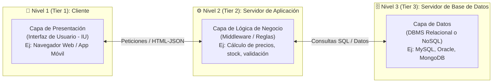

* 💡 **EJEMPLO PRÁCTICO DE CÁTEDRA (Motor de Búsqueda en Internet en 3 Capas — Tanenbaum):**
  1. **Nivel de Interfaz de Usuario:** El cuadro de texto en tu navegador donde escribís la *expresión clave* y recibís una *página HTML* con los resultados.
  2. **Nivel de Procesamiento (Lógica):** Recibe tu palabra clave en el **Generador de consultas**, interroga a la base de datos, recibe los títulos con metainformación, les aplica el **Algoritmo de ordenamiento** (ranking de relevancia) y se los pasa al **Generador HTML** para armar la página de respuesta.
  3. **Nivel de Datos:** La **Base de datos con páginas web** previamente indexadas.

* **Las 5 Ventajas de la Arquitectura Multi-Nivel:**
  1. **Escalabilidad independiente:** Si en el *Hot Sale* explota el tráfico web, agregás más servidores al Nivel 2 (Aplicación) sin necesidad de gastar en tocar el Nivel 3 (Base de Datos).
  2. **Reutilización:** La misma Lógica de Negocio (Nivel 2) sirve simultáneamente a la página web, a la app de Android y a la app de iOS (Nivel 1) sin duplicar código.
  3. **Mantenimiento y Evolución modular:** Podés cambiar el motor de base de datos de MySQL a Oracle en el Nivel 3 sin que el Nivel 1 (la pantalla del usuario) se entere.
  4. **Seguridad:** El Nivel 3 (Datos críticos) queda aislado en una red interna protegida por firewalls, jamás expuesto directamente a Internet como el Nivel 1.
  5. **Balanceo de Carga:** Permite distribuir las peticiones entrantes entre una granja de servidores idénticos evitando cuellos de botella.


---

# 4. Unidad 5 (Semana 11 - Parte 2): Software de Red, Modelos OSI y TCP/IP, Direccionamiento IP y Capas

## 4.1. Evolución Histórica, Protocolos y Jerarquía de Capas

### 4.1.1. Los Tres Hitos de los Años 1970
Las primeras redes priorizaban el hardware; el software fue una idea tardía. Para resolver conjuntamente los aspectos eléctricos, la agrupación de bits con control de errores y el enrutamiento extremo a extremo a través de múltiples routers, en los años 70 ocurrieron **tres hitos revolucionarios**:
1. **Ethernet:** Propuesta para redes de área local (LAN).
2. **Sistema Operativo UNIX:** Independiente de cualquier marca comercial y compatible con todo el hardware existente.
3. **Protocolos TCP/IP (ARPAnet, 1969–1974):** Proyecto militar de la agencia ARPA (DoD de EE. UU.) diseñado en plena Guerra Fría para resistir la destrucción parcial de su infraestructura mediante **conmutación de paquetes** y topologías malladas. En 1974 **Vint Cerf y Bob Kahn** especificaron la pila TCP/IP, dando origen a **Internet** ("la red de redes"). Frente a la proliferación de protocolos, la **ISO** y el **CCITT** unificaron criterios en 1983 y publicaron en **1984 el Modelo de Referencia OSI**.

---

### 4.1.2. ¿Qué es un Protocolo y cuáles son sus 3 Elementos?
Un **protocolo** es un conjunto de reglas, formatos y convenciones formales (implementadas en *software*) que determinan cómo se comunican las **entidades pares (capas homólogas del mismo nivel)** en distintos dispositivos a través de una red.

Todo protocolo define **tres elementos clave**:
1. **Sintaxis:** Estructura y formato de los datos (en qué orden van los bits y cuánto mide cada campo del encabezado).
2. **Semántica:** El significado de cada sección de bits o señal (qué significa ese código y qué acción debe disparar al recibirlo).
3. **Temporización:** Control de flujo, velocidad y sincronización entre quién envía y quién recibe.

* 🌍 **ANALOGÍA DEL DÍA A DÍA:** Dos personas hablando por walkie-talkie:
  * **Sintaxis:** La regla de decir primero *"Aquí Base, para Móvil 1"* y terminar con *"Cambio"*.
  * **Semántica:** Entender que *"Código Rojo"* significa activar la alarma y que *"Cambio y fuera"* significa cortar la llamada.
  * **Temporización:** No hablar a 300 palabras por minuto ni pisarse mientras el otro transmite.

---

### 4.1.3. Servicios vs. Protocolos y Comunicación Virtual vs. Real

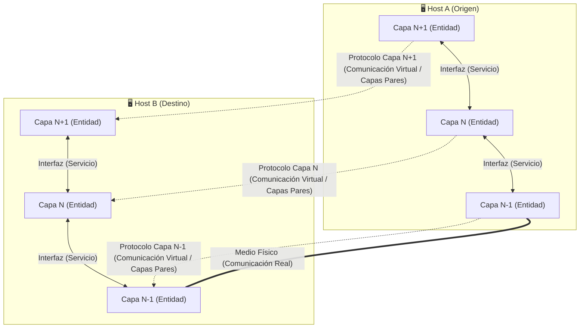

* 🚨 **LO MÁS IMPORTANTE A TENER EN CUENTA (Diferencia Crítica de Examen: Servicio vs. Protocolo):**

| Concepto | Dirección | Entre quiénes actúa | Qué define |
| :--- | :---: | :--- | :--- |
| **Servicio** | **Vertical** ($\updownarrow$) *(Dentro del mismo Host)* | Entre dos capas adyacentes a través de una **Interfaz**: la capa inferior ($N-1$) es el *proveedor* y la capa superior ($N$) es el *usuario*. | Define **QUÉ** operaciones primitivas ofrece la capa inferior a la superior, **pero NO dice nada sobre cómo se implementan**. |
| **Protocolo** | **Horizontal** ($\leftrightarrow$) *(Entre distintos Hosts)* | Entre **capas pares** (entidades del mismo nivel $N$ en máquinas diferentes). | Define **CÓMO** se formatean e intercambian los paquetes entre pares para lograr brindar el servicio. **Se puede cambiar el protocolo sin cambiar el servicio visible.** |

* **Arquitectura de Red y Pila de Protocolos:**
  * $\text{Arquitectura de Red} = \text{Conjunto de Capas} + \text{Protocolos}$.
  * **Pila de protocolos:** Lista concreta de protocolos utilizados en una arquitectura (uno o varios por capa).
  * **Objetivos del diseño en niveles:** Conectividad, Modularidad, Facilidad de implantación, Facilidad de uso, Confiabilidad, Facilidad de modificación e **Interoperabilidad** (equipos de distintos fabricantes trabajando juntos).

---

## 4.2. Modelo de Referencia OSI vs. Modelo TCP/IP y sus PDUs

* 🚨 **LO MÁS IMPORTANTE A TENER EN CUENTA (Comparativa Filosófica OSI vs. TCP/IP):**
  * **Modelo OSI (7 capas — Teórico/Prescriptivo):** Primero se diseñó cuidadosamente el modelo de 7 capas y sus funciones antes de que existieran sus protocolos. Por eso es excelente como marco pedagógico universal para describir cualquier red, aunque sus protocolos propios casi no se usaron.
  * **Modelo TCP/IP (4 capas — Pragmático/Descriptivo):** Ocurrió exactamente al revés: **primero se crearon y probaron los protocolos (TCP, IP, etc.)**, y luego se redactó el modelo de 4 capas simplemente para describir los protocolos que ya funcionaban. No sirve para describir otras redes distintas a TCP/IP, pero **es el estándar real que mueve Internet**.

### Cuadro Comparativo de Capas y Unidades de Datos del Protocolo (PDU)

| Nro. OSI | Capa del Modelo OSI | PDU en OSI | Capa Equivalente en TCP/IP | PDU en TCP/IP | Función Principal y Protocolos Clave |
| :---: | :--- | :---: | :--- | :---: | :--- |
| **7** | **Aplicación** | APDU | **4. Aplicación** | **Datos** *(Mensaje)* | Interfaz con las aplicaciones del usuario; incluye formateo, compresión y **cifrado** (`HTTP`, `HTTPS`, `FTP`, `SMTP`, `DNS`, `SSH`). |
| **6** | **Presentación** | PPDU | *(Incluida en Aplicación)* | **Datos** | Formato, codificación, compresión y cifrado de datos. |
| **5** | **Sesión** | SPDU | *(Incluida en Aplicación)* | **Datos** | Control del diálogo y sincronización de sesiones. |
| **4** | **Transporte** | TPDU | **3. Transporte** | **Segmento** *(TCP)* / *Datagrama (UDP)* | Comunicación extremo a extremo entre **procesos** mediante **Puertos** (`TCP` orientado a conexión/fiable, `UDP` sin conexión/no fiable). |
| **3** | **Red** *(Límite de subred)* | **Paquete** | **2. Interred** *(o Internet / Red)* | **Paquete** *(Datagrama IP)* | El "corazón" de la red: **direccionamiento lógico IP** y **encaminamiento (routing)** dando saltos entre routers (`IP`, `ICMP`, `IGMP`, `ARP`). |
| **2** | **Enlace de Datos** | **Trama** | **1. Acceso a Red** *(o Enlace)* | **Trama** *(Frame)* | Acceso físico al medio local (LAN), **direccionamiento físico MAC** y detección de errores en el enlace (Ethernet, Wi-Fi, Fibra). |
| **1** | **Física** | **Bit** | *(Incluida en Acceso a Red)* | **Bits** | Transmisión de señales eléctricas, ópticas o de radio por el cable o aire. |

* 💡 **EJEMPLO PRÁCTICO (¿Qué es un *Host* y qué es una *Subred*?):**
  * **Host (Anfitrión):** Cualquier computadora o dispositivo que funciona como punto de inicio y final de las transferencias de datos en Internet; posee una **dirección IP única** y un nombre de dominio/host. *(También se llama hosting al servicio de alojamiento web).*
  * **Subred:** En la terminología de arquitectura de red (Tanenbaum), es el conjunto de **routers (encaminadores) y los canales/líneas de comunicación** que los conectan entre sí para transportar paquetes de un host a otro.

---

## 4.3. La Capa de Interred (Nivel de Red) y Direccionamiento IP

### 4.3.1. Dirección Física (MAC) vs. Dirección Lógica (IP)

| Característica | Dirección Física (MAC) | Dirección Lógica (IPv4) |
| :--- | :--- | :--- |
| **Capa donde opera** | Capa 1 de TCP/IP (**Acceso a la red / Enlace**) | Capa 2 de TCP/IP (**Interred / Red**) |
| **Dónde viene grabada** | En la placa de red (NIC), en hexadecimal de 6 bytes (ej. `00-60-52-0B-B7-7D`). | Configurada por software en el SO, 4 bytes / 32 bits (ej. `192.168.0.10`). |
| **Alcance y Propósito** | **Local:** Comunica dos máquinas que están **dentro de la misma red local**. | **Global:** Identifica unívocamente a un host en un conjunto de redes interconectadas (Internet) e indica a qué red pertenece. |

* 🚨 **LO MÁS IMPORTANTE A TENER EN CUENTA:** El concepto de "pertenecer a la misma red" **depende de las direcciones IP configuradas y su máscara, NO del cableado físico**. Si conectás dos PCs al mismo switch (mismo cableado), pero a una le ponés la IP `192.168.1.10/24` y a la otra `10.0.0.5/8`, **no podrán comunicarse directamente**; necesitarán obligatoriamente un **router** (dispositivo con varias placas/direcciones IP, una en cada red) que encamine los paquetes entre ambas redes.

---

### 4.3.2. Estructura y Conversión de Direcciones IPv4
Una dirección **IPv4** es un número de **32 bits (4 bytes)** dividido en **4 octetos** (grupos de 8 bits separados por puntos), donde cada octeto decimal toma un valor entre **`0` y `255`** ($2^8 = 256$ valores posibles). En total existen $2^{32} \approx 4.294.967.296$ (más de 4.000 millones) de direcciones IPv4.

Toda dirección IP se divide conceptualmente en dos partes:
$$\underbrace{\text{Identificador de Red (Prefijo común)}}_{\text{Igual en todas las PCs de la misma red}} + \underbrace{\text{Identificador de Host (Sufijo)}}_{\text{Único para cada máquina dentro de esa red}}$$

* 💡 **EJEMPLO PRÁCTICO DE CÁTEDRA (Representación en Decimal, Binario y Hexadecimal):**
  La dirección IP **`128.10.2.30`** representa exactamente a la misma máquina en los tres sistemas de numeración (se puede verificar con la Calculadora en modo *Programador* de Windows):
  * **Decimal con puntos:** `128 . 10 . 2 . 30` *(rango `0.0.0.0` a `255.255.255.255`)*
  * **Binario (32 bits):** `10000000 . 00001010 . 00000010 . 00011110` *(rango `00000000...` a `11111111...`)*
  * **Hexadecimal:** `80 . 0A . 02 . 1E` *(rango `00.00.00.00` a `FF.FF.FF.FF`)*

---

### 4.3.3. Clasificación de Direcciones IP: Públicas/Privadas y Estáticas/Dinámicas

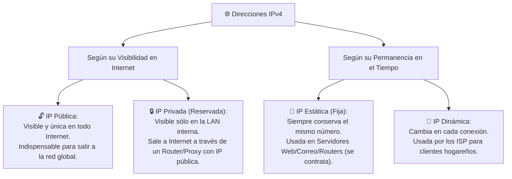

* 🚨 **LO MÁS IMPORTANTE A TENER EN CUENTA:** En todo Internet **jamás puede haber dos hosts con la misma IP pública** al mismo tiempo. En cambio, **sí puede haber millones de máquinas con la misma IP privada** (por ejemplo, `192.168.1.10` en tu casa y `192.168.1.10` en una oficina), siempre que estén en redes privadas independientes. Desde Internet nadie puede conectarse directamente hacia una IP privada.

---

### 4.3.4. Clases de Direcciones IPv4 (RFC 1166) y Rangos Reservados (IPs Privadas)

#### Tabla de Clases de Direcciones IPv4

| Clase | Primeros Bits (Binario) | Formato (`r`=red, `h`=host) | Bits Red / Bits Host | Nro. de Redes | Nro. de Hosts por Red | Rango de Direcciones | Máscara de Subred por Defecto |
| :---: | :---: | :---: | :---: | :---: | :---: | :---: | :---: |
| **Clase A** | **`0`**`xxxxxxx` | `r.h.h.h` | 8 / 24 | $128$ | $16.777.214$ | `0.0.0.0` a `127.0.0.0` | **`255.0.0.0`** (`/8`) |
| **Clase B** | **`10`**`xxxxxx` | `r.r.h.h` | 16 / 16 | $16.384$ | $65.534$ | `128.0.0.0` a `191.255.0.0` | **`255.255.0.0`** (`/16`) |
| **Clase C** | **`110`**`xxxxx` | `r.r.r.h` | 24 / 8 | $2.097.152$ | **$254$** | `192.0.0.0` a `223.255.255.0` | **`255.255.255.0`** (`/24`) |
| **Clase D** | **`1110`**`xxxx` | Multicast | — | — | Grupo Multicast | `224.0.0.0` a `239.255.255.255` | *(Multidifusión)* |
| **Clase E** | **`1111`**`xxxx` | Reservada | — | — | No utilizable | `240.0.0.0` a `255.255.255.255` | *(Investigación / Reservada)* |

* **Formas de transmisión:**
  * **Unidifusión (*Unicast*):** Destinado a un único host.
  * **Multidifusión (*Multicast* - Clase D):** Destinado a un grupo selecto de hosts suscritos.
  * **Difusión (*Broadcast*):** Destinado simultáneamente a **todos** los hosts de una red.

#### Tabla de Direcciones IP Reservadas (Privadas) en cada Clase

| Clase | Rango de Redes Privadas Reservadas | Uso Típico |
| :---: | :--- | :--- |
| **A** | **`10.0.0.0`** (`10.0.0.0` a `10.255.255.255`) | Grandes corporaciones e infraestructura con miles de equipos. |
| **B** | **`172.16.0.0` a `172.31.0.0`** | Redes medianas / campus universitarios. |
| **C** | **`192.168.0.0` a `192.168.255.0`** | Redes domésticas y PyMEs de hasta **254 computadoras** por subred (ej. `192.168.23.1` a `192.168.23.254`). |

---

### 4.3.5. Máscara de Subred, Notación CIDR y Puerta de Enlace (*Default Gateway*)

La **máscara de subred** es un número de 32 bits cuyos **unos (`1`) continuos a la izquierda indican la parte de RED** y cuyos **ceros (`0`) a la derecha indican la parte de HOST**.
* La **Notación CIDR (*Classless Inter-Domain Routing*)** escribe la dirección IP seguida de `/N`, donde `N` es la cantidad de bits en `1` de la máscara (ej. `192.168.0.4/24` equivale a máscara `255.255.255.0`, es decir `11111111.11111111.11111111.00000000`). Permite crear redes a medida sin desperdiciar IPs como ocurría con las clases rígidas A, B y C.

> 🧮 **CÁLCULO PASO A PASO — Producto Binario (`AND`) con la Máscara de Subred:**
> Para saber a qué red pertenece una máquina, el SO hace el **producto lógico `AND` bit a bit** entre la IP y la Máscara (sólo da `1` cuando ambos bits valen `1`; de lo contrario da `0`).
>
> * 💡 **EJEMPLO PRÁCTICO DE CÁTEDRA (Máscara `255.255.0.0` o `/16`):**
>   * **Máquina 1 (`148.120.33.110`):**
>     ```text
>     IP Máquina 1:   148.120.33.110  ->  10010100.01111000 . 00100001.01101110
>     Máscara (/16):  255.255.0.0     ->  11111111.11111111 . 00000000.00000000
>     -------------------------------------------------------------------------
>     Resultado AND:  148.120.0.0     ->  10010100.01111000 . 00000000.00000000  (Red 148.120.0.0)
>                                         <------ RED ------> <----- HOST ----->
>     ```
>   * **Máquina 2 (`148.120.33.89`):** Al hacer `AND` con `255.255.0.0` también da **`148.120.0.0`**. ¡Están en la **misma subred**! Se entregan los paquetes **directamente** entre ellas.
>   * **Máquina 3 (`148.115.89.3`):** Al hacer `AND` con `255.255.0.0` da **`148.115.0.0`**. ¡Pertenece a **otra subred distinta**! Para hablar con ella, la Máquina 1 debe enviarle el paquete a su **Puerta de Enlace (*Default Gateway* / Router)**.

* 💡 **EJEMPLO PRÁCTICO DE CÁTEDRA (Interconexión de 3 Redes con Routers R1 y R2):**

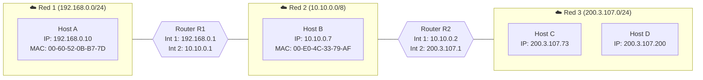

* **Caso 1 (`D` envía mensaje a `C`):** `D` (`200.3.107.200`) compara el prefijo de `C` (`200.3.107.73`). Como ambos empiezan con `200.3.107`, advierte que están en la **misma Red 3** y le entrega la trama **directamente** sin usar ningún router.
* **Caso 2 (`D` envía mensaje a `B`):** `D` (`200.3.107.200`) ve que `B` (`10.10.0.7`) pertenece a otra red. Entonces `D` le envía el paquete a su **Puerta de Enlace (`Router R2`, `200.3.107.1`)**, y `R2` lo entrega directamente a `B` porque `R2` también está conectado a la Red 2 (`10.10.0.2`). *(En Internet es habitual atravesar entre 10 y 20 routers en menos de 600 ms).*

---

### 4.3.6. Características del Protocolo IP y Evolución a IPv6
* **Protocolo IP (IPv4):** Es **NO orientado a conexión** (cada paquete o *datagrama IP* se enruta de forma independiente y puede viajar por caminos distintos, llegando desordenado o duplicado) y **NO fiable** (*best-effort*: los paquetes pueden perderse, dañarse o retrasarse sin que IP los reenvíe).
* **Protocolo IPv6:** Utiliza direcciones de **128 bits** ($3.4 \times 10^{38}$ direcciones posibles), solucionando el agotamiento de IPv4. Sus mejoras clave son:
  1. **Elimina la necesidad de NAT** (traducción de direcciones), recuperando la conectividad directa extremo a extremo.
  2. **Autoconfiguración** nativa de dispositivos.
  3. **Encabezado simplificado** para que los routers procesen más rápido.
  4. **Seguridad nativa** mediante **IPsec** integrado.

---

## 4.4. La Capa de Transporte (Puertos, TCP y UDP)

Mientras la capa de red (IP) lleva el paquete de una **computadora** a otra, la **Capa de Transporte** lleva el mensaje desde un **proceso (aplicación) de origen hasta el proceso de destino exacto** dentro de esa computadora utilizando un **Puerto** y una memoria intermedia (*buffer*).

### 4.4.1. El Concepto de Puerto (16 bits)
* Un **puerto** es un número entero de **16 bits**, por lo que existen **$65.536$ puertos** ($0$ al $65535$) en cada host.
* **Puertos en el Cliente (Dinámicos/Efímeros):** Cuando abrís el navegador, el SO le asigna dinámicamente un puerto libre cualquiera **mayor a `1024`** (ej. puerto `1256`).
* **Puertos en el Servidor (*Well-Known Ports* / Bien Conocidos — RFC 1700):** Son números fijos estandarizados (menores a `1024`) donde los servidores escuchan permanentemente:

| Número de Puerto | Servicio / Protocolo | Uso Principal |
| :---: | :---: | :--- |
| **`21`** | **FTP** | Transferencia de archivos (*File Transfer Protocol*) |
| **`22`** | **SSH** | Administración remota segura cifrada (*Secure Shell*) |
| **`25`** | **SMTP** | Envío y transferencia de correo electrónico |
| **`53`** | **DNS** | Resolución de nombres de dominio a direcciones IP |
| **`80`** | **HTTP** | Navegación web estándar (sin cifrar) |
| **`110`** | **POP3** | Descarga de correo electrónico al dispositivo local |
| **`143`** | **IMAP** | Gestión y lectura de correo electrónico en el servidor |
| **`443`** | **HTTPS** | Navegación web segura cifrada (HTTP sobre TLS/SSL) |
| **`993`** | **IMAP SSL** | Correo entrante IMAP con cifrado SSL/TLS |
| **`995`** | **POP SSL** | Correo entrante POP3 con cifrado SSL/TLS |

* 🌍 **ANALOGÍA DEL DÍA A DÍA (Dirección IP vs. Número de Puerto):**
  * La **Dirección IP** es la **dirección de la calle y altura de un edificio de oficinas** (permite que el cartero llegue hasta la puerta del edificio).
  * El **Número de Puerto** es el **número de piso y oficina interna** dentro de ese edificio (ej. Oficina 80 = Mostrador de Atención Web; Oficina 25 = Mesa de Entradas de Correo). Sin el número de oficina, el cartero llega al edificio pero no sabe a qué empleado entregarle la carta.

---

### 4.4.2. Comparativa de Protocolos de Transporte: TCP vs. UDP

| Característica | 🛡️ Protocolo TCP (*Transmission Control Protocol*) | ⚡ Protocolo UDP (*User Datagram Protocol*) |
| :--- | :--- | :--- |
| **Conexión previa** | **Orientado a conexión:** Abre un canal o *circuito virtual* previo antes de transmitir y lo cierra al terminar. | **No orientado a conexión:** Envía los datagramas directamente sin avisar antes. |
| **Fiabilidad** | **Fiable:** Usa confirmaciones (**ACK / *Acknowledgement***). Si no recibe el ACK a tiempo, **reenvía** el segmento. Entrega ordenada y sin duplicados. | **No fiable:** No confirma recepción ni reenvía nada. Si se pierde o llega desordenado, debe resolverlo la aplicación. |
| **Estructura de datos** | Flujo de **bytes no estructurado** y **Full-Dúplex** (bidireccional simultáneo, como una tubería). | Mensajes cortos independientes (sólo le agrega puertos origen/destino al paquete IP). |
| **Velocidad / Uso** | Más lento por el control; usado donde **no se puede perder ni un bit** (Web HTTP/HTTPS, Correo, FTP, SSH). | Ultrarrápido y sin sobrecarga; usado en consultas cortas (DNS), streaming en vivo, VoIP y juegos online. |

---

## 4.5. La Capa de Aplicación (Distinción Clave de Examen)

La **Capa de Aplicación** (Capa 4 en TCP/IP) es el puente entre el software del usuario y la red: traduce las acciones del usuario en mensajes estandarizados que la red pueda transportar.

* 🚨 **LO MÁS IMPORTANTE A TENER EN CUENTA (¿Las Apps están en la Capa de Aplicación? ¡NO!):**
  * **Las aplicaciones que usa el usuario (Chrome, Firefox, WhatsApp, Outlook) NO forman parte de la Capa de Aplicación.**
  * Lo que forma parte de la Capa de Aplicación son **los PROTOCOLOS (`HTTP`, `SMTP`, `FTP`, `DNS`)** que esas aplicaciones invocan para comunicarse por la red.

| Aplicación del Usuario *(NO está en la capa)* | Protocolo de Capa de Aplicación que utiliza *(SÍ está en la capa)* |
| :--- | :--- |
| Navegador Web (Chrome, Firefox, Edge) | **`HTTP` / `HTTPS`** |
| Cliente de Correo (Outlook, Thunderbird, Gmail) | **`SMTP`** (envío), **`POP3`** / **`IMAP`** (recepción) |
| WhatsApp | **Protocolo propietario** sobre TCP/IP |
| Búsqueda de nombres de dominio | **`DNS`** |
| Clientes de transferencia de archivos (FileZilla) | **`FTP`** |

---

# 5. Unidad 6 (Semana 12): Seguridad de la Información, Malware, Criptografía, VPN, Firma Digital y Autenticación

## 5.1. Seguridad de la Información vs. Seguridad Informática y la Tríada C-I-D

* **Seguridad de la Información:** Conjunto de medidas preventivas y reactivas (políticas, procedimientos y controles) para proteger la información **sin importar su soporte o formato** (papel en un archivador físico, conversación hablada o datos digitales).
* **Seguridad Informática:** Es la **rama de la Seguridad de la Información** cuyo objeto es exclusivamente la **información digitalizada** (almacenada o procesada en computadoras y redes).

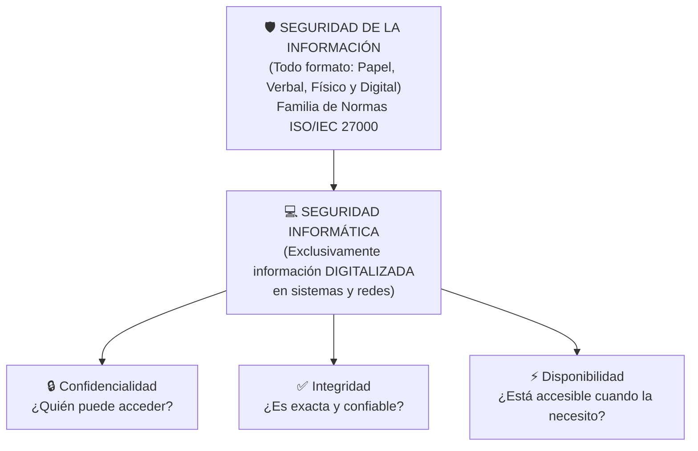

### La Tríada C-I-D (o C-I-A en inglés)

| Pilar | Pregunta Clave que Responde | Definición | Amenazas Comunes | Medidas de Prevención |
| :--- | :--- | :--- | :--- | :--- |
| **1. Confidencialidad** | *¿Quién puede acceder a esta información?* | Prevenir la divulgación a personas o sistemas no autorizados. | Acceso no autorizado, robo de credenciales, ingeniería social, *shoulder surfing* (mirar la pantalla por encima del hombro), robo de laptop. | SO seguros, control de accesos y privilegios, **MFA**, **cifrado** en tránsito y reposo, capacitación anti-phishing. |
| **2. Integridad** | *¿Es esta información confiable y exacta?* | Garantizar que los datos se mantengan exactos, completos y sin alteraciones no autorizadas o accidentales. | Alteración maliciosa, errores humanos de carga/desarrollo, manipulación de registros, fallos de sincronización. | Validaciones de entrada, logs de auditoría y trazabilidad, control de versiones, **hashing y firmas digitales**, QA, antivirus. |
| **3. Disponibilidad** | *¿Puedo acceder a la información cuando la necesito?* | Asegurar que los datos y sistemas estén operativos cuando los usuarios legítimos los requieran. | Ataques de Denegación de Servicio (**DoS/DDoS**), fallos de hardware/software, cortes eléctricos/desastres, **ransomware**. | **Backups periódicos** (y pruebas de restauración), infraestructura redundante, balanceo de carga, planes de continuidad (BCP/DRP). |

---

### Familia de Normas Internacionales ISO/IEC 27000

| Norma | Propósito Específico | ¿Es Certificable? |
| :--- | :--- | :---: |
| **ISO/IEC 27001** | Define los requisitos para implementar un **SGSI (Sistema de Gestión de Seguridad de la Información)** en cualquier organización. Es el núcleo de la familia. | 🏆 **SÍ (La ÚNICA certificable)** |
| **ISO/IEC 27002** | Guía de **buenas prácticas y catálogo de controles** de seguridad para proteger la tríada C-I-D. | ❌ No (Guía de apoyo) |
| **ISO/IEC 27005** | Gestión de **riesgos** asociados a los activos de información. | ❌ No (Guía de apoyo) |
| **ISO/IEC 27701** | Gestión de la **privacidad** y protección de datos personales. | ❌ No (Extensión) |
| **ISO/IEC 27032** | Directrices específicas enfocadas en **ciberseguridad**. | ❌ No (Guía de apoyo) |

* 🚨 **LO MÁS IMPORTANTE A TENER EN CUENTA:** De toda la familia ISO 27000, **la única norma contra la cual una empresa u organismo puede certificarse por auditoría es la ISO/IEC 27001**; todas las demás (27002, 27005, etc.) son normas de referencia y apoyo.

---

## 5.2. Software Maligno (Malware): Las 9 Categorías

El **malware (*malicious software*)** es cualquier código diseñado para infiltrarse, dañar, alterar o robar información sin consentimiento del usuario.

| Categoría | ¿Se replica solo? | ¿Necesita archivo huésped / usuario? |Cómo funciona y cuál es su objetivo | 🌍 Analogía del Día a Día |
| :--- | :---: | :---: | :--- | :--- |
| **1. Virus** | Sí (al ejecutarse) | **Sí** (se adhiere a un `.exe` o documento y requiere que el usuario lo abra) | Corrompe o destruye archivos y ralentiza el sistema al propagarse por pendrives o adjuntos. | Un **virus biológico (gripe)** que necesita infectar una célula huésped y que una persona contagie a otra. |
| **2. Gusano (*Worm*)** | **Sí (Automático por red)** | **No** (no necesita archivo huésped ni clic del usuario) | Explota vulnerabilidades de red para multiplicarse solo, consumiendo ancho de banda, saturando servidores o abriendo puertas para otro malware. | Una **plaga de langostas** que vuela sola de un campo a otro por el aire devorando todos los recursos. |
| **3. Troyano (*Trojan*)** | **No** | Sí (engaña al usuario disfrazado de programa útil/legítimo) | Una vez instalado, abre **puertas traseras (*backdoors*)** para dar control remoto al atacante o robar datos. | El **Caballo de Troya**: parece un regalo inofensivo, pero adentro trae soldados que abren las puertas de la muralla desde adentro. |
| **4. Spyware** | No | Se instala oculto con *freeware* o fallos del navegador | **Espía silenciosamente** hábitos de navegación, claves y datos bancarios en segundo plano. | Un **detective privado con micrófono oculto** anotando todo lo que hacés en tu casa. |
| **5. Adware** | No | Se instala junto a programas gratuitos | Muestra **ventanas emergentes (*pop-ups*) publicitarias**, cambia el inicio del navegador y recolecta datos comerciales. | Un **vendedor ambulante** que se mete en tu living a pegarte folletos en la cara cada 2 minutos. |
| **6. Ransomware** | A veces (vía gusanos) | Ingresa por phishing o brechas de red | **Secuestra los datos cifrando todos los archivos** del disco y exige un rescate económico (en criptomonedas) por la clave. | Un **secuestrador que le cambia la cerradura a tu casa** y te pide rescate para darte la llave nueva. |
| **7. Rootkit** | No | Se instala tras lograr acceso inicial | **Oculta a bajo nivel** (firmware, hipervisor, kernel, biblioteca o app) la presencia de otros procesos maliciosos, archivos y claves de registro, desactivando el antivirus. Suele requerir reinstalar el SO. | Un **infiltrado con capa de invisibilidad** que además altera las cámaras de seguridad para que los guardias vean todo normal. |
| **8. Keylogger** | No | Parte de un troyano o vulnerabilidad | **Registra cada pulsación del teclado** (usuarios, contraseñas, tarjetas) y la envía al atacante. | Alguien filmando tus dedos desde arriba cuando ponés el PIN en el cajero automático. |
| **9. Botnet** | Sí (recluta equipos) | Infección silenciosa masiva | Red de miles de dispositivos infectados (**bots o zombies**) controlados remotamente por un **botmaster** para lanzar ataques **DDoS**, enviar spam o minar criptomonedas. | Un **ejército de hipnotizados** que hacen su vida normal hasta que el líder les da la orden de ir todos juntos a bloquear la puerta de un banco. |

* 🚨 **LO MÁS IMPORTANTE A TENER EN CUENTA:** Diferencia clásica de examen entre **Virus, Gusano y Troyano**:
  * **Virus:** Necesita archivo huésped + acción humana para propagarse.
  * **Gusano:** Se propaga **solo y automáticamente por la red** sin archivo huésped ni intervención humana.
  * **Troyano:** **No se replica solo**; entra mediante engaño disfrazado de software legítimo.

---

## 5.3. Encriptación (Cifrado de Datos) y Esteganografía

### 5.3.1. Modelo Matemático y Principio de Kerckhoffs
El **cifrado** transforma datos legibles (**Texto Plano, $P$**) en una secuencia incomprensible (**Texto Cifrado, $C$**) usando un algoritmo y una clave.

> 🧮 **FÓRMULAS DE CIFRADO Y DESCIFRADO:**
> * **Proceso de Cifrado:** $$C = E(P, K_E)$$ *(donde $E$ es el algoritmo de cifrado y $K_E$ la clave de cifrado).*
> * **Proceso de Descifrado:** $$P = D(C, K_D)$$ *(donde $D$ es el algoritmo de descifrado y $K_D$ la clave de descifrado).*

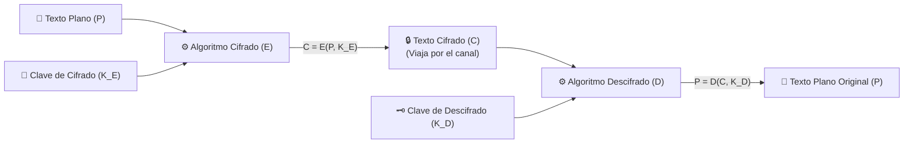

* 🚨 **LO MÁS IMPORTANTE A TENER EN CUENTA (Principio de Kerckhoffs vs. Seguridad por Oscuridad):**
  * **Seguridad por oscuridad (mala práctica):** Creer que un sistema es seguro porque su algoritmo de cifrado se mantiene en secreto. Si alguien descubre cómo funciona el algoritmo, todo cae.
  * **Principio de Kerckhoffs (siglo XIX, pilar de la criptografía moderna):** **El algoritmo ($E$ y $D$) debe ser 100% público y conocido por todos; la seguridad debe residir única y exclusivamente en el secreto de las CLAVES ($K_E, K_D$).**
* **Clasificación según cómo procesan los bits:**
  * **Cifradores de flujo (*Stream Cipher*):** Cifran bit a bit o byte a byte en forma continua; usualmente implementados en *hardware* para comunicaciones seriales.
  * **Cifradores de bloques (*Block Cipher*):** Dividen el texto plano en bloques de tamaño fijo (ej. 64 o 128 bits) y son los más utilizados hoy en software (ej. DES, AES).
* **Además de Confidencialidad, el cifrado moderno (asimétrico) aporta dos propiedades legales y técnicas:**
  1. **Prueba de Origen:** Permite verificar con certeza que el mensaje realmente fue enviado por quien dice ser el emisor.
  2. **No Repudio:** Garantiza que el emisor **no pueda negar posteriormente** haber enviado o firmado ese mensaje (con validez legal).

---

### 5.3.2. Línea de Tiempo Histórica de la Criptografía

| Época | Hitos y Algoritmos Destacados |
| :--- | :--- |
| **Antigüedad** | • **Jeroglíficos egipcios** (complejidad visual).<br>• **Scytale (Escítala) espartana:** Método de **transposición** (tira de cuero enrollada en un cilindro de grosor específico).<br>• **Cifrado César:** Método de **sustitución monoalfabética** (desplazar cada letra un número fijo de posiciones en el abecedario). |
| **Edad Media y Renacimiento** | • **Sustitución polialfabética (Leon Battista Alberti, s. XV):** Usa múltiples alfabetos para derrotar el análisis de frecuencias.<br>• **Disco/Cifrado de Vigenère (s. XVI):** Considerado "el cifrado indescifrable" durante tres siglos hasta ser quebrado en el s. XIX. |
| **Siglo XX (Era Mecánica y Electrónica)** | • **Máquina Enigma:** Usada por Alemania en la 2da Guerra Mundial; descifrada por **Alan Turing** y el equipo de Bletchley Park.<br>• **DES (*Data Encryption Standard*, 1977):** Estándar simétrico de EE. UU. con bloques de 64 bits y claves de 56 bits.<br>• **3DES (*Triple DES*):** Aplica DES tres veces sucesivas para ampliar la seguridad. |
| **Era Moderna y Digital** | • **RSA (1977):** Primer gran algoritmo **asimétrico**, basado en la dificultad de factorizar números primos gigantes.<br>• **PGP (*Pretty Good Privacy*, 1991):** Creado para cifrado y firma de correos, publicado como *freeware*.<br>• **AES (*Advanced Encryption Standard*, 2001):** Reemplazó a DES; usa claves de **128, 192 o 256 bits** y es el estándar mundial simétrico actual.<br>• **ECC (*Elliptic Curve Cryptography*):** Criptografía de curva elíptica; brinda la misma seguridad que RSA pero con **claves mucho más pequeñas**, ideal para celulares e IoT. |

---

### 5.3.3. Encriptación Simétrica vs. Encriptación Asimétrica (y sus 3 Casos)

#### A) Encriptación de Clave Simétrica (Clave Privada o Secreta)
Utiliza **una única clave compartida ($K_E = K_D$)** tanto para cifrar como para descifrar.

* 🌍 **ANALOGÍA DEL DÍA A DÍA:** Una caja fuerte con una cerradura tradicional: vos le ponés llave en Buenos Aires y para que tu amigo la abra en Córdoba **tenés que hacerle llegar primero una copia exacta de esa misma llave** sin que nadie se la robe en el camino.

#### B) Encriptación de Clave Asimétrica (Clave Pública y Clave Privada)
Cada usuario genera un **par de claves matemáticamente vinculadas**:
* 📢 **Clave Pública:** Se publica abiertamente para que todo el mundo la conozca.
* 🤫 **Clave Privada:** La guarda en absoluto secreto únicamente su dueño (jamás viaja por la red).
* **Regla de oro:** *Lo que se cifra con una clave del par, SÓLO puede descifrarse con la otra clave de ese mismo par.*

Dependiendo de **qué clave se use para cifrar**, el cifrado asimétrico resuelve **3 casos distintos**:

```mermaid
flowchart TB
    subgraph Caso1["🔒 CASO 1: CONFIDENCIALIDAD (Que sólo el Receptor pueda leerlo)"]
        direction LR
        M1["Mensaje"] --> E1["Cifra con CLAVE PÚBLICA<br/>del RECEPTOR"] --> C1["Texto Cifrado"] --> D1["Descifra con CLAVE PRIVADA<br/>del RECEPTOR"] --> R1["Mensaje Original"]
    end

    subgraph Caso2["✍️ CASO 2: PRUEBA DE ORIGEN / AUTENTICACIÓN (Demostrar que lo envió el Emisor)"]
        direction LR
        M2["Mensaje"] --> E2["Cifra con CLAVE PRIVADA<br/>del EMISOR"] --> C2["Texto Cifrado"] --> D2["Descifra con CLAVE PÚBLICA<br/>del EMISOR"] --> R2["Mensaje Original<br/>(Origen Verificado)"]
    end

    subgraph Caso3["🛡️ CASO 3: CONFIDENCIALIDAD + PRUEBA DE ORIGEN (Signed & Encrypted)"]
        direction LR
        M3["Mensaje"] --> E3A["1° Cifra con PRIVADA<br/>del EMISOR"] --> E3B["2° Cifra con PÚBLICA<br/>del RECEPTOR"] --> C3["CTm2"] --> D3A["1° Descifra con PRIVADA<br/>del RECEPTOR"] --> D3B["2° Descifra con PÚBLICA<br/>del EMISOR"] --> R3["Mensaje Secreto<br/>y Autenticado"]
    end
```

* 🌍 **ANALOGÍA DEL DÍA A DÍA (El Buzón con Ranura y el Sello de Lacre Personal):**
  * **Caso 1 (Confidencialidad):** La **Clave Pública del Receptor** es como un **buzón abierto en la vereda**: cualquiera en la calle puede meter una carta por la ranura (cifrar con la pública del receptor), pero **nadie más que el dueño de casa tiene la llave privada del candado** (Clave Privada del Receptor) para abrir la puertita y leer la carta.
  * **Caso 2 (Prueba de Origen):** La **Clave Privada del Emisor** es como un **sello de lacre único que sólo el Rey tiene en su anillo**. Cualquier ciudadano tiene una lupa oficial (**Clave Pública del Emisor**) para verificar que ese sello en relieve es auténtico del Rey; cualquiera puede leer el decreto, pero **nadie más que el Rey pudo haberlo sellado**.
  * **Caso 3 (Ambos):** El Rey estampa su sello real en la carta (**1° Privada del Emisor**) y luego mete la carta dentro del buzón cerrado del General (**2° Pública del Receptor**). Cuando llega, el General abre su buzón con su llave (**1° Privada del Receptor**) y luego verifica con su lupa el sello del Rey (**2° Pública del Emisor**).

#### Tabla Comparativa: Cifrado Simétrico vs. Cifrado Asimétrico

| Característica | 🔑 Cifrado de Clave Simétrica | 🗝️📢 Cifrado de Clave Asimétrica |
| :--- | :--- | :--- |
| **Cantidad de claves** | **1 sola clave compartida** entre emisor y receptor. | **Par de claves** por usuario (1 Pública + 1 Privada). |
| **Velocidad y Rendimiento** | ⚡ **Muy rápido y eficiente** para grandes volúmenes de datos (discos, VPNs, streaming). | 🐢 **Mucho más lento** (matemáticamente pesado); no es eficiente para archivos gigantes. |
| **Distribución de claves** | ❌ **Gran problema:** Requiere un canal seguro previo para entregar la clave separada del mensaje; si se filtra, cae todo. | ✅ **Muy sencilla y escalable:** La clave pública se reparte libremente sin riesgo. |
| **Propiedades de seguridad** | Sólo **Confidencialidad** (no asegura Prueba de Origen ni No Repudio porque ambos tienen la misma clave). | Provee **Confidencialidad**, **Prueba de Origen** y **No Repudio**. |
| **Ejemplos de Algoritmos** | `AES`, `DES`, `3DES`, `Blowfish`, `IDEA`, `RC4`, `SAFER`. | `RSA`, `ECC`, `DSA`, `ElGamal`. |

---

### 5.3.4. Esteganografía
La **esteganografía** es el arte y la ciencia de **ocultar información dentro de otro objeto o archivo portador** (imagen, audio, video o texto) de modo que nadie sospeche siquiera que existe un mensaje oculto.

* 🚨 **LO MÁS IMPORTANTE A TENER EN CUENTA (Criptografía vs. Esteganografía):**
  * **Criptografía:** Oculta el **significado** del mensaje transformándolo en algo ilegible (pero cualquiera que intercepta el tráfico ve que hay un mensaje cifrado).
  * **Esteganografía:** Oculta la **existencia misma** del mensaje disimulándolo dentro de otro archivo inocente (aunque el mensaje adentro no está cifrado por sí solo).
* 💡 **EJEMPLO PRÁCTICO (Método LSB — *Least Significant Bit* en Imágenes — Tanenbaum):**
  En una fotografía digital (por ejemplo, la famosa foto de las cebras del libro de Tanenbaum), cada píxel tiene 3 bytes de color (Rojo, Verde, Azul). Si reemplazamos el **bit menos significativo (el último bit de la derecha, LSB)** de cada píxel por los bits de un documento secreto, el color del píxel varía en $\frac{1}{256}$, algo **totalmente invisible al ojo humano**, permitiendo esconder archivos enteros dentro de una foto normal. También se hace alterando frecuencias inaudibles en archivos `.mp3` o agregando espacios invisibles en textos.

---

## 5.4. Red Privada Virtual (VPN — *Virtual Private Network*)

Una **VPN** es una tecnología de red que permite **extender una red local privada (Intranet) a través de una red pública o no controlada como Internet**, creando un **"túnel" lógico cifrado**.

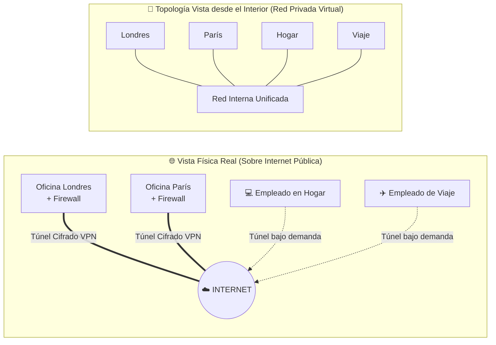

* 🚨 **LO MÁS IMPORTANTE A TENER EN CUENTA:**
  * Combina la **seguridad y privacidad** de una línea alquilada privada con el **bajo costo y la flexibilidad global** de Internet.
  * Puede unir permanentemente sucursales (Firewall de Londres $\leftrightarrow$ Firewall de París) o conectarse **bajo demanda** desde la notebook de un empleado en su casa o un hotel.
  * Para las computadoras conectadas a la VPN, **la topología lógica interna se ve exactamente igual que si estuvieran enchufadas al mismo cable local de la oficina**.

---

## 5.5. Firmas Digitales y Certificados Digitales

### 5.5.1. ¿Qué es la Firma Digital y qué garantiza?
La **Firma Digital (o Electrónica)** es un conjunto de datos criptográficos adjuntos a un documento electrónico que cumple **tres funciones esenciales**:
1. **Identificar al firmante** de manera inequívoca (Autenticación de origen).
2. **Asegurar la Integridad** del documento (detecta si se alteró aunque sea una sola coma después de firmado).
3. **Asegurar el No Repudio** (el firmante no puede negar legalmente haberlo firmado, pues usó su clave privada exclusiva).
* **Usos cotidianos:** Declaraciones juradas impositivas (AFIP/Renta), facturas electrónicas, expedientes administrativos, historia laboral, notificaciones judiciales y firma de correos.

### 5.5.2. ¿Qué es el Certificado Digital (o DNI Electrónico)?
Para poder firmar digitalmente es **obligatorio poseer un Certificado Digital** (o DNIe).
* 🚨 **LO MÁS IMPORTANTE A TENER EN CUENTA:** Un **Certificado Digital** es un archivo electrónico **firmado con la clave privada de una Autoridad de Certificación (CA / Proveedor de Servicios de Certificación)** que contiene la **Clave Pública del titular** junto con sus datos de identidad verificados. Evita que un impostor publique una clave pública falsa diciendo que es tuya.
* 💡 **EJEMPLO PRÁCTICO DE CÁTEDRA (Ver el Certificado del Campus FADENA):**
  Al entrar a `https://campus.fadena.undef.edu.ar/`, hacer clic en el **icono del candado** a la izquierda de la barra de direcciones $\rightarrow$ *Conexión segura* $\rightarrow$ *Más información* $\rightarrow$ *Ver certificado*. Allí el navegador muestra quién emitió el certificado (la Autoridad Certificante), a quién pertenece y su clave pública.

### 5.5.3. El Proceso Básico de la Firma Digital (Paso a Paso con *Hash*)
Como cifrar asimétricamente un PDF entero de 50 MB sería lentísimo, **no se cifra el documento entero con la clave privada, sino su resumen (*Hash*)**:

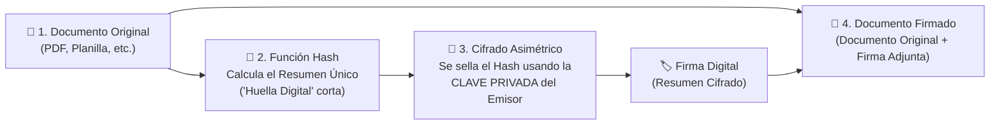

1. **Requisito inicial:** El firmante posee su Certificado Digital o DNIe con su clave privada.
2. **Paso 1 — Generación del Resumen (*Hash* o "Huella Digital"):** La aplicación pasa el documento original por una función matemática *Hash* que genera un resumen cortísimo y **único**. Si alguien cambia un espacio o una coma en el PDF original, el *Hash* resultante cambia por completo.
3. **Paso 2 — Codificación con Clave Privada (El sello secreto):** La aplicación cifra ese resumen *Hash* utilizando la **Clave Privada del firmante**.
4. **Paso 3 — Creación de la Firma y Envío:** Ese *Hash* cifrado se adjunta al documento original formando el **Documento Electrónico Firmado**. *(Cuando el receptor lo recibe, descifra la firma con la Clave Pública del firmante para obtener el Hash original, calcula por su cuenta el Hash del documento recibido y, si ambos Hashes son idénticos, comprueba quién firmó y que nadie tocó el archivo).*

---

## 5.6. Autenticación, Gestión de Identidades (IAM) y MFA

La **Autenticación** es el proceso mediante el cual un **Remitente** (usuario, programa o máquina) demuestra su identidad ante un **Verificador** (el sistema que valida la identidad para darle acceso).

### Los 2 Pilares de IAM (*Identity and Access Management*) y las 4 Etapas de Conexión
Toda infraestructura sólida de Gestión de Identidades y Accesos se apoya en:
1. Una **fuente única y fiable de identidades**.
2. Una **gestión rigurosa de los derechos** asociados a esas identidades.

El proceso de conexión de un usuario se articula en **dos fases (4 etapas en total)**:

| Fase | Etapa 1: Autenticación | Etapa 2: Autorización / Conexión |
| :--- | :--- | :--- |
| **1. Conexión Inicial (Puesto de Trabajo)** | **Autenticación del Puesto:** El usuario inicia sesión en su PC (Windows/Linux) y demuestra quién es. | **Conexión a Recursos:** El SO comprueba sus permisos y le habilita sus carpetas, impresoras y red. |
| **2. Conexión a una Aplicación Específica** | **Autenticación en la Aplicación:** El usuario abre un sistema interno (ej. ERP/SGBD) y vuelve a autenticarse si se requiere. | **Conexión a Transacciones y Datos:** La app verifica su perfil y le habilita las pantallas y datos permitidos. |

### Los 3 Factores de Autenticación y MFA (*Multi-Factor Authentication*)

| Factor | Nombre Técnico | En qué consiste | 💡 Ejemplos Prácticos |
| :--- | :--- | :--- | :--- |
| 🧠 **1. Algo que SABES** | Autenticación por **Conocimiento** | Un secreto que está en la memoria del usuario. | Contraseña (*password*), código PIN, respuesta a pregunta de seguridad. |
| 📱 **2. Algo que TIENES** | Autenticación por **Posesión** | Un objeto físico o dispositivo que el usuario tiene en su poder. | Tarjeta inteligente (*smartcard*), llave USB de seguridad (*token*), tarjeta de coordenadas, código OTP enviado al celular. |
| 👁️ **3. Algo que ERES** | Autenticación por **Característica Física (Biometría)** | Un rasgo biológico o físico único e intransferible de la persona. | Huella dactilar, reconocimiento facial, escaneo de iris/retina, reconocimiento de voz. |

* 🚨 **LO MÁS IMPORTANTE A TENER EN CUENTA (¿Qué es MFA?):** La **Autenticación Multifactor (MFA)** consiste en exigir la combinación de **dos o más factores de DISTINTA categoría** (por ejemplo: poner tu contraseña *[Algo que sabes]* + aprobar el código en tu celular *[Algo que tienes]*). Poner dos contraseñas seguidas **NO** es MFA porque ambas pertenecen al mismo factor (*conocimiento*).


---

# 6. Unidad 6 (Semana 13): Firewalls, IDS/IPS, Gestión de Usuarios en Linux, Políticas y Control de Acceso (DAC, MAC, RBAC)

## 6.1. Cortafuegos (Firewalls): Concepto y los 5 Tipos

Un **cortafuegos (*firewall*)** es un sistema (de *hardware* o *software*) situado estratégicamente en el **punto de unión entre la red interna de la organización y la red externa (Internet)** para controlar, inspeccionar y filtrar el tráfico de red, **permitiendo o denegando** las comunicaciones según las políticas de seguridad definidas.

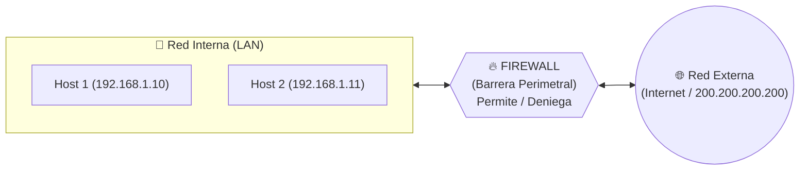

### Análisis Detallado de los 5 Tipos de Firewalls

#### 1️⃣ Firewall de Filtrado de Paquetes (*Stateless* / Sin Estado)
* **Capa donde opera:** Capa de Red (IP origen/destino), con soporte frecuente de campos de Transporte (Puerto origen/destino) y Enlace (MAC).
* **Cómo funciona:** Evalúa cada paquete **de forma totalmente aislada**, sin recordar nada sobre paquetes anteriores ni sesiones activas.
* 🚨 **LO MÁS IMPORTANTE A TENER EN CUENTA (El Problema Bidireccional del Firewall Stateless):**
  Como no tiene memoria ("sin estado"), si la PC interna `192.168.1.10` solicita una web al servidor externo `200.200.200.200` (puerto `80`), cuando el servidor externo responde enviando la página de vuelta hacia `192.168.1.10`, el firewall *stateless* **no recuerda que la PC interna había pedido esa página** y cree que es tráfico entrante nuevo no solicitado. Por lo tanto, **obliga a configurar reglas de filtrado dobles** (una regla explícita de salida y otra regla explícita de entrada para el retorno). Si olvidás la regla de entrada, la página nunca carga.

#### 2️⃣ Firewall de Inspección con Estado (*Stateful Inspection*)
* **Cómo funciona:** Además de mirar los encabezados, mantiene en memoria una **"Tabla de Estado" (*State Table*)** con todas las conexiones activas.
* **Mecanismo de gestión de sesiones en 2 pasos:**
  1. **Registro de estado (Iniciación):** Cuando `192.168.1.10:X` pide conectarse a `200.200.200.200:80` por `TCP`, el firewall anota esa sesión activa en su Tabla de Estados.
  2. **Validación automática del retorno:** Cuando vuelve la respuesta desde `200.200.200.200:80`, el firewall consulta su Tabla de Estados; al ver que corresponde a una sesión legítima iniciada desde adentro, **la deja pasar automáticamente sin necesitar una regla de entrada explícita**.
* **Ventajas:** Mayor seguridad (detecta ataques de inundación `SYN` o inyección de paquetes fuera de sesión) y **simplifica la configuración** (basta una sola regla de salida).
* **Desventajas:** Consume más CPU y memoria RAM para mantener la tabla dinámica.

#### 3️⃣ Firewall a Nivel de Circuito (*Circuit-Level Gateway*)
* **Capa donde opera:** Capa de Transporte (Sesión TCP).
* **Cómo funciona:** Actúa como intermediario validando únicamente el **establecimiento inicial, seguimiento y cierre de la sesión** (el *handshake* entre un puerto `OUT` y su puerto `IN` correspondiente), armando un "túnel o circuito virtual".
* 🚨 **LO MÁS IMPORTANTE A TENER EN CUENTA:** Una vez que valida que el circuito de conexión es legítimo, **deja fluir los paquetes sin inspeccionar su contenido**. Es más vulnerable que un firewall de aplicación porque un atacante podría meter datos maliciosos dentro de un circuito cuya conexión inicial fue válida.

#### 4️⃣ Firewall a Nivel de Aplicación (*Application Level* / *Proxy*)
* **Capa donde opera:** Capa de Aplicación (entiende a fondo `HTTP`, `FTP`, `SMTP`, etc.).
* **Cómo funciona:** Opera como un **Servidor Proxy** (*proximus* = "actuar en lugar de"). **Intercepta y termina (rompe) la conexión del cliente**: el cliente se conecta al Proxy, el Proxy abre e inspecciona profundamente la **carga útil (*payload*)** buscando comandos maliciosos o *malware*, y si todo es legítimo, el Proxy **abre una segunda conexión totalmente nueva** en su propio nombre hacia el servidor externo.
* 🚨 **LO MÁS IMPORTANTE A TENER EN CUENTA:**
  * **Jamás existe conexión directa** entre el host interno y el servidor externo.
  * **Oculta las direcciones IP internas** frente a Internet (todo parece salir de la IP del Proxy).
  * **Desventaja:** Es el que ofrece **máxima seguridad**, pero esa inspección profunda de aplicación **incrementa la latencia (retraso)**.

#### 5️⃣ Cortafuegos Personal (*Host-Based Firewall*)
* **Dónde opera:** Aplicación de software instalada **dentro del Sistema Operativo de un único dispositivo final** (PC, notebook o servidor).
* **Cómo funciona:** Filtra el tráfico local decidiendo **qué programas o procesos específicos** de esa máquina tienen permiso para abrir conexiones entrantes o salientes. Es vital para notebooks que salen fuera del perímetro de la oficina (ej. Wi-Fi de un café).
* 💡 **EJEMPLOS PRÁCTICOS:** **Firewall de Windows Defender** (en Windows) e **`iptables`** (en Linux).

---

### Cuadro Comparativo y Analogías de los 5 Tipos de Firewall

| Tipo de Firewall | Capa Principal | ¿Qué inspecciona? | 🌍 Analogía del Día a Día (El Guardia de un Edificio) |
| :--- | :---: | :--- | :--- |
| **1. Filtrado de Paquetes (*Stateless*)** | Red (Capa 3) | IP origen/destino, puerto y MAC de cada paquete suelto (sin memoria). | Un guardia con amnesia que mira sólo el remitente del sobre: si vos mandás un mensajero a comprar café, cuando el mensajero vuelve 5 minutos después no se acuerda de él y no lo deja entrar si no tiene otra orden escrita. |
| **2. Inspección con Estado (*Stateful*)** | Red + Transporte (Capas 3 y 4) | Encabezados + **Tabla de Estados** de sesiones activas. | Un guardia con planilla: cuando el mensajero sale a comprar café, lo anota en el cuaderno; cuando vuelve con el café, chequea el cuaderno y lo deja pasar directo. |
| **3. Nivel de Circuito (*Circuit-Level*)** | Transporte (Capa 4) | Sólo el apretón de manos inicial (*handshake*) y cierre de sesión. | Un telefonista que verifica las credenciales de los dos que van a hablar, les conecta el cable telefónico y no escucha nada de lo que hablan después. |
| **4. Nivel de Aplicación (*Proxy*)** | Aplicación (Capa 7) | **Carga útil (*payload*)** completa; rompe la conexión directa y oculta la IP interna. | Un secretario personal: vos le das tu pedido a él; él lee toda la carta con lupa para ver que no haya veneno, la transcribe en una hoja nueva con su propia firma y se la lleva él mismo al proveedor (el proveedor nunca te ve la cara a vos). |
| **5. Personal (*Host-Based*)** | Sistema Operativo Local | Qué proceso/aplicación local pide usar la placa de red. | El cerrojo propio en la puerta de tu dormitorio adentro del edificio, que te protege incluso cuando salís de viaje. |

---

## 6.2. Sistemas de Detección y Prevención de Intrusiones (IDS vs. IPS)

En arquitecturas modernas, los firewalls perimetrales se complementan con **NGFW** (*Next-Generation Firewalls*), **IDS/IPS** y plataformas **SIEM** (correlación de eventos).

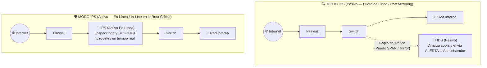

### 6.2.1. Clasificación de los IDS según qué supervisan: NIDS vs. HIDS

| Tipo de IDS | Ámbito que Monitorea | Dónde se instala | ✅ Ventaja Principal | ❌ Desventaja Principal |
| :--- | :--- | :--- | :--- | :--- |
| **NIDS** (*Network-based IDS*) | Todo el tráfico de red de un segmento completo. | Conectado a un puerto **SPAN o *Mirror*** de un switch (escucha una copia del tráfico sin estar en el medio). | Visión amplia y global de toda la actividad de la red con un solo equipo. | **No puede ver adentro del tráfico cifrado** (HTTPS/VPN) y genera un volumen gigante de *logs*. |
| **HIDS** (*Host-based IDS*) | Actividad interna de un equipo: *logs*, llamadas al sistema (*syscalls*), integridad de archivos críticos y Registro de Windows (*Registry*). | Instalado como software dentro de cada servidor o *endpoint*. | Detecta ataques que **ya superaron el perímetro** o ataques internos (y ve los datos ya descifrados en el host). | Consume CPU/RAM del servidor y sólo ve lo que pasa en esa máquina. |

### 6.2.2. Acciones Activas del IPS y sus Riesgos Inherentes
Como el **IPS (*Intrusion Prevention System*)** está colocado **en línea (*in-line*)**, todo paquete está obligado a atravesarlo. Cuando detecta un ataque (por firmas, protocolo o anomalías), ejecuta automáticamente:
1. **Bloqueo de Tráfico:** Destruye/descarta el paquete malicioso antes de que llegue a la víctima.
2. **Reinicio de Conexión:** Envía paquetes **`TCP RST` (Reset)** para cortar de inmediato la sesión entre atacante y víctima.
3. **Cuarentena / Bloqueo de IP:** Agrega la IP atacante a una lista negra (*blocklist*) o le ordena al firewall que la bloquee.
4. **Engaño (*Honeypot*):** Redirige silenciosamente al atacante hacia un servidor señuelo falso para estudiarlo sin riesgo.

* 🚨 **LO MÁS IMPORTANTE A TENER EN CUENTA (Los 2 Grandes Riesgos de un IPS):**
  1. **Falsos Positivos:** Si el IPS se equivoca y confunde tráfico legítimo de clientes con un ataque (un *falso positivo*), **lo bloqueará automáticamente, provocando él mismo una Denegación de Servicio (DoS)** contra la propia empresa.
  2. **Latencia:** Como hace Inspección Profunda de Paquetes (**DPI**) en el medio del cable principal, si no tiene hardware de altísimo rendimiento puede enlentecer toda la red.

### 6.2.3. Tabla Resumen de Diferencias: IDS vs. IPS y Herramientas Reales

| Característica | 🔍 IDS (*Intrusion Detection System*) | 🛡️ IPS (*Intrusion Prevention System*) |
| :--- | :--- | :--- |
| **Naturaleza** | **Pasiva** (sólo observa y avisa). | **Activa** (interviene y frena el ataque). |
| **Acción ante amenaza** | Genera **Alertas** y registra *logs*. | **Bloquea / Mitiga** el tráfico en tiempo real. |
| **Ubicación en la red** | **Fuera de línea** (*Out-of-band* / *Port Mirroring* / SPAN). | **En línea** (*In-line*, en la ruta crítica del tráfico). |
| **Tiempo de respuesta** | **Manual** (depende del administrador que lee la alerta). | **Automático e inmediato**. |
| **Ejemplos de Herramientas Reales (Cátedra)** | • **Snort** (NIDS basado en firmas, open source)<br>• **Suricata** (NIDS/HIDS multihilo con DPI)<br>• **Zeek / Bro** (NIDS de análisis contextual y forense)<br>• **OSSEC** (HIDS de monitoreo de logs e integridad) | • **Cisco Firepower** (IPS/NGFW integrado con SecureX)<br>• **Fortinet FortiIPS** (IPS dedicado de alta velocidad)<br>• **Palo Alto Threat Prevention** (IPS integrado)<br>• **Trend Micro TippingPoint** (IPS dedicado) |

* 🌍 **ANALOGÍA DEL DÍA A DÍA:**
  * **IDS:** Una **cámara de seguridad con alarma sonora**: si entra un ladrón, suena la sirena y le manda un WhatsApp al dueño, pero la cámara no tiene brazos para frenar al ladrón.
  * **IPS:** Una **puerta blindada inteligente con guardia armado** en el pasillo de entrada: si detecta que tenés una ganzúa, te cierra la reja en la cara en el acto (aunque si falla el sensor —*falso positivo*— puede dejar encerrado al propio dueño de casa).

---

## 6.3. Gestión de Usuarios y Grupos en Sistemas Operativos Linux

### 6.3.1. ¿Por qué es obligatorio trabajar con múltiples usuarios? (Las 3 Razones)
1. **Principio de Mínimo Privilegio (PoLP — Seguridad):** Asegura que cada persona o servicio tenga **únicamente los permisos estrictamente necesarios** para cumplir su tarea.
   * *Protección del sistema:* Evita que un usuario común borre por error o por un script malicioso archivos vitales del SO (que pertenecen a `root`).
   * *Aislamiento de servicios:* Los servidores web o bases de datos corren con usuarios lógicos limitados; si jaquean la web, el atacante queda encerrado en ese usuario sin poder tomar control total del servidor.
2. **Responsabilidad y Auditoría (Trazabilidad):** Permite saber ante cualquier incidente o fallo exactamente **quién** realizó la acción, **qué** hizo y **cuándo** ocurrió.
3. **Estabilidad y Personalización (Operativa):** Cada usuario tiene su entorno aislado (variables de entorno, configuración) y su propio directorio `/home/usuario` protegido de los demás.

---

### 6.3.2. Clasificación de Usuarios en Linux y sus Rangos de UID

En Linux, el sistema operativo **no identifica internamente a los usuarios por su nombre de texto, sino por su número `UID` (*User Identifier*)**:

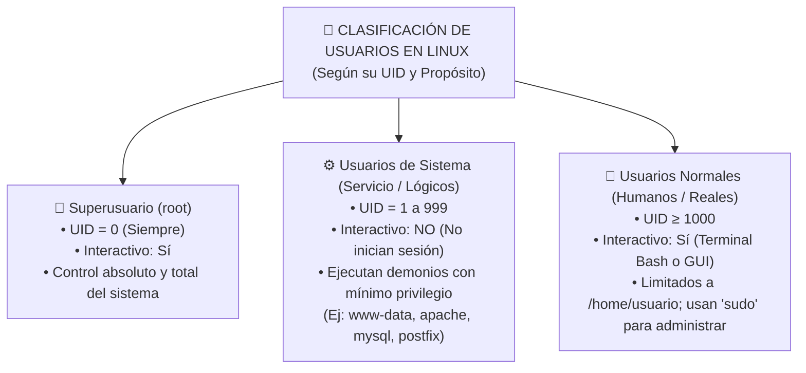

| Tipo de Usuario | Rango Típico de `UID` | ¿Es Interactivo? | Función Principal y Ejemplos |
| :--- | :---: | :---: | :--- |
| **Superusuario (`root`)** | **`0`** *(Siempre es cero)* | **Sí** (Administrador) | Control maestro total del SO; puede leer, modificar o borrar cualquier archivo y ejecutar cualquier comando sin restricción. |
| **Usuarios de Sistema** *(Servicio o Lógicos)* | **`1` a `999`** | **No** *(Cuentas no interactivas)* | Ejecutar demonios/servicios en segundo plano (`www-data`, `apache`, `mysql`, `postfix`) aplicando el Principio de Mínimo Privilegio. |
| **Usuarios Normales** *(Humanos o Reales)* | **`≥ 1000`** | **Sí** (Usuario estándar) | Trabajo diario en su `/home/nombre_usuario` usando el intérprete **BASH** (*Bourne Again Shell*); requieren **`sudo`** para tareas administrativas. |

---

### 6.3.3. Estructura de Grupos (`GID`), Grupo Primario, Secundarios y el Modelo UPG

Un **grupo** (identificado internamente por un número único **`GID` — *Group Identifier***) agrupa cuentas para asignarles permisos de forma colectiva.
* **Grupo Primario (Obligatorio — 1 solo por usuario):** Toda cuenta debe tener exactamente un grupo primario (el que se asigna por defecto a los archivos nuevos que crea ese usuario).
* **Grupos Secundarios o Suplementarios (Opcionales — de 0 a muchos):** Grupos adicionales a los que se suma al usuario para darle acceso a recursos compartidos (ej. grupo `ventas`, grupo `sudo`).

* 🚨 **LO MÁS IMPORTANTE A TENER EN CUENTA — ¿Qué es UPG (*User Private Group* / Grupo Privado de Usuario)?**
  Por seguridad y aislamiento, cuando creás un usuario en Linux sin especificarle otro grupo primario, Linux aplica la política **UPG**: **crea automáticamente un grupo primario con exactamente el mismo nombre que el usuario, donde ese usuario es el único miembro**. Así, ningún otro usuario normal del sistema puede espiar sus archivos recién creados a través del permiso de grupo.

* 💡 **EJEMPLO PRÁCTICO DE CÁTEDRA (Creación de usuario con UPG):**
  Al ejecutar en la terminal de Ubuntu Linux el comando:
  ```bash
  useradd -m pmartinez
  ```
  El sistema operativo realiza automáticamente **3 acciones** (además de crear su carpeta `/home/pmartinez` gracias al modificador `-m`):
  1. Crea la cuenta de usuario llamada **`pmartinez`** (con su `UID ≥ 1000`).
  2. Crea un **grupo primario** con el mismo nombre: **`pmartinez`** (con su `GID`).
  3. Asigna a **`pmartinez`** como el **único miembro** de ese grupo primario `pmartinez`.

### 6.3.4. Los 7 Atributos de una Cuenta de Usuario en Linux
1. **Identificación:** Nombre de cuenta y `UID` únicos.
2. **Pertenencia a Grupos:** 1 grupo primario obligatorio (`GID`) + grupos secundarios opcionales.
3. **Intérprete de Comandos (Shell):** Programa que interpreta sus comandos al iniciar sesión (en Ubuntu por defecto es **`/bin/bash`**).
4. **Seguridad:** Contraseña robusta y fecha opcional de caducidad/expiración de la cuenta.
5. **Entorno Personalizado:** Perfil de entrada (*login profile*) con variables de entorno y *aliases* en su directorio `/home`.
6. **Cuotas de Disco:** Límite máximo de espacio de almacenamiento permitido en el sistema de archivos.
7. **Auditoría:** Registro de todas sus actividades en los *logs* del sistema.

---

## 6.4. Políticas de Usuarios y Contraseñas Seguras (ISO/IEC 27001 y 27002 - Dominio A.9)

### 6.4.1. Políticas de Cuentas de Usuario
Regulan todo el ciclo de vida de la identidad digital (formato de nombres, tecnología como **Active Directory, OpenLDAP, Apache Directory, Okta, Google Cloud Identity**, y estados de la cuenta: **activa, bloqueada, expirada o inactiva**).

Segun el **Dominio A.9 de ISO/IEC 27002**, existen **6 controles clave de gestión de usuarios**:
1. **Registro de usuarios:** Alta formal y controlada (nunca crear usuarios de forma informal o "de favor").
2. **Gestión de acceso:** Asignación de permisos estrictamente según el **rol** laboral.
3. **Acceso privilegiado:** Controles extra y estrictos para cuentas de administrador (`root` / `Admin`).
4. **Autenticación secreta:** Entrega y resguardo seguro de credenciales.
5. **Revisión de accesos:** **Auditoría continua y periódica** para quitar permisos que quedaron viejos cuando alguien cambió de puesto.
6. **Eliminación de accesos:** **Desactivación inmediata** en el instante en que un empleado se desvincula de la organización.

### 6.4.2. Buenas Prácticas de Contraseñas según ISO/IEC 27002
* 🚨 **LO MÁS IMPORTANTE A TENER EN CUENTA (Checklist ISO 27002 para Contraseñas):**
  * 📏 **Longitud mínima recomendada:** **12 caracteres**.
  * 🔣 **Complejidad:** Combinar caracteres alfanuméricos (mayúsculas, minúsculas, números) y símbolos especiales.
  * 🚫 **No adivinables:** Prohibir fechas de nacimiento, nombres propios, secuencias (`123456`) o palabras de diccionario.
  * 🤐 **Confidencialidad y cambio ante sospecha:** Obligación de no compartirla jamás y cambiarla de inmediato si se sospecha compromiso.
  * 🔄 **Cambios forzados:** Exigir el cambio obligatorio en el **primer inicio de sesión** cuando se entrega una contraseña temporal/inicial, y en períodos definidos.
  * ♻️ **Historial (No reutilización):** Impedir que el usuario vuelva a poner sus contraseñas anteriores al cambiarla.
  * 🔒 **Bloqueo por intentos fallidos:** Bloquear la cuenta tras un número de intentos erróneos (frena ataques de fuerza bruta).
  * 🗄️ **Almacenamiento cifrado:** Guardar siempre las credenciales cifradas/hasheadas en el servidor (nunca en texto plano) y sumar **MFA**.

---

## 6.5. Roles, Permisos y los 3 Modelos de Control de Acceso (DAC, MAC, RBAC)

Una vez superada la **Autenticación** (*¿quién sos?*), entra en juego la **Autorización** (*¿qué tenés permiso para hacer?*), basada en 4 elementos:
1. **Recurso (*Asset*):** Objeto a proteger (archivo `documento.pdf`, directorio `/etc/`, impresora).
2. **Permiso (*Right*):** Acción permitida sobre el recurso (**Leer `r`**, **Escribir `w`**, **Ejecutar `x`**, Modificar, Eliminar).
3. **Identidad (*User*):** Quien pide acceder (el usuario `jlopez` o el servicio `apache`).
4. **Rol (*Role*):** Conjunto predefinido de permisos pensado para un puesto o función (ej. *Administrador*, *Contador*, *Usuario de Ventas*, *Invitado*).

---

### Comparativa Detallada de los 3 Modelos de Control de Acceso: DAC vs. MAC vs. RBAC

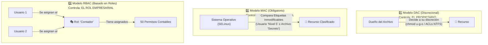

| Característica | 1️⃣ DAC (*Discretionary Access Control* — Discrecional) | 2️⃣ MAC (*Mandatory Access Control* — Obligatorio) | 3️⃣ RBAC (*Role-Based Access Control* — Basado en Roles) |
| :--- | :--- | :--- | :--- |
| **¿Quién tiene el poder de decisión?** | **El Propietario (dueño) del recurso** (a su "discreción"). | **El Administrador Central y el Sistema Operativo** (el usuario NO puede cambiar nada). | **Los Roles**, definidos centralmente por el administrador. |
| **Cómo funciona el mecanismo** | Quien crea un archivo es su dueño y puede darle o quitarle permisos a quien quiera. | Se asignan **etiquetas de seguridad (clasificación)** tanto a los recursos (*"Secreto"*, *"Confidencial"*) como a los usuarios (*"Nivel 5"*, *"Nivel 3"*). Sólo accedés si tu etiqueta $\ge$ etiqueta del recurso. | 1) Se crea el **Rol** (ej. *Contador*).<br>2) Se le dan permisos al Rol.<br>3) Se meten los usuarios adentro de ese Rol. |
| **Implementación Técnica en Linux y Windows** | • **Linux/Unix:** Tríada **`u-g-o`** (*Usuario dueño, Grupo, Otros*) + permisos **`rwx`** modificables por el dueño con **`chmod`**.<br>• **Windows NTFS:** **Listas de Control de Acceso (ACLs)**. | • **Linux:** **SELinux** o **AppArmor**.<br>• **Aclaración clave:** El SO verifica las etiquetas MAC **ignorando cualquier permiso DAC** que el dueño haya querido regalar. | • **Windows / Active Directory / LDAP:** Se implementa mediante **Grupos de Seguridad** (el grupo actúa como el Rol). |
| **Rigidez** | **Baja** (muy flexible y fácil de cambiar). | **Alta** (extremadamente rígido e inflexible). | **Media** (muy fácil de escalar y mantener). |
| **Cumplimiento del Mínimo Privilegio (PoLP)** | Débil: depende de la disciplina y cuidado de cada usuario. | **Inherente al modelo** (máxima seguridad a prueba de errores humanos). | **Implementado por el administrador** (estándar ideal para **ISO 27001**). |
| **Principal Ventaja / Riesgo** | ❌ **Alto riesgo:** Si un usuario se equivoca y hace `chmod 777` a un archivo crítico, lo expone a todos. | ✅ **Máxima seguridad**, pero muy complejo de administrar. | ✅ **Ahorro masivo de gestión:** En vez de dar 50 permisos a 100 usuarios ($50 \times 100 = 5000$ operaciones), das 50 permisos a 5 Roles y asignás los usuarios ($50 + 100 = 150$ operaciones). |
| **Ámbito de Uso Típico** | Uso por defecto en PCs personales y sistemas Linux/Windows estándar. | **Entornos militares, inteligencia y alta seguridad gubernamental**. | **Entornos corporativos, bancarios y empresariales**. |

* 🌍 **ANALOGÍA DEL DÍA A DÍA (DAC vs. MAC vs. RBAC):**
  * **DAC (Discrecional):** Es **tu casa propia**: como sos el dueño de la escritura, vos decidís a tu antojo a qué amigo le hacés una copia de la llave (incluso si te equivocás y se la das a alguien peligroso).
  * **MAC (Obligatorio):** Es una **base militar secreta**: aunque un Coronel sea el autor de un plano rotulado *"ULTRA SECRETO (Nivel 5)"*, **tiene prohibido** mostrárselo a su propio asistente si el asistente tiene credencial *"Nivel 3"*, porque el guardia de la puerta (el SO) mira las etiquetas de seguridad y no el deseo del Coronel.
  * **RBAC (Basado en Roles):** Es la **tarjeta magnética de un Hospital**: cuando contratan a una médica nueva, no configuran puerta por puerta las 300 cerraduras del hospital para su nombre; simplemente le asignan el rol **"Cirujana"** a su credencial y automáticamente se le abren todos los quirófanos.

---

# 7. Anexo General: Tabla de Comandos y Herramientas de Linux y Windows

A continuación se presenta la recopilación exhaustiva de los **comandos, intérpretes, utilidades de seguridad y herramientas de administración de Linux y Windows** detallados en los documentos teóricos de la cátedra, junto con los comandos prácticos equivalentes de ambos sistemas operativos asociados a cada unidad del programa.

## 7.1. Comandos, Utilidades y Herramientas Mencionados Explícitamente en los PDFs Teóricos

| Comando / Herramienta | Sistema Operativo | Unidad donde se detalla | Explicación Detallada de su Función | 💡 Ejemplo Práctico de Uso |
| :--- | :---: | :---: | :--- | :--- |
| **`useradd`** *(con opción `-m`)* | 🐧 **Linux** | Unidad 6 (Semana 13, pág. 17) | Comando administrativo para crear una nueva cuenta de usuario en el sistema. Con el parámetro **`-m`** (*make home*), crea automáticamente su directorio personal (`/home/usuario`). Además, por la regla **UPG (*User Private Group*)**, crea un grupo primario con el mismo nombre del usuario y lo asigna como su único miembro. | `sudo useradd -m pmartinez`<br>*(Crea el usuario `pmartinez`, el grupo primario `pmartinez` y la carpeta `/home/pmartinez`).* |
| **`chmod`** *(Change Mode)* | 🐧 **Linux / Unix** | Unidad 6 (Semana 13, pág. 22) | Comando del modelo de control de acceso discrecional (**DAC**) que permite al propietario de un archivo o directorio (o a `root`) modificar los permisos de **Lectura (`r` = 4)**, **Escritura (`w` = 2)** y **Ejecución (`x` = 1)** para la tríada **`u`** (*Usuario propietario*), **`g`** (*Grupo*) y **`o`** (*Otros*). | `chmod 640 informe.pdf`<br>o en modo simbólico:<br>`chmod u=rw,g=r,o= informe.pdf`<br>*(El dueño lee y escribe, el grupo sólo lee y otros no tienen acceso).* |
| **`sudo`** *(Superuser Do)* | 🐧 **Linux** | Unidad 6 (Semana 13, pág. 16) | Utilidad de seguridad que permite a un **usuario normal ($\text{UID} \ge 1000$)** autorizado ejecutar un comando puntual con privilegios elevados de **Superusuario (`root`, $\text{UID} = 0$)** sin necesidad de iniciar sesión directamente como `root`, manteniendo la trazabilidad en los *logs*. | `sudo useradd -m jlopez`<br>*(Pide la contraseña del usuario actual y ejecuta el alta con permisos de administrador).* |
| **`bash`** *(Bourne Again Shell)* | 🐧 **Linux (Ubuntu)** | Unidad 6 (Semana 13, págs. 15 y 17) | Es el **intérprete de comandos (*Shell*)** predeterminado para usuarios humanos en Ubuntu Linux. Lee los comandos escritos por el usuario en la terminal, evalúa variables de entorno/aliases y realiza las llamadas correspondientes al *kernel* del sistema operativo. | `bash script_backup.sh`<br>o verificar tu shell actual con:<br>`echo $SHELL` $\rightarrow$ `/bin/bash` |
| **`iptables`** | 🐧 **Linux** | Unidad 6 (Semana 13, pág. 9) | Herramienta de **Cortafuegos Personal (*Host-Based Firewall*)** y de red integrada en Linux (sobre *Netfilter* del kernel). Permite definir tablas y cadenas de reglas (`INPUT`, `OUTPUT`, `FORWARD`) para filtrar, permitir (`ACCEPT`) o bloquear (`DROP`) paquetes por IP, protocolo y puerto. | `sudo iptables -A INPUT -p tcp --dport 22 -j ACCEPT`<br>*(Permite tráfico TCP entrante al puerto 22 SSH).*<br>`sudo iptables -L -v`<br>*(Lista las reglas activas).* |
| **SELinux / AppArmor** | 🐧 **Linux** | Unidad 6 (Semana 13, pág. 22) | Módulos de seguridad del kernel de Linux que implementan el modelo **MAC (*Mandatory Access Control*)**. Asignan contextos y etiquetas de seguridad obligatorias a procesos y archivos que ni siquiera el dueño de un archivo puede saltear. | `getenforce` *(Muestra si SELinux está en modo `Enforcing`, `Permissive` o `Disabled`).*<br>`sudo aa-status` *(Muestra el estado de perfiles en AppArmor de Ubuntu).* |
| **Firewall de Windows Defender** *(y `netsh advfirewall`)* | 🪟 **Windows** | Unidad 6 (Semana 13, pág. 9) | **Cortafuegos Personal (*Host-Based Firewall*)** nativo del sistema operativo Windows. Filtra el tráfico entrante y saliente a nivel del host por programa, proceso, puerto o dirección IP según el perfil de red (Dominio, Privado o Público). | Interfaz gráfica: `wf.msc`<br>Por consola (CMD/PowerShell):<br>`netsh advfirewall show allprofiles`<br>*(Muestra el estado del firewall en todos los perfiles).* |
| **ACLs de Windows NTFS** *(y comando `icacls`)* | 🪟 **Windows** | Unidad 6 (Semana 13, pág. 22) | Implementación del modelo **DAC** en el sistema de archivos **NTFS** de Windows. Cada archivo o carpeta tiene una **Lista de Control de Acceso (ACL)** donde el propietario define qué usuarios o grupos tienen permisos de Lectura, Escritura, Modificación o Control Total. | En consola Windows:<br>`icacls "C:\Datos\Reporte.xlsx" /grant jlopez:(R,W)`<br>*(Otorga permiso de Lectura y Escritura al usuario `jlopez` en la ACL del archivo).* |
| **Active Directory (AD) / Grupos de Seguridad** | 🪟 **Windows Server** | Unidad 6 (Semana 13, págs. 18, 22 y 23) | Servicio de directorio centralizado de Microsoft para la gestión de identidades (**IAM**) y políticas de dominio. Utiliza **Grupos de Seguridad** para implementar el modelo **RBAC (*Control de Acceso Basado en Roles*)** a escala empresarial. | Consola administrativa: `dsa.msc`<br>En PowerShell:<br>`Add-ADGroupMember -Identity "Rol_Contadores" -Members "jlopez"` |
| **Calculadora Científica / Programador (`calc.exe`)** | 🪟 **Windows** | Unidad 5 (Semana 11 - 2da parte, pág. 15) | Utilidad nativa de Windows recomendada en el apunte de cátedra para realizar las conversiones de los octetos de una **dirección IPv4** entre **Decimal (`DEC`)**, **Binario (`BIN`)** y **Hexadecimal (`HEX`)**, así como operaciones lógicas `AND` con la máscara de subred. | Ejecutar `calc` en Windows $\rightarrow$ Cambiar a modo **Programador** $\rightarrow$ Ingresar `128` en `DEC` $\rightarrow$ Muestra `10000000` en `BIN` y `80` en `HEX`. |

---

## 7.2. Tabla Práctica de Comandos Equivalentes Linux vs. Windows por Temática de la Materia

Para complementar los comandos citados en la teoría y resolver cualquier pregunta práctica o de examen sobre los temas de las **Unidades 4, 5 y 6**, esta tabla compara los comandos exactos en **Linux (Bash)** y **Windows (CMD / PowerShell)**:

| Operación / Concepto de Cátedra | 🐧 Comando en Linux + Explicación y Ejemplo | 🪟 Comando en Windows + Explicación y Ejemplo |
| :--- | :--- | :--- |
| **1. Gestión de Usuarios (Altas, Bajas y Modificación)**<br>*(Unidad 6 - Sem. 13)* | • **Crear usuario (con home y UPG):**<br>`sudo useradd -m -s /bin/bash pmartinez`<br>• **Asignar/cambiar contraseña:**<br>`sudo passwd pmartinez`<br>• **Modificar cuenta (ej. agregar a grupo secundario):**<br>`sudo usermod -aG ventas pmartinez`<br>• **Eliminar usuario (y su `/home`):**<br>`sudo userdel -r pmartinez` | • **Crear usuario local:**<br>`net user pmartinez ClaveSegura123! /add`<br>• **Cambiar contraseña:**<br>`net user pmartinez NuevaClave456!`<br>• **Eliminar usuario:**<br>`net user pmartinez /delete` |
| **2. Gestión de Grupos e Identificadores (`UID` / `GID`)**<br>*(Unidad 6 - Sem. 13)* | • **Ver `UID`, `GID` y grupos de un usuario:**<br>`id pmartinez`<br>*(Muestra `uid=1001(pmartinez) gid=1001(pmartinez) grupos=...`)*<br>• **Crear un nuevo grupo (Rol):**<br>`sudo groupadd contadores`<br>• **Ver bases de datos de usuarios y grupos:**<br>`cat /etc/passwd` y `cat /etc/group` | • **Ver información y grupos de un usuario:**<br>`net user pmartinez` o `whoami /all`<br>• **Crear un nuevo grupo local (Rol):**<br>`net localgroup contadores /add`<br>• **Agregar usuario a un grupo:**<br>`net localgroup contadores pmartinez /add` |
| **3. Políticas de Contraseñas y Bloqueo de Cuentas**<br>*(Unidad 6 - Sem. 13)* | • **Configurar caducidad y políticas de clave (`chage`):**<br>`sudo chage -M 90 -m 7 -W 14 pmartinez`<br>*(Fuerza cambio cada 90 días, mínimo 7 días entre cambios, avisa 14 días antes).*<br>• **Forzar cambio en el primer inicio de sesión:**<br>`sudo chage -d 0 pmartinez`<br>• **Bloquear (`-L`) / Desbloquear (`-U`) cuenta:**<br>`sudo usermod -L pmartinez` | • **Ver y configurar políticas de contraseñas (longitud mínima, caducidad, bloqueo):**<br>`net accounts`<br>`net accounts /minpwlen:12 /maxpwage:90 /lockoutthreshold:5`<br>*(Exige mínimo 12 caracteres, caducidad 90 días y bloquea al 5to intento fallido).* |
| **4. Permisos de Archivos y Propietarios (Modelo DAC)**<br>*(Unidad 6 - Sem. 13)* | • **Ver permisos `rwx` y dueños (`u-g-o`):**<br>`ls -l documento.pdf`<br>*(Ej: `-rw-r----- 1 pmartinez contadores ...`)*<br>• **Cambiar permisos (`chmod`):**<br>`chmod 750 script.sh` *(Dueño `rwx`, Grupo `r-x`, Otros `---`)*<br>• **Cambiar propietario y grupo (`chown`):**<br>`sudo chown pmartinez:contadores documento.pdf` | • **Ver permisos ACL NTFS de un archivo:**<br>`icacls documento.pdf`<br>• **Otorgar o quitar permisos en la ACL:**<br>`icacls documento.pdf /grant contadores:(R)`<br>`icacls documento.pdf /remove invitado`<br>• **Cambiar propietario del archivo:**<br>`takeown /f documento.pdf` |
| **5. Configuración de Red: IP, Máscara CIDR y Puerta de Enlace**<br>*(Unidad 5 - Sem. 11 Parte 2)* | • **Ver dirección IPv4/IPv6, dirección física MAC y máscara CIDR:**<br>`ip addr show` *(o `ip a` / `ifconfig`)*<br>• **Ver tabla de enrutamiento y Puerta de Enlace (*Default Gateway*):**<br>`ip route show` *(o `route -n`)* | • **Ver dirección IPv4/IPv6, MAC, máscara de subred y puerta de enlace:**<br>`ipconfig /all`<br>• **Ver tabla de enrutamiento local:**<br>`route print` |
| **6. Diagnóstico de Conectividad y Saltos de Routers**<br>*(Unidad 5 - Sem. 11 Parte 2)* | • **Probar conectividad (Protocolo ICMP en capa Interred):**<br>`ping -c 4 148.120.33.89`<br>• **Ver los 10 a 20 routers (saltos) hasta un destino:**<br>`traceroute campus.fadena.undef.edu.ar`<br>• **Consultar resolución de nombres (Protocolo DNS, puerto 53):**<br>`nslookup www.ibm.com` *(o `dig www.ibm.com`)* | • **Probar conectividad (ICMP):**<br>`ping 148.120.33.89`<br>• **Ver la ruta de routers (saltos) hasta un destino:**<br>`tracert campus.fadena.undef.edu.ar`<br>• **Consultar resolución de nombres (DNS):**<br>`nslookup www.ibm.com` |
| **7. Inspección de Puertos en Escucha (TCP / UDP)**<br>*(Unidad 5 - Sem. 11 Parte 2)* | • **Listar todos los puertos TCP/UDP en escucha (*listening*) y qué proceso/demonio los usa:**<br>`sudo ss -tulnp` *(o `sudo netstat -tulnp`)*<br>*(Permite ver p. ej. el puerto `80` usado por `apache` o el `22` por `sshd`).* | • **Listar todos los puertos abiertos, conexiones activas y el PID del proceso:**<br>`netstat -ano`<br>*(Muestra protocolo TCP/UDP, IP:Puerto local, IP:Puerto remoto, estado `LISTENING`/`ESTABLISHED` y PID).* |
| **8. Verificación de Integridad (Cálculo de Resumen *Hash*)**<br>*(Unidad 6 - Sem. 12)* | • **Calcular la "huella digital" (Hash SHA-256 o MD5) de un documento:**<br>`sha256sum documento.pdf`<br>`md5sum documento.pdf`<br>*(Si cambia una sola coma del archivo, el hash cambia por completo).* | • **Calcular el resumen Hash criptográfico de un archivo:**<br>En CMD: `certutil -hashfile documento.pdf SHA256`<br>En PowerShell: `Get-FileHash documento.pdf -Algorithm SHA256` |
| **9. Monitoreo y Eliminación de Procesos (Recuperación de Interbloqueo)**<br>*(Unidad 4 - Sem. 9)* | • **Listar procesos activos y su consumo de recursos:**<br>`ps aux` o en tiempo real con `top` / `htop`<br>• **Abortar/eliminar un proceso bloqueado ("víctima"):**<br>`kill -9 <PID>` *(Envía señal `SIGKILL` inapelable para liberar sus recursos).* | • **Listar procesos activos y su consumo de memoria/CPU:**<br>`tasklist`<br>• **Abortar/eliminar forzosamente un proceso bloqueado:**<br>`taskkill /F /PID <PID>` *(o desde el Administrador de Tareas `taskmgr`).* |
