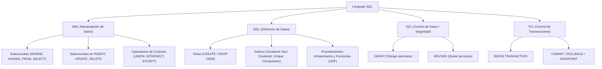
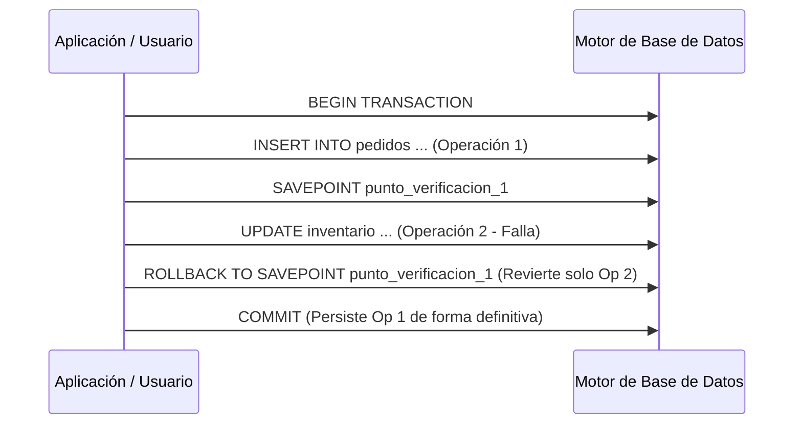
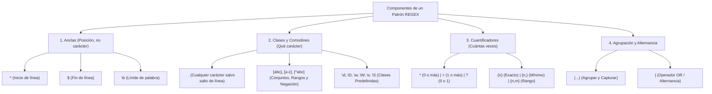
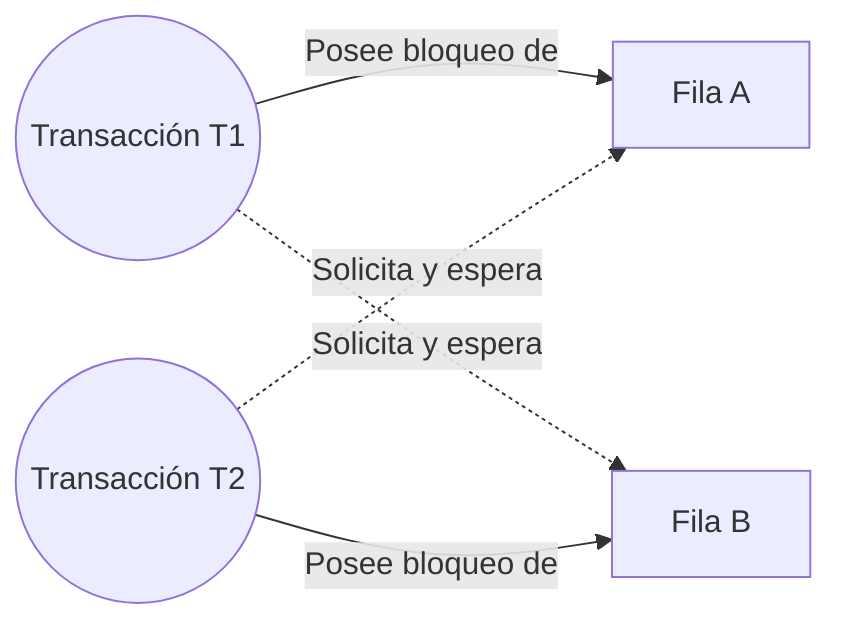
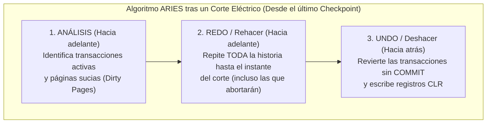
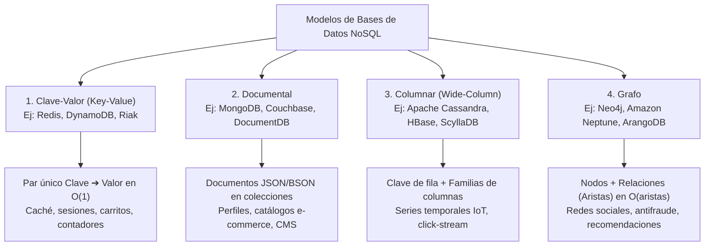
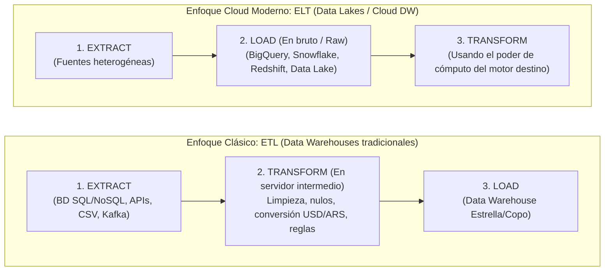
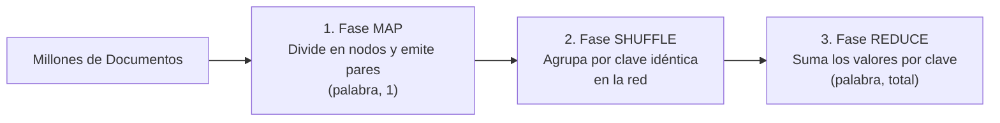

# 📚 Resumen Maestro Detallado: Sistemas de Tratamiento de Datos (STD - FADENA 2026)

Este documento reúne y desarrolla **absolutamente todos los conceptos, arquitecturas, fórmulas, casos de uso, diagramas y comandos** abordados en los documentos oficiales de la materia:
1. [1 - SQL Avanzado.pdf](file:///C:/Users/fgcarril/OneDrive%20-%20FEBICOM%20S.A/Escritorio/Facultad/STD/1%20-%20SQL%20Avanzado.pdf) y [2 - SQL Avanzado - Presentación.pdf](file:///C:/Users/fgcarril/OneDrive%20-%20FEBICOM%20S.A/Escritorio/Facultad/STD/2%20-%20SQL%20Avanzado%20-%20Presentaci%C3%B3n.pdf)
2. [2 - Formatos de intercambio de datos y Logs.pdf](file:///C:/Users/fgcarril/OneDrive%20-%20FEBICOM%20S.A/Escritorio/Facultad/STD/2%20-%20Formatos%20de%20intercambio%20de%20datos%20y%20Logs.pdf)
3. [3 - Introducción a las Expresiones Regulares (REGEX).pdf](file:///C:/Users/fgcarril/OneDrive%20-%20FEBICOM%20S.A/Escritorio/Facultad/STD/3%20-%20Introduccio%CC%81n%20a%20las%20Expresiones%20Regulares%20(REGEX).pdf)
4. [Administracion de base de datos.pdf](file:///C:/Users/fgcarril/OneDrive%20-%20FEBICOM%20S.A/Escritorio/Facultad/STD/Administracion%20de%20base%20de%20datos.pdf)
5. [NoSQL_Tendencias_2026.pdf](file:///C:/Users/fgcarril/OneDrive%20-%20FEBICOM%20S.A/Escritorio/Facultad/STD/NoSQL_Tendencias_2026.pdf)

---

## 🧭 Guía Visual de Emojis Utilizados en este Resumen

Para facilitar la lectura rápida y el estudio para exámenes, cada concepto incluye marcadores visuales fijos:
* 🎯 **Lo más importante a tener en cuenta:** Conceptos clave, reglas técnicas obligatorias y puntos críticos de examen.
* 💡 **Analogía del día a día:** Comparaciones cotidianas para comprender el funcionamiento intuitivamente.
* 💻 **Ejemplo práctico:** Fragmentos de código reales, consultas o trazas comentadas paso a paso.
* ⚠️ **Atención / Trampa común:** Casos borde (como valores `NULL`, limitaciones de motores como SQLite o riesgos de seguridad).

---

# 🗄️ MÓDULO 1: SQL Avanzado (DML, DDL, DCL y TCL)

 Las sentencias SQL se dividen en cuatro grandes sublenguajes según su propósito dentro del motor de base de datos:



---

## 1.1. Sentencias de Manipulación de Datos (DML): Subconsultas

Una **subconsulta** (o *consulta anidada*) es una sentencia `SELECT` escrita dentro de otra sentencia SQL (que puede ser otro `SELECT`, `INSERT`, `UPDATE` o `DELETE`). La consulta que la contiene se denomina **consulta externa o principal**.

* 🎯 **Lo más importante a tener en cuenta:**
  * Siempre suele escribirse encerrada entre **paréntesis `()`** (salvo en ciertos `INSERT INTO ... SELECT`).
  * Pueden anidarse tantos niveles como sea necesario.
  * Según la cantidad de datos que devuelven, se clasifican en:
    1. **Escalar:** Devuelve **1 sola fila y 1 sola columna** (un único valor).
    2. **De fila única:** Devuelve **1 fila con una o más columnas**.
    3. **De múltiples filas (conjunto/tabla):** Devuelve **varias filas** con una o múltiples columnas.
  * Pueden ubicarse en cuatro cláusulas de un `SELECT`:
    * **`WHERE`:** Filtra registros individuales según el resultado de la subconsulta.
    * **`HAVING`:** Filtra grupos de registros (después del `GROUP BY`) según una subconsulta.
    * **`FROM`:** Usa el resultado de la subconsulta como una **tabla temporal o derivada** (requiere alias obligatorio con `AS`).
    * **`SELECT`:** Incluye un cálculo escalar como una columna más del resultado.
* 💡 **Analogía del día a día:** Imagina que quieres comprar un regalo que cueste menos que tu presupuesto promedio del mes pasado, pero no recuerdas cuál fue ese promedio. Primero abres tu resumen bancario para calcular ese número (esa es la **subconsulta**) y, con ese dato en la mano, entras a la tienda a filtrar los productos (esa es la **consulta externa**).

---

### A. Subconsultas en `WHERE` y `HAVING`: Operadores de Comparación

#### 1) Operadores Básicos de Comparación (`=`, `<>`, `>`, `<`, `>=`, `<=`)
* **Sintaxis:** `expresion operador ( subconsulta )`
* 🎯 **Lo más importante a tener en cuenta:** La subconsulta **DEBE devolver un único valor (escalar: 1 fila y 1 columna)**. Si devuelve más de una fila, el motor arrojará un error en tiempo de ejecución.
* 💡 **Analogía del día a día:** Es como preguntar "¿Quiénes miden más que el jugador más alto del equipo rival?". Como "el más alto" es una única altura exacta (ej. 2.05 m), puedes comparar a cada persona directamente con `>=`.
* 💻 **Ejemplo práctico (En `WHERE` y en `HAVING`):**
  ```sql
  -- 1. En WHERE: Productos con precio mayor o igual al producto más caro de 'Samsung'
  SELECT *
  FROM producto
  WHERE precio >= (
      SELECT MAX(precio)
      FROM producto INNER JOIN fabricante
        ON producto.codigo_fabricante = fabricante.codigo
      WHERE fabricante.nombre = 'Samsung'
  );

  -- 2. En HAVING: Departamentos cuyo sueldo promedio supera al sueldo promedio general
  SELECT departamentoID, AVG(sueldo)
  FROM empleados
  GROUP BY departamentoID
  HAVING AVG(sueldo) > (SELECT AVG(sueldo) FROM empleados);
  ```

#### 2) Operadores de Pertenencia a Conjuntos (`IN` y `NOT IN`)
* **Sintaxis:** `expresion [NOT] IN ( subconsulta )`
* 🎯 **Lo más importante a tener en cuenta:**
  * La subconsulta devuelve **una columna y varias filas** (una lista de valores).
  * `IN` es verdadero si la expresión coincide con **alguno** de los valores de la lista.
  * `NOT IN` es verdadero si la expresión es **distinta a todos** los valores de la lista (o si la subconsulta devuelve 0 filas).
* 💡 **Analogía del día a día:** `IN` es el guardia de seguridad de un evento VIP revisando si tu DNI figura en la lista de invitados. `NOT IN` es verificar que tu patente no esté en la lista de vehículos con multas.
* 💻 **Ejemplo práctico:**
  ```sql
  -- Ciudades donde vive al menos un cliente
  SELECT ciudadID, nombre
  FROM ciudad
  WHERE ciudadID IN (SELECT ciudadID FROM clientes);

  -- Clientes que NO han realizado ningún pedido
  SELECT *
  FROM cliente
  WHERE clienteID NOT IN (SELECT clienteID FROM pedido);
  ```

#### 3) Operadores Cuantificados (`ANY` y `ALL`)
Se combinan siempre con un operador de comparación (`=`, `<>`, `>`, `<`, `>=`, `<=`) frente a una subconsulta que devuelve **una columna y varias filas**:
* **`expresion operador ANY ( subconsulta )`:** Es verdadero si la comparación se cumple para **al menos uno** de los valores devueltos por la subconsulta. Si la subconsulta está vacía, da **falso**.
* **`expresion operador ALL ( subconsulta )`:** Es verdadero si la comparación se cumple para **todos** los valores devueltos por la subconsulta. Si la subconsulta no devuelve ninguna fila, se evalúa como **verdadero**.
* 💡 **Analogía del día a día:**
  * `sueldo > ANY (supervisores)`: Ganar más que **algún** supervisor (basta con superar al supervisor que menos gana).
  * `sueldo > ALL (supervisores)`: Ganar más que **todos** los supervisores (tienes que superar incluso al supervisor que más gana).
* 💻 **Ejemplo práctico:**
  ```sql
  -- Operarios que ganan más que ALGÚN supervisor
  SELECT empleadoID, nombre
  FROM empleados
  WHERE categoria = 'operario'
    AND sueldo > ANY (SELECT sueldo FROM empleados WHERE categoria = 'supervisor');

  -- Operarios que ganan más que TODOS los supervisores
  SELECT empleadoID, nombre
  FROM empleados
  WHERE categoria = 'operario'
    AND sueldo > ALL (SELECT sueldo FROM empleados WHERE categoria = 'supervisor');
  ```

* ⚠️ **Atención — Equivalencias de `ANY` y `ALL` en SQLite:**
  **SQLite NO implementa los operadores `ANY` ni `ALL`** (arroja error de sintaxis). Para lograr el mismo resultado en SQLite, se reescriben usando `MIN()`, `MAX()`, `IN` o `NOT IN`:

| Expresión con `ANY` / `ALL` | Equivalencia exacta compatible con SQLite | Lógica intuitiva |
| :--- | :--- | :--- |
| `expr = ANY (subconsulta)` | `expr IN (subconsulta)` | Igual a alguno de la lista |
| `expr <> ALL (subconsulta)` | `expr NOT IN (subconsulta)` | Distinto de todos los de la lista |
| `expr > ANY (subconsulta)` | `expr > (SELECT MIN(...) FROM ...)` | Mayor que el más chico |
| `expr >= ANY (subconsulta)` | `expr >= (SELECT MIN(...) FROM ...)` | Mayor o igual que el más chico |
| `expr > ALL (subconsulta)` | `expr > (SELECT MAX(...) FROM ...)` | Mayor que el más grande |
| `expr >= ALL (subconsulta)` | `expr >= (SELECT MAX(...) FROM ...)` | Mayor o igual que el más grande |
| `expr < ANY (subconsulta)` | `expr < (SELECT MAX(...) FROM ...)` | Menor que el más grande |
| `expr <= ANY (subconsulta)` | `expr <= (SELECT MAX(...) FROM ...)` | Menor o igual que el más grande |
| `expr < ALL (subconsulta)` | `expr < (SELECT MIN(...) FROM ...)` | Menor que el más chico |
| `expr <= ALL (subconsulta)` | `expr <= (SELECT MIN(...) FROM ...)` | Menor o igual que el más chico |

#### 4) Comparación de Múltiples Columnas (Tuplas) y Fechas en SQLite
* 🎯 **Lo más importante a tener en cuenta:** Los operadores de comparación, `IN`, `NOT IN`, `ANY` y `ALL` permiten comparar **varios valores a la vez** escribiendo una tupla a la izquierda: `(expr1, expr2, ...) operador (subconsulta)`. La subconsulta debe devolver **exactamente la misma cantidad de columnas**.
* ⚠️ **Atención — Fechas en SQLite:** SQLite no tiene las funciones `MONTH()` ni `YEAR()`; maneja las fechas como texto y extrae sus partes usando `strftime('%m', fecha)` para el mes y `strftime('%Y', fecha)` para el año.
* 💻 **Ejemplo práctico:**
  ```sql
  -- Facturas que coinciden simultáneamente con el descuento máximo y monto máximo
  SELECT * FROM facturas
  WHERE (descuento, monto) = (SELECT MAX(descuento), MAX(monto) FROM facturas);

  -- Clientes que compraron en el mismo mes y año que el cliente 282 (Estándar vs SQLite)
  -- En SQLite:
  SELECT DISTINCT clienteID FROM facturas
  WHERE (strftime('%m', fecha), strftime('%Y', fecha)) IN (
      SELECT strftime('%m', fecha), strftime('%Y', fecha)
      FROM facturas WHERE clienteID = 282
  );
  ```

#### 5) ⚠️ Trampa Crítica: Valores `NULL` con `NOT IN` y `ALL`
* 🎯 **Lo más importante a tener en cuenta:** Si la subconsulta dentro de un `NOT IN` o un `ALL` devuelve **aunque sea un único valor `NULL`**, todo el predicado se evalúa como `UNKNOWN` (`NULL`) y **la consulta externa NO devolverá ningún registro (0 filas)**.
  * *¿Por qué?* Porque `x NOT IN (10, 20, NULL)` equivale a `x <> 10 AND x <> 20 AND x <> NULL`. Como `x <> NULL` es desconocido (`NULL`), toda la cadena `AND` jamás puede ser verdadera.
  * **Solución:** Filtrar los nulos en la subconsulta con `WHERE columna IS NOT NULL`, o convertirlos en un valor por defecto usando **`COALESCE(columna, valor_si_es_nulo)`**.
* 💡 **Analogía del día a día:** Quieres afirmar "Soy más alto que TODOS los que están en esa habitación", pero una persona está escondida detrás de una cortina (`NULL`). Como no sabes cuánto mide esa persona oculta, no puedes asegurar que eres más alto que todos.
* 💻 **Ejemplo práctico:**
  ```sql
  -- Usando COALESCE para transformar NULL en 0 y evitar que ALL falle:
  SELECT * FROM facturas
  WHERE descuento >= ALL (SELECT COALESCE(descuento, 0) FROM facturas);
  ```

#### 6) Operadores de Existencia (`EXISTS` y `NOT EXISTS`)
* **Sintaxis:** `[EXISTS | NOT EXISTS] ( subconsulta )`
* 🎯 **Lo más importante a tener en cuenta:**
  * No comparan valores ni columnas: **solo verifican si la subconsulta devuelve al menos una fila (`EXISTS` = verdadero) o ninguna fila (`NOT EXISTS` = verdadero)**.
  * Operan con **evaluación en cortocircuito (*short-circuit*)**: en cuanto el motor encuentra la primera fila que cumple la condición, detiene la búsqueda de inmediato y devuelve `TRUE` (en `EXISTS`) o `FALSE` (en `NOT EXISTS`).
  * Como no importa qué columnas proyecte la subconsulta, suele escribirse `SELECT 1` o `SELECT *`.
* 💡 **Analogía del día a día:** En lugar de pedir que te traigan todas las facturas de un cliente para contarlas, simplemente te asomas al cajón del cliente: apenas ves **un** papel adentro, cierras el cajón y dices "¡Sí tiene pedidos!" (`EXISTS`).
* 💻 **Ejemplo práctico:**
  ```sql
  -- Clientes que realizaron al menos un pedido después del 10/08/2025
  SELECT clienteID, nombre
  FROM cliente
  WHERE EXISTS (
      SELECT 1 FROM pedido
      WHERE cliente.clienteID = pedido.clienteID
        AND pedido.fecha > '2025-08-10'
  );
  ```

---

### B. Subconsultas Correlacionadas vs. No Correlacionadas

```text
┌─────────────────────────────────────────────────────────────────────────┐
│ 1. SUBCONSULTA NO CORRELACIONADA (Independiente)                        │
│                                                                         │
│   [Subconsulta Interna] ──(Se ejecuta 1 sola vez)──► Resultado Fijo     │
│                                                            │            │
│                                                            ▼            │
│                                                   [Consulta Externa]    │
├─────────────────────────────────────────────────────────────────────────┤
│ 2. SUBCONSULTA CORRELACIONADA (Dependiente fila por fila)               │
│                                                                         │
│   [Consulta Externa: Fila 1] ──(Pasa e1.deptoID)──► [Subconsulta]       │
│   [Consulta Externa: Fila 2] ──(Pasa e1.deptoID)──► [Subconsulta]       │
│   [Consulta Externa: Fila N] ──(Pasa e1.deptoID)──► [Subconsulta]       │
└─────────────────────────────────────────────────────────────────────────┘
```

* 🎯 **Lo más importante a tener en cuenta:**
  * **No Correlacionada:** Es autónoma; no hace referencia a ninguna columna de la consulta externa. Se ejecuta **primero y una única vez**, entregando su resultado fijo a la consulta principal.
  * **Correlacionada:** Hace referencia a una o más columnas de la tabla externa. La consulta externa se ejecuta primero y **por cada fila candidata ejecuta la subconsulta interna** pasándole el valor de esa fila.
* 💡 **Analogía del día a día:**
  * **No correlacionada:** Averiguar el promedio de edad de toda la universidad (lo calculas una sola vez en dirección) y luego preguntar a cada alumno si supera ese número.
  * **Correlacionada:** Preguntarle a cada alumno si es más alto que el promedio *de su propia comisión*: por cada alumno debes mirar a qué comisión pertenece y calcular el promedio de esa comisión.
* 💻 **Ejemplo práctico:**
  ```sql
  -- Subconsulta CORRELACIONADA: Empleados que ganan más que el promedio de SU departamento
  SELECT e1.nombre, e1.sueldo
  FROM empleados e1
  WHERE e1.sueldo > (
      SELECT AVG(e2.salario)
      FROM empleados e2
      WHERE e2.departamentoID = e1.departamentoID -- Referencia externa
  );
  ```

---

### C. Subconsultas en `FROM`, `SELECT`, `INSERT`, `UPDATE` y `DELETE`

1. **En la cláusula `FROM` (Tablas Derivadas):**
   * 🎯 **Clave:** El resultado actúa como una tabla temporal en memoria. Es **obligatorio asignarle un alias** (`AS nombre_tabla`) y puede devolver múltiples filas y columnas.
   * 💻 **Ejemplo:**
     ```sql
     -- Máximo precio promedio entre las categorías de productos
     SELECT MAX(promedio.precio_promedio)
     FROM (
         SELECT categoria, AVG(precio) AS precio_promedio
         FROM producto
         GROUP BY categoria
     ) AS promedio;
     ```
2. **En la cláusula `SELECT` (Subconsulta Escalar):**
   * 🎯 **Clave:** Debe devolver **estrictamente 1 fila y 1 columna** (un valor escalar). Ideal para mostrar un cálculo agregado junto al detalle de cada fila.
   * 💻 **Ejemplo:**
     ```sql
     SELECT nombre,
            (SELECT AVG(salario) FROM empleados e2
             WHERE e2.departamento = e1.departamento) AS salario_prom_dep
     FROM empleados e1;
     ```
3. **En sentencias `INSERT`, `UPDATE` y `DELETE`:**
   * 🎯 **Clave:** En `INSERT INTO tabla (cols) SELECT ...`, las columnas devueltas por el `SELECT` deben coincidir en cantidad y tipo con las de la tabla destino (y no requiere paréntesis). En `UPDATE` y `DELETE`, la subconsulta se coloca dentro del `WHERE`.
   * 💻 **Ejemplo:**
     ```sql
     -- INSERT masivo de alumnos aprobados
     INSERT INTO aprobadosMatem (alumnoID, nombre, nota)
     SELECT a.alumnoID, a.nombre, c.nota
     FROM alumnos a INNER JOIN calificaciones c ON a.alumnoID = c.alumnoID
     WHERE c.nota > 6 AND c.materia = 'Matem';

     -- UPDATE con subconsulta: aumento del 10% a departamentos con presupuesto > 80000
     UPDATE empleados SET sueldo = sueldo * 1.1
     WHERE departamentoID IN (SELECT departamentoID FROM departamentos WHERE presupuesto > 80000);

     -- DELETE con subconsulta: borrar empleados con sueldo menor al promedio
     DELETE FROM empleados WHERE sueldo < (SELECT AVG(sueldo) FROM empleados);
     ```

---

## 1.2. Operadores de Conjunto (`UNION`, `INTERSECT`, `EXCEPT`)

Provenientes del Álgebra Relacional, permiten combinar verticalmente los resultados de dos o más sentencias `SELECT`:

```text
      UNION (A ∪ B)             INTERSECT (A ∩ B)            EXCEPT (A - B)
   ┌───────┐ ┌───────┐         ┌───────┐ ┌───────┐         ┌───────┐ ┌───────┐
   │█████████│█████████│       │       │███│       │       │███████│ │       │
   │██ A ████│████ B ██│       │   A   │███│   B   │       │██ A ██│ │   B   │
   │█████████│█████████│       │       │███│       │       │███████│ │       │
   └───────┘ └───────┘         └───────┘ └───────┘         └───────┘ └───────┘
  Todo A más todo B           Solo filas comunes          Filas de A que NO
    (sin duplicados)             en A y en B                 están en B
```

* 🎯 **Lo más importante a tener en cuenta:**
  * **Compatibilidad de esquema:** Ambas consultas `SELECT` deben tener **exactamente la misma cantidad de columnas** y tipos de datos compatibles en cada posición.
  * **Eliminación de duplicados por defecto:** `UNION`, `INTERSECT` y `EXCEPT` eliminan filas duplicadas automáticamente. Si se desea conservar duplicados, se agrega la palabra clave **`ALL`** (`UNION ALL`, `INTERSECT ALL`, `EXCEPT ALL`).
  * **Cláusula `ORDER BY`:** Solo puede escribirse **una única vez al final de toda la sentencia compuesta**, ordenando el resultado global.
  * **Conmutatividad:** `UNION` e `INTERSECT` son conmutativos ($A \cup B = B \cup A$), pero **`EXCEPT` NO es conmutativo** ($A - B \neq B - A$).
* 💡 **Analogía del día a día:** Si tienes la lista de contactos de tu teléfono ($A$) y la de tu correo ($B$): `UNION` junta todos tus contactos sin repetir nombres; `INTERSECT` te muestra solo a quienes tienes en ambos lados; `EXCEPT` te muestra a quienes tienes en el teléfono pero todavía no agregaste al correo.
* 💻 **Ejemplo práctico:**
  ```sql
  -- Ciudades donde hay clientes PERO NO hay vendedores:
  SELECT ciudad FROM clientes
  EXCEPT
  SELECT ciudad FROM vendedores
  ORDER BY ciudad ASC;
  ```

---

## 1.3. Sentencias de Definición de Datos (DDL): Vistas, Índices y Objetos

### A. Vistas (`VIEW`)
Una **vista** es una **tabla virtual** definida por una consulta `SELECT`.

* 🎯 **Lo más importante a tener en cuenta:**
  * **No almacena datos físicamente** en disco (salvo las *Vistas Materializadas* que veremos en Administración de BD); solo guarda la definición de la consulta.
  * Se **actualiza dinámicamente**: cualquier cambio en las tablas base se refleja al instante al consultar la vista.
  * Cumple **tres propósitos fundamentales**:
    1. **Seguridad:** Oculta columnas o filas sensibles (como sueldos o contraseñas) a ciertos usuarios.
    2. **Reducción de complejidad y reutilización:** Encapsula `JOIN`s complejos para que el usuario consulte la vista como si fuera una tabla simple.
    3. **Independencia lógica de datos:** Si el esquema conceptual se divide o modifica, la vista mantiene la estructura anterior para no romper las aplicaciones.
* 💡 **Analogía del día a día:** Una vista es como una **ventana con filtro polarizado** hacia una habitación: no duplica los muebles que están adentro (no ocupa espacio físico), te deja ver solo la parte de la habitación hacia donde apunta (seguridad), y si alguien mueve una silla adentro, lo ves al instante (actualización dinámica).
* 💻 **Ejemplo práctico:**
  ```sql
  -- Crear vista de empleados con el nombre de su jefe
  CREATE VIEW v_emp_jef (empID, empNombre, jefID, jefNombre) AS
  SELECT e.empID, e.nombre, j.empID, j.nombre
  FROM empleados e
  LEFT OUTER JOIN empleados j ON e.jefeID = j.empID;

  -- Consultar la vista igual que una tabla normal
  SELECT v.ventasID, vej.empNombre, vej.jefNombre
  FROM ventas v INNER JOIN v_emp_jef vej ON v.empleadoID = vej.empID;

  -- Eliminar la vista
  DROP VIEW v_emp_jef;
  ```

### B. Índices (`INDEX`)
Estructuras auxiliares asociadas a una o más columnas para **acelerar la recuperación de datos** evitando escanear toda la tabla fila por fila (*Full Table Scan*).

* 🎯 **Lo más importante a tener en cuenta:**
  * **Ventaja vs. Costo:** Aceleran enormemente las lecturas (`SELECT` con `WHERE`, `JOIN`, `ORDER BY`), pero **ocupan espacio en disco y ralentizan las escrituras (`INSERT`, `UPDATE`, `DELETE`)** porque cada modificación obliga a actualizar el índice.
  * **Reglas de diseño:** Indexar columnas muy consultadas y de **alta cardinalidad** (muchos valores distintos, como DNI o email). **No indexar** tablas pequeñas ni columnas de baja cardinalidad (ej. estado activo/inactivo).
  * **Clasificación física:**
    * **Índice Agrupado (*Clustered*):** Define el **orden físico real** en que se guardan las filas en el disco. **Solo puede haber 1 por tabla** (generalmente la `PRIMARY KEY`).
    * **Índice No Agrupado (*Non-Clustered*):** Estructura independiente con punteros a las filas físicas reales. Una tabla puede tener **muchos** índices no agrupados (es el tipo por defecto).
  * **Otras clasificaciones:** **Únicos (`UNIQUE`)** (impiden valores duplicados) y **Compuestos** (abarcan múltiples columnas simultáneamente).
* 💡 **Analogía del día a día:**
  * **Índice Agrupado (*Clustered*):** Es una **guía telefónica o diccionario**, donde las páginas mismas del libro están ordenadas físicamente de la A a la Z. Solo puedes ordenar las hojas físicas de una manera.
  * **Índice No Agrupado (*Non-Clustered*):** Es el **índice temático al final de un libro de cocina**: la receta de "Pastel" está en la página 84 y "Sopa" en la 12; el índice al final está ordenado alfabéticamente y te dice a qué número de página saltar (puntero).
* 💻 **Ejemplo práctico:**
  ```sql
  -- Índice simple, único y compuesto
  CREATE INDEX idx_apellido ON empleados (apellido);
  CREATE UNIQUE INDEX idx_correo ON empleados (email);
  CREATE INDEX idx_nombrecompleto ON empleados (apellido, nombre);

  -- Eliminar índice
  DROP INDEX idx_apellido ON empleados; -- O bien: ALTER TABLE empleados DROP INDEX idx_apellido;
  ```

### C. Otros Objetos: Procedimientos Almacenados vs. Funciones (UDF)

Ambos son bloques de código SQL precompilados y almacenados en el motor para reutilizar lógica, pero tienen diferencias estrictas:

| Característica | Procedimiento Almacenado (`PROCEDURE`) | Función Definida por el Usuario (`FUNCTION` / UDF) |
| :--- | :--- | :--- |
| **Modificación de datos** | ✅ Permite `INSERT`, `UPDATE`, `DELETE` y `SELECT`. | ❌ **No permite** modificar datos de tablas. |
| **Parámetros y Retorno** | Parámetros de entrada/salida. Puede devolver 0, 1 o varios valores. | Solo parámetros de **entrada**. **Obligatorio** devolver 1 valor (`RETURNS`). |
| **Forma de invocación** | Se ejecuta de forma autónoma con `CALL` o `EXEC`. No va dentro de un `SELECT`. | Se incrusta directamente dentro de expresiones SQL (`SELECT funcion(col) FROM ...`). |
| **Propósito típico** | Ejecutar lógica de negocio transaccional compleja. | Cálculos o transformaciones repetitivas sobre valores. |

* 💡 **Analogía del día a día:** Un **Procedimiento Almacenado** es como un robot de cocina programado que corta, cocina y sirve el plato cuando aprietas el botón `START` (`CALL`). Una **Función (UDF)** es como una calculadora de bolsillo: le das números de entrada y te devuelve un resultado en pantalla sin alterar la cocina.

---

## 1.4. Sentencias de Control de Datos (DCL): `GRANT` y `REVOKE`

El sublenguaje **DCL (*Data Control Language*)** administra la seguridad, permisos y control de acceso sobre los objetos de la base de datos (tablas, vistas, procedimientos).

* 🎯 **Lo más importante a tener en cuenta:**
  * **`GRANT`:** Otorga privilegios (`SELECT`, `INSERT`, `UPDATE`, `DELETE`, `EXECUTE`) a un usuario o rol.
  * **`REVOKE`:** Quita privilegios previamente otorgados.
* 💡 **Analogía del día a día:** `GRANT` es habilitar la tarjeta magnética de un empleado para que pueda abrir la puerta del laboratorio; `REVOKE` es desprogramarle ese permiso cuando cambia de sector.
* 💻 **Ejemplo práctico:**
  ```sql
  -- Otorgar permisos de lectura, inserción y borrado sobre 'empleados' a 'usuarioA'
  GRANT SELECT, INSERT, DELETE ON empleados TO usuarioA;

  -- Revocar el permiso de inserción a 'usuarioA'
  REVOKE INSERT ON empleados FROM usuarioA;
  ```

---

## 1.5. Sentencias de Control de Transacciones (TCL) y Propiedades ACID

Una **transacción** es una secuencia de una o más operaciones SQL (`INSERT`, `UPDATE`, `DELETE`) que conforman una **única unidad lógica de trabajo indivisible**.



* 🎯 **Lo más importante a tener en cuenta:**
  * **Propiedades ACID:**
    * **A — Atomicidad (*Atomicity*):** Todo o nada. O se completan todos los pasos o no se aplica ninguno.
    * **C — Consistencia (*Consistency*):** La transacción lleva la base de datos de un estado válido a otro estado válido respetando todas las reglas de integridad.
    * **I — Aislamiento (*Isolation*):** Las transacciones simultáneas no interfieren entre sí.
    * **D — Durabilidad (*Durability*):** Una vez confirmado el `COMMIT`, los cambios son permanentes incluso si se corta la luz inmediatamente después.
  * **Comandos TCL:**
    * **`BEGIN TRANSACTION`:** Inicia formalmente la transacción.
    * **`COMMIT`:** Guarda permanentemente todos los cambios de la transacción (irreversible con `ROLLBACK`).
    * **`ROLLBACK`:** Deshace todas las operaciones realizadas desde el `BEGIN TRANSACTION` o hasta un `SAVEPOINT`.
    * **`SAVEPOINT nombre`:** Crea un punto de control intermedio dentro de una transacción larga para poder deshacer solo una parte (`ROLLBACK TO SAVEPOINT nombre`) sin perder lo anterior.
* 💡 **Analogía del día a día:** Imagina una **transferencia bancaria** (descontar \$100 de la Cuenta A y sumar \$100 a la Cuenta B) y un **videojuego**: `BEGIN` es empezar la misión; `SAVEPOINT` es un *checkpoint* a mitad del nivel; `ROLLBACK TO SAVEPOINT` es reaparecer en el *checkpoint* si cometes un error sin perder todo el nivel; y `COMMIT` es guardar la partida definitivamente al terminar.

---

# 📄 MÓDULO 2: Formatos de Intercambio de Datos y Estándares de Logs

En Ciberdefensa, los formatos de serialización y los estándares de logs son el lenguaje común que permite comunicar APIs, configurar infraestructuras y recolectar evidencia en plataformas **SIEM (*Security Information and Event Management*)** para análisis forense y detección de intrusiones.

### Línea de Tiempo Evolutiva de los Estándares

```text
[1960s-70s] ──► CSV (Mainframes / IBM FORTRAN: Tablas planas delimitadas)
[1983]      ──► Syslog (Eric Allman / Sendmail en BSD: Telemetría centralizada en red)
[1993-1995] ──► CLF (1993, NCSA HTTPd) y ELF (1995, W3C: Logs de servidores web)
[1998]      ──► XML 1.0 (W3C, derivado de GML/SGML: Árbol jerárquico y validación XSD/DTD)
[2001-2002] ──► JSON (Douglas Crockford) y YAML 1.0 (Clark Evans: Ligereza web e IaC/DevOps)
[2005-2017] ──► Formalización IETF: RFC 4180 (CSV), RFC 5424 (Modern Syslog), RFC 8259 (JSON)
```

---

## 2.1. Parte I: Formatos de Serialización e Intercambio de Datos

### 1) Formato CSV (*Comma-Separated Values*)
* **Orígenes e Historia:** Nacido en los años 60-70 con los *mainframes* (tarjetas perforadas y FORTRAN de IBM) y popularizado en los 80 por las hojas de cálculo (VisiCalc, Lotus 1-2-3, Microsoft Excel). Formalizado tardíamente en octubre de 2005 mediante el **RFC 4180** de la IETF.
* 🎯 **Lo más importante a tener en cuenta:**
  * Estructura **tabular plana** (filas separadas por saltos de línea `CRLF` y columnas separadas por comas `,`).
  * **Tres problemas históricos de la no estandarización:**
    1. *Colisión de delimitadores regionales:* En América Latina y Europa la coma es el separador decimal, dando origen a **DSV (*Delimiter-Separated Values*)** separados por punto y coma (`;`).
    2. *Comas y comillas dentro de los datos (Escape según RFC 4180):* Si un campo contiene comas o comillas dobles (ej. `Monitor Samsung 24"`), todo el campo debe encerrarse entre comillas dobles y las comillas internas deben duplicarse: `"Monitor Samsung 24"""`.
    3. *Codificación de caracteres:* Falta de charset explícito (conflictos entre ASCII, ISO-8859-1 y UTF-8 con tildes y eñes).
  * **Ventajas:** Extremadamente compacto (sin etiquetas), lectura/escritura rapidísima y soporte universal (Excel, Python `pandas`, ingesta masiva de IOCs en ciberseguridad).
  * ⚠️ **Desventajas y Riesgo en Ciberdefensa:** No soporta jerarquías ni tipos de datos explícitos, y es vulnerable a **Inyección de Fórmulas (*CSV Injection*)** cuando un campo comienza con `=`, `+`, `-` o `@` y se abre en una hoja de cálculo.
* 💡 **Analogía del día a día:** Es como una **lista de supermercado escrita en una hoja cuadriculada**: ocupa poquísimo espacio y cualquiera la lee de un vistazo, pero no sirve para dibujar un árbol genealógico complejo.
* 💻 **Ejemplo práctico (RFC 4180 con escape de comillas):**
  ```csv
  Fecha,Producto,Categoría,Unidades Vendidas,Precio Unitario (USD)
  2026-09-01,Laptop Dell Inspiron,Computadoras,3,850
  2026-09-02,"Monitor Samsung 24""",Monitores,5,180
  ```

---

### 2) Formato XML (*Extensible Markup Language*)
* **Orígenes e Historia:** Deriva de **GML** (IBM, años 70) y **SGML** (estándar ISO de 1986, muy potente pero complejo). Como HTML (subconjunto de SGML) mezclaba datos con presentación visual y tenía etiquetas fijas, el **W3C** (liderado por Jon Bosak y Tim Bray) publicó **XML 1.0 el 10 de febrero de 1998**.
* 🎯 **Lo más importante a tener en cuenta:**
  * Estructura de **árbol jerárquico** con un único elemento raíz, etiquetas de apertura `<tag>` y cierre `</tag>` definidas libremente por el desarrollador, atributos (`id="p-0001"`), prólogo (`<?xml ...?>`), comentarios (`<!-- -->`) y **espacios de nombres (`xmlns:hr`)** para evitar colisiones semánticas.
  * **Ecosistema complementario:**
    * **XSD (*XML Schema*) y DTD (*Document Type Definition*):** Contratos formales para validar estrictamente la estructura y tipos de datos.
    * **XPath:** Lenguaje para navegar y extraer nodos del árbol XML.
    * **XSLT:** Estándar para transformar un XML en HTML, texto u otro XML.
  * **Usos clave en Ciberdefensa y Empresas:** Servicios web **SOAP**, federación de identidades **SAML**, gráficos vectoriales **SVG** e inteligencia de amenazas **STIX 1.x**.
  * ⚠️ **Desventajas y Riesgo en Ciberdefensa:** Muy **verboso** (gran tamaño por etiquetas repetidas), alto consumo de CPU/RAM al parsear (DOM/SAX) y vulnerable a ataques **XXE (*XML External Entity*)** si el parser resuelve entidades externas sin sanitizar.
* 💡 **Analogía del día a día:** Es como un **archivador ministerial lleno de carpetas etiquetadas**: cada carpeta tiene un rótulo exacto de apertura y cierre y un sello oficial de validación (XSD). Es imposible confundirse de documento, pero las carpetas pesan más que los papeles que llevan adentro.
* 💻 **Ejemplo práctico:**
  ```xml
  <?xml version="1.0" encoding="UTF-8"?>
  <!-- Registro con espacio de nombres (namespace) y atributos -->
  <personas xmlns:hr="urn:unirio:schemas:rrhh">
    <hr:profesor id="p-0001" categoria="Titular">
      <hr:nombre>María</hr:nombre>
      <hr:especialidad>Minería de Datos</hr:especialidad>
    </hr:profesor>
  </personas>
  ```

---

### 3) Formato JSON (*JavaScript Object Notation*)
* **Orígenes e Historia:** Descubierto en **2001 por Douglas Crockford** (State Software / Yahoo!) al extraer la notación literal de objetos de JavaScript para comunicar aplicaciones web asíncronas (AJAX) sin la pesadez de XML. Estandarizado como **ECMA-404 (2013)** y **RFC 8259 (2017)**.
* 🎯 **Lo más importante a tener en cuenta:**
  * Basado en dos estructuras universales: **Objetos** (colecciones de pares `"clave": valor` entre llaves `{}`) y **Arreglos/Listas** (valores ordenados entre corchetes `[]`).
  * Tipos de datos soportados: cadenas (obligatoriamente con comillas dobles `""`), números, booleanos (`true`/`false`), `null`, objetos y arrays.
  * **Usos clave:** APIs RESTful, SPAs, configuración (`package.json`), bases documentales NoSQL (MongoDB, Elasticsearch), ciberinteligencia moderna (**STIX 2.x**) y logs estructurados (**JSON Lines**).
  * ⚠️ **Desventajas y Seguridad:** **No soporta comentarios** por defecto, no distingue enteros de flotantes ni tiene tipo nativo de fecha. En JavaScript nunca debe parsearse con `eval()` (riesgo de ejecución de código), sino con **`JSON.parse()`**.
* 💡 **Analogía del día a día:** Es una **caja de mudanza moderna con código QR**: guarda cosas unas dentro de otras igual que el archivador XML, pero sin tapas dobles ni formularios burocráticos; viaja rápido y cualquier aplicación web la abre al instante.
* 💻 **Ejemplo práctico:**
  ```json
  {
    "empresa": "TechSolutions",
    "activa": true,
    "empleados": [
      { "id": 1, "nombre": "Ana", "habilidades": ["Python", "SQL"] }
    ]
  }
  ```

---

### 4) Formato YAML (*YAML Ain't Markup Language*)
* **Orígenes e Historia:** Creado en mayo de **2001 por Clark Evans**, Ingy döt Net y Oren Ben-Kiki (originalmente llamado *Yet Another Markup Language* y renombrado recursivamente para destacar que se centra en los datos). Su versión **YAML 1.2 (2009)** lo consolidó como un **superconjunto oficial de JSON** (cualquier archivo JSON válido es también un YAML válido).
* 🎯 **Lo más importante a tener en cuenta:**
  * Diseñado para **máxima legibilidad humana**, usando **indentación con espacios** (nunca tabuladores) en lugar de llaves o etiquetas de cierre.
  * Tres estructuras primitivas: **Mapas** (`clave: valor`), **Listas** (guion `- elemento`) y **Escalares** (strings, números, booleanos).
  * Añade capacidades que JSON no tiene: **comentarios (`#`)**, cadenas multilínea y **anclas (`&`) / alias (`*`)** para reutilizar bloques sin repetirlos.
  * **Usos clave en DevOps e IaC (*Infraestructura como Código*):** Playbooks de **Ansible**, manifiestos de **Kubernetes / Docker Compose** y pipelines **CI/CD** (GitHub Actions, GitLab CI).
  * ⚠️ **Desventajas y Riesgo en Ciberdefensa:** Extrema sensibilidad a errores de indentación, ambigüedad implícita de tipos y riesgo crítico de **Ejecución Remota de Código (RCE)** si se deserializa con funciones inseguras (ej. usar `yaml.load()` en lugar de `yaml.safe_load()` / `SafeLoader` en Python).
* 💡 **Analogía del día a día:** Es un **esquema con sangrías y viñetas escrito en un cuaderno**: no tiene llaves ni corchetes que ensucien la vista, se lee como texto humano normal y puedes dejar notas al margen (`#`).

---

### 📊 Matriz Comparativa y Perfil de Rendimiento (CSV vs. XML vs. JSON vs. YAML)

| Característica | CSV | XML | JSON | YAML |
| :--- | :--- | :--- | :--- | :--- |
| **Año / Estándar** | ~1970 / RFC 4180 (2005) | 1998 (W3C XML 1.0) | 2001 / RFC 8259 (2017) | 2001 / YAML 1.2 (2009) |
| **Estructura** | Tabular plana (Filas/Cols) | Árbol jerárquico (Etiquetas) | Jerárquica (`{}` y `[]`) | Jerárquica (Indentación) |
| **Comentarios** | ❌ No | ✅ Sí (`<!-- -->`) | ❌ No | ✅ Sí (`#`) |
| **Validación esquema** | Muy limitada | Nativa y estricta (XSD/DTD) | JSON Schema | Herramientas externas |
| **Tamaño / Peso** | ⭐⭐⭐⭐⭐ (5/5 - Mínimo) | ⭐⭐ (2/5 - Muy verboso) | ⭐⭐⭐⭐ (4/5 - Ligero) | ⭐⭐⭐ (3/5 - Minimalista) |
| **Legibilidad Humana** | ⭐⭐⭐ (3/5) | ⭐⭐⭐ (3/5) | ⭐⭐⭐⭐ (4/5) | ⭐⭐⭐⭐⭐ (5/5 - Máxima) |
| **Complejidad/Metadatos**| ⭐ (1/5) | ⭐⭐⭐⭐⭐ (5/5) | ⭐⭐⭐⭐ (4/5) | ⭐⭐⭐⭐ (4/5) |
| **Riesgo de Seguridad** | *CSV Injection* (`=cmd...`) | *XXE (XML External Entity)* | Inyección si se usa `eval()` | Deserialización insegura (RCE) |

---

## 2.2. Parte II: Formatos de Registro de Eventos (Logs)

### 5) Common Log Format (CLF)
* **Orígenes:** Creado en **1993 por el NCSA** (*National Center for Supercomputing Applications*, creadores del navegador Mosaic y el servidor NCSA HTTPd) y adoptado por Apache, Nginx y CERN HTTPd.
* 🎯 **Lo más importante a tener en cuenta:**
  * Estructura **posicional rígida de 7 campos fijos** separados por espacios por cada petición HTTP:
    `host ident authuser [fecha:hora zona_horaria] "método recurso protocolo" código_de_estado bytes_enviados`
  * Si un dato no está disponible (como `ident` o `authuser`), se coloca un guion **`-`**.
  * **En Ciberdefensa:** Permite detectar escaneos de directorios (ráfagas de errores **404 Not Found**) o ataques de fuerza bruta (errores **401 Unauthorized / 403 Forbidden**), pero **carece de `Referer` y `User-Agent`**.
* 💡 **Analogía del día a día:** Es la **planilla de papel del guardia de la entrada de un edificio**: anota quién entró, a qué hora, a qué piso fue y si lo dejaron pasar (`200`) o le negaron la entrada (`403`), pero no anota desde qué calle venía ni qué ropa llevaba.
* 💻 **Ejemplo práctico y Anatomía Posicional:**
  ```text
  127.0.0.1 - - [10/Oct/2023:13:55:36 -0300] "GET /index.html HTTP/1.1" 200 1043
  ├───┬───┘ ┬ ┬ └────────────┬─────────────┘ └───────────┬────────────┘ ─┬─ ──┬─
  │         │ │              │                           │               │    └── 7. Bytes enviados (1043)
  │         │ │              │                           │               └─────── 6. Código HTTP (200 OK)
  │         │ │              │                           └─────────────────────── 5. Petición (Método + URI + Proto)
  │         │ │              └─────────────────────────────────────────────────── 4. Timestamp y Zona Horaria
  │         │ └────────────────────────────────────────────────────────────────── 3. Usuario HTTP Auth (-)
  │         └──────────────────────────────────────────────────────────────────── 2. Identificador RFC 1413 (-)
  └────────────────────────────────────────────────────────────────────────────── 1. IP o Host del cliente
  ```

---

### 6) Extended Log Format (ELF - W3C)
* **Orígenes:** Propuesto en **1995 ante el W3C** por Phillip M. Hallam-Baker y Brian Behlendorf para superar la rigidez del CLF. Adoptado nativamente por **Microsoft IIS** (*W3C Extended Log File Format*) e inspirador del *Combined Log Format* en Apache.
* 🎯 **Lo más importante a tener en cuenta:**
  * Es **autodescriptivo y personalizable** mediante directivas de cabecera que inician con `#` (`#Version`, `#Date`, `#Software` y especialmente **`#Fields:`**, que define qué columnas se registran y en qué orden).
  * **Prefijos direccionales estandarizados:**
    * **`c-` (*Client*):** Dato del cliente (ej. `c-ip`).
    * **`s-` (*Server*):** Dato del servidor (ej. `s-ip`, `s-port`).
    * **`cs-` (*Client to Server*):** Enviado del cliente al servidor (ej. `cs-method`, `cs-uri-stem`, `cs-uri-query`, `cs(User-Agent)`, `cs(Referer)`, `cs(Cookie)`).
    * **`sc-` (*Server to Client*):** Respuesta del servidor al cliente (ej. `sc-status`, `sc-bytes`).
    * **`time-taken`:** Tiempo que tardó el servidor en procesar la solicitud.
  * **Valor en un SOC / Ciberdefensa:** Gracias a `cs(User-Agent)`, `cs-uri-query` y `cs(Cookie)`, permite detectar **herramientas automatizadas de ataque (`sqlmap`, `Nikto`, `Nmap`)**, intentos de **Inyección SQL** en la URL y secuestro de sesiones (*session hijacking*).
* 💡 **Analogía del día a día:** A diferencia de la planilla fija del CLF, el ELF es una **planilla de auditoría configurable con encabezados**: el jefe de seguridad decide exactamente qué columnas agregar arriba (`#Fields`) y además registra con qué vehículo llegó el visitante (`User-Agent`) y quién lo recomendó (`Referer`).
* 💻 **Ejemplo práctico (Detección de un escáner automatizado):**
  ```text
  #Version: 1.0
  #Date: 2026-10-10 13:55:00
  #Fields: date time cs-method cs-uri-stem c-ip sc-status cs(User-Agent) cs(Referer)
  2026-10-10 13:55:36 GET /index.html 127.0.0.1 200 "Mozilla/5.0 (Windows NT 10.0; Win64; x64)" "Buscador Web"
  2026-10-10 13:56:02 POST /login.php 192.168.1.45 401 "Scanner-Automatizado/1.7" "-"
  ```

---

### 7) Estándar y Protocolo Syslog
* **Orígenes y Evolución:** Creado en **1983 por Eric Allman** en la Universidad de California, Berkeley, para el servidor de correo *Sendmail* en BSD. Desacopla la generación del log de su almacenamiento enviando eventos por red a un colector central.
  * **RFC 3164 (2001) — *BSD Syslog*:** Estandarizó el formato tradicional sobre **UDP puerto 514**.
  * **RFC 5424 (2009) — *Modern Syslog*:** Añadió datos estructurados (`STRUCTURED-DATA`), timestamps de alta precisión **ISO 8601**, codificación **UTF-8**, transporte fiable sobre **TCP (puerto 514)** y cifrado sobre **TLS (puerto 6514, RFC 5425)**. Implementado hoy en **Rsyslog** y **Syslog-ng**.
* 🎯 **Lo más importante a tener en cuenta:**
  * **Tres componentes del mensaje Syslog:**
    1. **`PRI` (*Priority Value*):** Número entre `< >` al inicio que combina la **Facilidad** (subsistema origen, códigos `0` a `23`, ej. `0 = kern`, `1 = user`, `2 = mail`, `4 = auth`, `16-23 = local0-local7`) y la **Severidad** (criticidad, niveles `0` a `7`).
    2. **`HEADER`:** Contiene el `TIMESTAMP` y el `HOSTNAME` (o IP) del equipo origen.
    3. **`MSG`:** Incluye el proceso/PID (`TAG + PID`, ej. `sshd[2410]:`) y el texto del evento.
  * **Fórmula Matemática del PRI (Pregunta fija de examen):**
    $$\text{PRI} = (\text{Facilidad} \times 8) + \text{Severidad}$$
* 💡 **Analogía del día a día:** Syslog es el **sistema de radio de emergencias 911 de una ciudad**: cada patrullero, hospital o cuartel de bomberos (Facilidad) transmite por radio (UDP/TCP/TLS) a una central única (Servidor SIEM) anteponiendo un código numérico de prioridad (`PRI`) que indica quién llama y qué tan grave es la urgencia (Severidad de 0 a 7).
* 💻 **Ejemplo práctico y Anatomía de Syslog:**
  Si un evento proviene de **`auth` (Facilidad = 4)** con nivel **`Critical` (Severidad = 2)**:
  $$\text{PRI} = (4 \times 8) + 2 = 34 \implies \texttt{<34>}$$
  ```text
  <34>Oct 10 13:55:36 servidor1 sshd[2410]: Accepted publickey for juan from 10.0.0.15 port 51234 ssh2
  └─┬┘└──────┬──────┘ └───┬───┘ └────┬────┘ └────────────────────────────┬───────────────────────────┘
   PRI   TIMESTAMP    HOSTNAME   TAG + PID                    Contenido del Mensaje (MSG)
  ```

#### Tabla de los 8 Niveles de Severidad de Syslog (`0` = Más grave a `7` = Menos grave)

| Código | Nivel (*Severity*) | Descripción Operativa en Ciberdefensa |
| :---: | :--- | :--- |
| **0** | `Emergency (emerg)` | El sistema está completamente inutilizable (ej. *Kernel Panic*, caída total). |
| **1** | `Alert (alert)` | Se requiere acción correctiva inmediata (ej. corrupción activa de base de datos). |
| **2** | `Critical (crit)` | Condiciones críticas en componentes primarios (ej. fallo de hardware o intrusión). |
| **3** | `Error (err)` | Errores en operaciones o servicios no fatales para el sistema global. |
| **4** | `Warning (warn)` | Advertencias de anomalías que escalarán a error si no se atienden (ej. disco al 85%). |
| **5** | `Notice (notice)` | Eventos normales pero significativos para auditoría (ej. login exitoso, cambio config). |
| **6** | `Informational (info)` | Mensajes operativos habituales del funcionamiento normal de los servicios. |
| **7** | `Debug (debug)` | Trazas detalladas de código o protocolo (ej. negociación criptográfica SSL/TLS). |

---

### 🔄 Arquitectura de Convergencia: Del Log a la Serialización en un SIEM

```mermaid
flowchart LR
    subgraph F1["1. FUENTES DE EVENTOS"]
        S1["Servidores Web (CLF / ELF)"]
        S2["Firewalls / Routers (Syslog)"]
        S3["Sistemas Linux / Windows"]
        S4["Contenedores (K8s YAML)"]
    end

    subgraph F2["2. TRANSPORTE Y NORMALIZACIÓN"]
        C1["Colectores / Agentes (Rsyslog, Beats)"]
        C2["Transporte Seguro Syslog TLS (Puerto 6514)"]
        C3["Parsing de texto plano a JSON / XML"]
    end

    subgraph F3["3. ALMACENAMIENTO Y SOC"]
        M1["Plataforma SIEM / Data Lake"]
        M2["Indexación en JSON (Elasticsearch)"]
        M3["Reglas de Correlación y Alertas"]
        M4["Exportación de IOCs en CSV / STIX 2.x"]
    end

    F1 --> F2 --> F3
```




---

# 🔍 MÓDULO 3: Expresiones Regulares (REGEX)

Una **Expresión Regular (`REGEX` o `RegExp`)** es una secuencia de caracteres que define un **patrón de búsqueda**. Nacieron en la década de 1950 (informática teórica y matemáticas) y se popularizaron gracias a **Ken Thompson** en los Laboratorios Bell al integrarlas en las utilidades de Unix **`ed`** (editor de texto) y **`grep`** (*Globally search for a Regular Expression and Print*).

* 🎯 **Lo más importante a tener en cuenta:**
  * Se utilizan para **tres tareas fundamentales**:
    1. **Validación:** Verificar si una cadena cumple un formato (ej. contraseña segura, email, IP).
    2. **Búsqueda y extracción (*Scraping/Parsing*):** Extraer fragmentos que coinciden con un patrón dentro de logs o textos masivos (ej. extraer IPs atacantes o enlaces).
    3. **Sustitución (*Sanitización/Anonimización*):** Buscar un patrón y reemplazarlo (ej. ocultar números de DNI o correos electrónicos en un documento público).
  * Todo patrón REGEX se compone de dos tipos de caracteres:
    * **Caracteres Literales:** Se representan exactamente a sí mismos (ej. el patrón `gato` busca la secuencia literal `'g'`, `'a'`, `'t'`, `'o'`, coincidiendo en `"El gato"`, `"gatos"` y `"agazapado"` si tuviera `'gato'`, pero no en `"Ágata"`).
    * **Metacaracteres:** Caracteres con "superpoderes" que dan instrucciones especiales al motor de búsqueda. Si necesitas buscar un metacarácter como texto literal (por ejemplo, un punto `.` real), debes **escaparlo anteponiendo una barra invertida `\`** (ej. `\.`).
* 💡 **Analogía del día a día:** Si el `Ctrl + F` tradicional de un editor de texto es como buscar en una biblioteca un libro cuyo título exacto conoces letra por letra, **REGEX es como decirle al bibliotecario**: *"Tráeme cualquier libro cuya portada empiece con una palabra de 4 letras, tenga un año de 4 dígitos en el medio y termine con un signo de interrogación"*.

---

## 3.1. Mapa Completo de Metacaracteres, Clases y Cuantificadores



---

### A. Anclas y Delimitadores de Palabra (`^`, `$`, `\b`)
* 🎯 **Lo más importante a tener en cuenta:** **Las anclas NO consumen ni coinciden con ningún carácter**, sino que validan una **posición** específica dentro del texto:
  * **`^` (Acento circunflejo):** Inicio de la línea o cadena (ej. `^Hola` coincide con `"Hola, mundo"`, pero NO con `"Adiós y Hola"`).
  * **`$` (Signo dólar/monetario):** Final de la línea o cadena (ej. `fin$` coincide con `"Este es el fin"`, pero NO con `"El fin del mundo"`).
  * **`^Solo esto$`:** Combinar ambas obliga a que la línea entera coincida **exactamente** de principio a fin sin ningún carácter extra.
  * **`\b` (*Word Boundary* / Límite de palabra):** Posición exacta entre un carácter de palabra (`\w`) y uno que no es de palabra (`\W`, como un espacio, signo de puntuación o inicio/fin de línea).
* 💡 **Analogía del día a día:** Las anclas son como los **márgenes de un renglón y los espacios entre palabras**: no son letras escritas con tinta, sino las fronteras invisibles que indican dónde empieza el renglón (`^`), dónde termina (`$`) y dónde empieza o termina una palabra suelta (`\b`).
* 💻 **Ejemplo práctico (`gato` vs. `\bgato\b`):**

| Texto de prueba | ¿Coincide con `gato`? | ¿Coincide con `\bgato\b`? | Motivo técnico |
| :--- | :---: | :---: | :--- |
| `"El gato negro."` | ✅ Sí | ✅ Sí | Rodeado de espacios (límites `\b`). |
| `"Me gusta el gato."` | ✅ Sí | ✅ Sí | Rodeado de espacio y punto literal (ambos son `\W`). |
| `"Los gatos son ágiles."` | ✅ Sí | ❌ **No** | La `'s'` es un carácter `\w` pegado a `'o'`; no hay límite. |
| `"Estoy agatopado."` | ✅ Sí | ❌ **No** | Incrustado dentro de otra palabra. |

---

### B. Clases de Caracteres, Rangos y Atajos Predefinidos

1. **Conjuntos (`[]`) y Rangos (`-`):**
   * `[ai]` coincide con **uno solo** de los caracteres dentro de los corchetes: `gr[ai]s` coincide con `"grasa"` y `"gris"`, pero no con `"grosor"`.
   * `[0-9]`, `[a-z]`, `[A-Z]` definen rangos continuos. Se pueden combinar: `[A-Za-z0-9_]`.
2. **Conjuntos Negados (`[^...]`):**
   * Si el **primer carácter** dentro de los corchetes es `^`, invierte el conjunto y coincide con cualquier carácter que **NO** esté en la lista.
   * 💻 **Ejemplo:** `q[^u]` busca una `'q'` seguida de un carácter que no sea `'u'` (coincide con `"q a"` pero no con `"que"`).
   * ⚠️ **Trampa común de examen:** Fuera de `[]`, `^` significa "inicio de línea". Dentro de `[]`, `^` significa "negación" **únicamente si está en la primera posición** (`[^abc]`). Si está en otra posición (ej. `[a^b]`), es simplemente el carácter literal `^`. En cuanto a `"Iraq"` frente a `q[^u]`: en motores estándar `[^u]` exige que exista un carácter después de la `'q'` (salvo que haya un salto de línea o espacio posterior).
3. **El Comodín Universal (`.`):**
   * Coincide con **cualquier carácter individual**, excepto (por defecto) el salto de línea `\n`. Ejemplo: `h.la` coincide con `"hola"`, `"hila"`, `"h&la"` y `"h la"`.
4. **Clases Predefinidas (Atajos):**
   * 🎯 **Regla de oro:** La letra **minúscula** representa el conjunto; la misma letra en **MAYÚSCULA** representa exactamente su negación:

| Atajo | Equivalencia en Corchetes | Descripción |
| :---: | :--- | :--- |
| **`\d`** | `[0-9]` | Cualquier **dígito** numérico. |
| **`\D`** | `[^0-9]` | Cualquier carácter que **NO sea un dígito**. |
| **`\w`** | `[A-Za-z0-9_]` | Cualquier **carácter de palabra** (alfanumérico más guion bajo `_`). |
| **`\W`** | `[^A-Za-z0-9_]` | Cualquier carácter que **NO sea de palabra** (espacios, símbolos, signos). |
| **`\s`** | `[ \t\r\n\f\v]` | Cualquier **espacio en blanco** (espacio, tabulador, salto de línea). |
| **`\S`** | `[^ \t\r\n\f\v]` | Cualquier carácter que **NO sea un espacio en blanco**. |

---

### C. Cuantificadores (`*`, `+`, `?`, `{n}`, `{n,}`, `{n,m}`)
Indican **cuántas repeticiones** del elemento inmediatamente anterior se exigen:

| Cuantificador | Nombre | Repeticiones | Ejemplo | Coincide con... | No coincide con... |
| :---: | :--- | :---: | :--- | :--- | :--- |
| **`*`** | Asterisco | **0 o más** veces | `ho*la` | `"hla"`, `"hola"`, `"hooooola"` | `"hela"` |
| **`+`** | Más | **1 o más** veces | `ho+la` | `"hola"`, `"hooooola"` | `"hla"` (exige al menos una `'o'`) |
| **`?`** | Interrogación | **0 o 1** vez (opcional) | `colou?r` | `"color"`, `"colour"` | `"colouur"` |
| **`{n}`** | Exacto | Exactamente **$n$** veces | `\d{4}` | `"1984"` | `"123"` (como palabra de 3 dígitos) |
| **`{n,}`** | Mínimo | **$n$ o más** veces | `\d{2,}` | `"12"`, `"99999"` | `"5"` |
| **`{n,m}`** | Rango | Entre **$n$ y $m$** veces | `\w{3,5}` | `"sol"`, `"luna"`, `"casas"` | `"la"` (si se exige palabra aislada) |

---

### D. Agrupación, Captura (`()`) y Alternancia (`|`)
* **Paréntesis `()`:** Cumplen **dos funciones simultáneas**:
  1. **Agrupar:** Permiten aplicar un cuantificador o un `OR` a una secuencia entera (ej. `(ha)+` coincide con `"ha"`, `"haha"`, `"hahahaha"`, mientras que `ha+` coincidiría con `"haaaaa"`).
  2. **Capturar:** Extraen y numeran cada sub-bloque coincidente para usarlo por separado.
     * 💻 **Ejemplo de Captura de Fecha:** El patrón `(\d{2})-(\d{2})-(\d{4})` sobre `"25-12-2023"` genera:
       * `group(0)` (coincidencia completa): `"25-12-2023"`
       * `Grupo 1`: `"25"` (Día) | `Grupo 2`: `"12"` (Mes) | `Grupo 3`: `"2023"` (Año).
* **Alternancia `|` (Operador OR):** Coincide con la opción de la izquierda o la de la derecha. Se suele encerrar entre paréntesis para acotar su alcance: `Me gusta el (café|té) con leche`.

---

## 3.2. Uso de REGEX en Entornos Reales (VS Code, JavaScript, Python y Web)

1. **En Visual Studio Code:** Abrir búsqueda con `Ctrl + F` (`Cmd + F` en Mac), escribir el patrón (ej. `color:.*(#|rgb)` para hallar colores hexadecimales o RGB en CSS) y activar el botón **`.*`**.
2. **En JavaScript:** Se crean con sintaxis literal `/patron/flags` o constructor `new RegExp("patron", "flags")` (donde `i` = *case-insensitive*, `g` = *global*).
   * **`patron.test(texto)`:** Método del objeto `RegExp` que devuelve `true` o `false` (ideal para validaciones).
   * **`texto.match(patron)`:** Método del `String` que devuelve un array con las coincidencias o `null`.
   * **`texto.replace(patron, reemplazo)`:** Método del `String` que sustituye el patrón por otro texto.
3. **En Python (Módulo estándar `import re`):**
   * 🎯 **Buena práctica fundamental:** Usar siempre **cadenas crudas (*raw strings*) con el prefijo `r"..."`** (ej. `r"\d+\.\d{2}"`) para que Python no malinterprete las barras invertidas `\` como escapes propios del lenguaje.
   * **`re.search(patron, texto)`:** Busca la **primera** aparición y devuelve un objeto `Match` (se extrae el texto con `.group(0)`) o `None`.
   * **`re.findall(patron, texto)`:** Busca **todas** las apariciones no superpuestas y las devuelve directamente como una **lista de strings** (ej. `['A123', 'B456']`).
   * **`re.sub(patron, reemplazo, texto)`:** Reemplaza todas las coincidencias (ej. anonimizar emails por `"[CORREO OCULTO]"`).
4. **Herramientas Online de Depuración:** **regex101.com** y **regexr.com** (resaltan coincidencias en tiempo real y desglosan el patrón paso a paso en lenguaje natural).

---

# 🛡️ MÓDULO 4: Administración de Bases de Datos (Seguridad, Concurrencia, Desempeño y Arquitecturas Distribuidas)

En infraestructuras críticas y Ciberdefensa, la administración de un SGBD debe garantizar simultáneamente la **Tríada CIA (Confidencialidad, Integridad y Disponibilidad)** y el cumplimiento normativo (**Ley 25.326 de Protección de Datos Personales en Argentina**, GDPR, HIPAA, PCI-DSS y **NIST SP 800-53**).

```mermaid
flowchart TD
    DBA["Administración de Bases de Datos"] --> S["1. Seguridad y Respaldo"]
    DBA --> C["2. Concurrencia y Recuperación"]
    DBA --> P["3. Desempeño y Optimización"]
    DBA --> D["4. Arquitecturas Distribuidas"]

    S --> S1["Autenticación (SCRAM-SHA-256, MFA, SSO)"]
    S --> S2["Control de Acceso (DAC, RBAC, MAC, ABAC, RLS)"]
    S --> S3["Cifrado (TDE en Reposo / TLS 1.3 en Tránsito)"]
    S --> S4["Auditoría (pgAudit, DAM/DBFW) y Backups (3-2-1-1-0, PITR)"]

    C --> C1["ACID e Integridad (Dominio, Entidad, Referencial, CHECK)"]
    C --> C2["Anomalías (Dirty, Non-Repeatable, Phantom, Lost Update)"]
    C --> C3["Control (2PL, MVCC, Niveles de Aislamiento, Deadlocks)"]
    C --> C4["Recuperación Interna (Protocolo WAL y Algoritmo ARIES)"]

    P --> P1["Índices Avanzados (B-Tree, Hash, Bitmap, GIN, Covering)"]
    P --> P2["Plan de Ejecución (CBO, EXPLAIN ANALYZE, Joins)"]
    P --> P3["Consultas SARGables, Particionamiento y Sharding"]
    P --> P4["Memoria (Buffer Pool), Pooling (PgBouncer) y VACUUM"]

    D --> D1["Replicación (Primario-Réplica vs Multi-Primario)"]
    D --> D2["Transacciones Distribuidas (2PC vs Patrón Saga)"]
    D --> D3["Teorema CAP, Modelo PACELC, DBaaS y NewSQL"]
```



---

## 4.1. Seguridad en Bases de Datos y Copias de Seguridad

### 1) Autenticación (*¿Quién eres?*) vs. Autorización (*¿Qué tienes permiso para hacer?*)
* **Autenticación:** Verifica la identidad declarada por un usuario, servicio o nodo antes de abrir sesión:
  * **Hashes salados modernos:** Usar funciones derivadas resistentes a fuerza bruta como **`SCRAM-SHA-256`** (PostgreSQL 10+) o **`caching_sha2_password`** (MySQL 8+), descartando MD5 o texto plano.
  * **MFA (*Multi-Factor Authentication*):** Combinar algo que sabe (contraseña), algo que posee (token físico FIDO2/YubiKey o certificado X.509) y algo que es (biometría).
  * **Autenticación Externa/Federada:** Delegar en **LDAP, Active Directory, Kerberos (GSSAPI)** o **SSO (OAuth 2.0, OIDC, SAML 2.0)**.
  * 🎯 **Buenas prácticas en Ciberdefensa:** Deshabilitar/renombrar cuentas por defecto (`sa`, `root`, `postgres` remoto), exigir TLS (`hostssl` en `pg_hba.conf`), rotar secretos con bóvedas (**HashiCorp Vault / KMS**) y limitar conexiones/intentos fallidos.
* **Autorización:** Determina qué acciones puede ejecutar la identidad ya autenticada mediante `GRANT` y `REVOKE` (más `FLUSH PRIVILEGES` en MySQL cuando corresponde).

---

### 2) Modelos Formales de Control de Acceso (`DAC`, `RBAC`, `MAC`, `ABAC` y `RLS`)

| Modelo | Criterio de Decisión | Caso de Uso Principal | Ejemplo Técnico |
| :--- | :--- | :--- | :--- |
| **DAC** (*Discrecional*) | El **propietario** del objeto decide quién accede. | Esquemas pequeños o básicos. | `GRANT` / `REVOKE` directo a usuarios. |
| **RBAC** (*Basado en Roles*) | El **rol o puesto funcional** del usuario en la organización. | Gestión corporativa estándar (principio de mínimo privilegio). | `CREATE ROLE analista_datos;` y asignar usuarios al rol. |
| **MAC** (*Obligatorio*) | **Etiquetas de clasificación** (*Público, Reservado, Secreto, Ultrasecreto*) vs. habilitación (*Clearance*) del sujeto. | **Entornos militares, inteligencia y Defensa Nacional.** | **Modelo Bell-LaPadula**: *No Read Up* (no leer nivel superior) y *No Write Down* (no filtrar hacia nivel inferior). Oracle Label Security, SELinux/`sepgsql`. |
| **ABAC** (*Basado en Atributos*) | **Políticas contextuales dinámicas** ( Sujeto + Objeto + Entorno: Rol + IP + Horario + Nivel de alerta). | Arquitecturas *Zero Trust* y acceso condicional. | Proxies IAM y políticas dinámicas cloud. |
| **RLS** (*Row-Level Security*) | **Predicado SQL dinámico evaluado fila por fila** según la sesión del usuario. | Sistemas multi-inquilino (*multi-tenant*) o aislamiento por jurisdicción militar. | `ALTER TABLE t ENABLE ROW LEVEL SECURITY;` + `CREATE POLICY ... USING (...)` en PostgreSQL. |

* 💡 **Analogía del día a día:**
  * **DAC:** Es tu casa particular; tú tienes la llave y se la prestas a quien quieras.
  * **RBAC:** Es la tarjeta de un hospital; todos los "Médicos de Guardia" abren el consultorio, sin importar su nombre.
  * **MAC:** Es una base militar con documentos sellados como *"ULTRASECRETO"*; ni siquiera el dueño del archivo puede mostrárselo a alguien sin credencial de alto mando (*No Write Down*), ni un soldado raso puede leer documentos de un general (*No Read Up*).
  * **ABAC:** Es un banco que solo deja abrir la bóveda si eres el gerente (rol), estás dentro de la sucursal (IP/ubicación), es de lunes a viernes de 9 a 15 hs (horario) y no hay alarma sísmica activa (entorno).
  * **RLS:** Todos los gerentes regionales abren la misma planilla de incidentes, pero cada uno ve en su pantalla **únicamente las filas de su propia provincia**, como si las demás no existieran.

---

### 3) Cifrado de Datos: En Reposo (*Data at Rest*) vs. En Tránsito (*Data in Transit*)
* **Cifrado en Almacenamiento (*Data at Rest*):**
  * Protege contra el robo físico de discos o backups usando cifrado simétrico (**AES-256** o **ChaCha20**) sobre *datafiles*, logs transaccionales (WAL/Redo) y respaldos.
  * **TDE (*Transparent Data Encryption*):** Cifra y descifra páginas de disco en tiempo real de forma transparente para la aplicación (Oracle, SQL Server, MySQL Enterprise).
  * **Cifrado del lado del cliente (*Client-Side Field Level Encryption / Always Encrypted*):** Cifra columnas sensibles antes de enviarlas al motor para que **ni siquiera el DBA pueda leerlas**, guardando las llaves en módulos **HSM** o **KMS**.
* **Cifrado en Transporte (*Data in Transit*):**
  * Protege contra intercepción en la red (*Man-in-the-Middle*) mediante **TLS 1.2 / TLS 1.3**.
  * 🎯 **¿Cómo funciona el Handshake TLS?**
    1. **Inicio Asimétrico (RSA / Curvas Elípticas ECDHE):** El servidor presenta su certificado digital con su **clave pública** (y opcionalmente valida al cliente con **mTLS**) para acordar una clave efímera de sesión. Solo el servidor con su **clave privada** puede descifrar el intercambio.
    2. **Canal Seguro Simétrico (AES-256-GCM):** Una vez acordada la clave de sesión, todas las consultas y respuestas viajan con cifrado simétrico de alta velocidad y **Secreto Perfecto hacia Adelante (*Perfect Forward Secrecy - PFS*)**.
* 💡 **Analogía del día a día:** El cifrado **en reposo (TDE)** es guardar el dinero dentro de una caja fuerte en el banco; el cifrado **en tránsito (TLS)** es trasladarlo en un camión de caudales blindado por la calle.

---

### 4) Auditoría de Bases de Datos
* 🎯 **Cuatro niveles de mecanismos de auditoría:**
  1. **Logs nativos del motor:** Registran usuario, IP, timestamp, sentencia (DDL/DML/DCL) y éxito/fallo.
  2. **Triggers de auditoría:** Capturan el valor anterior (`OLD`) y nuevo (`NEW`) de cada fila modificada en una tabla histórica.
  3. **Extensiones de motor:** Ej. **`pgAudit`** en PostgreSQL (`ALTER SYSTEM SET pgaudit.log = 'read, write, ddl, role';`), SQL Server Audit, Oracle Audit Vault.
  4. **DAM (*Database Activity Monitoring*) y DBFW (*Database Firewall*):** Agentes externos o inspectores de red que monitorean sin frenar al motor, detectan abusos de cuentas DBA, bloquean exfiltraciones masivas y alertan al **SIEM del SOC**.
* **Regla de Oro Forense:** Los logs de auditoría deben enviarse inmediatamente a un **servidor externo separado e inmutable** para que un atacante (o un administrador malicioso) no pueda borrar sus propias huellas.

---

### 5) Copias de Seguridad (*Backups*), Recuperación (`PITR`), `RPO`/`RTO` y Regla `3-2-1-1-0`

```text
COMPARATIVA DE ESTRATEGIAS DE BACKUP (Domingo a Miércoles)
═══════════════════════════════════════════════════════════════════════════
1. COMPLETO (Full)        [Dom: 100%] ──► [Lun: 100%] ──► [Mar: 100%] ──► [Mié: 100%]
   • Respalda: Todo el 100% cada vez (Lento al guardar, ocupa mucho espacio).
   • Restauración: ⚡ ¡La más rápida! Solo necesitas el último Full.

2. DIFERENCIAL            [Dom: Full] ──► [Lun: Δ Dom] ─► [Mar: Δ Dom..Mar] ─► [Mié: Δ Dom..Mié]
   • Respalda: Cambios ACUMULADOS desde el último Full (crece cada día).
   • Restauración: ⚖️ Intermedia. Necesitas: Último Full + Último Diferencial (2 archivos).

3. INCREMENTAL            [Dom: Full] ──► [Lun: Δ Dom] ─► [Mar: Δ Lun] ──► [Mié: Δ Mar]
   • Respalda: Solo lo que cambió desde el ÚLTIMO backup de cualquier tipo (⚡ El más rápido y liviano).
   • Restauración: 🐢 La más lenta. Necesitas: Último Full + TODOS los Incrementales en orden (Dom+Lun+Mar+Mié).
═══════════════════════════════════════════════════════════════════════════
```

* 🎯 **Conceptos Críticos de Continuidad de Negocio (*Disaster Recovery*):**
  * **PITR (*Point-in-Time Recovery*):** Combina un backup físico base con la reproducción de los logs transaccionales (**WAL** en PostgreSQL, **Binary Log** en MySQL, **Redo Log** en Oracle) para restaurar la base **exactamente un segundo antes de un desastre** (ej. antes de un `DROP TABLE` accidental).
  * **RPO (*Recovery Point Objective* — ¿Cuántos datos tolero perder medidos en tiempo?):** Mira hacia el **pasado**. Si tu RPO es 0 segundos, necesitas replicación sincrónica; si tu RPO es 24 horas, alcanza con un backup cada noche.
  * **RTO (*Recovery Time Objective* — ¿Cuánto tiempo tolero estar caído sin servicio?):** Mira hacia el **futuro** tras el incidente. Si tu RTO es de segundos, necesitas un clúster de Alta Disponibilidad (HA) con *Failover* automático (ej. Patroni o Always On).
  * **Regla `3-2-1-1-0` contra Ransomware:**
    * **`3`** copias de los datos en total.
    * **`2`** soportes o medios diferentes.
    * **`1`** copia en una ubicación geográfica externa (*off-site*).
    * **`1`** copia **inmutable** (*WORM / Object Lock* o desconectada físicamente con *air-gap* para que ningún ransomware pueda cifrarla).
    * **`0`** errores verificados mediante simulacros automatizados de restauración.

---

## 4.2. Concurrencia, Integridad y Recuperación Interna

### 1)Las 4 Restricciones Declarativas de Integridad
1. **Integridad de Dominio:** Tipos de datos estrictos, obligatoriedad (`NOT NULL`) y rangos válidos para una columna.
2. **Integridad de Entidad (Clave):** Toda tabla debe tener una **`PRIMARY KEY` única, irrepetible y nunca nula (`NOT NULL`)**.
3. **Integridad Referencial:** Coherencia de claves foráneas (**`FOREIGN KEY`**) entre tablas hijas y padres, impidiendo registros huérfanos y definiendo acciones (`ON DELETE RESTRICT`, `CASCADE`, `SET NULL`).
4. **Integridad Definida por el Usuario (Reglas de Negocio):** Condiciones operativas mediante **`CHECK (edad >= 18)`**, índices únicos condicionales o **`TRIGGERS`**.

---

### 2) Los 4 Problemas Clásicos de Concurrencia (Anomalías)

| Anomalía | ¿Qué ocurre exactamente entre la Transacción $T_1$ y $T_2$? | 💡 Analogía del día a día |
| :--- | :--- | :--- |
| **1. Lectura Sucia (*Dirty Read*)** | $T_2$ lee un dato modificado por $T_1$ que **aún NO hizo `COMMIT`**. Luego $T_1$ falla y hace `ROLLBACK`. $T_2$ usó un dato falso que nunca existió oficialmente. | Lees por encima del hombro el borrador de un compañero mientras escribe un informe; luego él tacha esa frase, pero tú ya tomaste una decisión con ese dato borrado. |
| **2. Lectura No Repetible (*Non-Repeatable Read*)** | $T_1$ lee una fila; luego $T_2$ **modifica (`UPDATE`) o borra** esa misma fila y hace `COMMIT`. Cuando $T_1$ vuelve a leer la misma fila, el valor cambió. | Miras el precio de un pasaje de avión (\$100); mientras sacas la tarjeta, la aerolínea actualiza el precio a \$150 y al refrescar la misma fila ves otro valor. |
| **3. Lectura Fantasma (*Phantom Read*)** | $T_1$ busca un rango (`WHERE salario > 5000`) y obtiene 5 filas. $T_2$ **inserta (`INSERT`)** un nuevo empleado que cumple esa condición y hace `COMMIT`. Al repetir la consulta, a $T_1$ le aparecen filas nuevas ("fantasmas"). | Cuentas cuántos alumnos hay en el aula (20); mientras anotas en tu planilla, entra un alumno nuevo por la puerta y al volver a contar ahora hay 21. |
| **4. Pérdida de Actualización (*Lost Update*) / *Write Skew*** | $T_1$ y $T_2$ leen simultáneamente el mismo saldo base (\$100), calculan en memoria y escriben; el segundo `UPDATE` **pisa silenciosamente** el cambio del primero. | Dos editores abren el mismo archivo Word desde una carpeta compartida al mismo tiempo; el último en presionar "Guardar" borra todo lo que escribió el primero. |

---

### 3) Protocolos de Control de Concurrencia y los 4 Niveles de Aislamiento SQL

* **Tres familias de protocolos:**
  1. **Bloqueos (*Locking*) y Protocolo de Dos Fases (*2PL / Strict 2PL*):** Usa bloqueos **Compartidos (`S` - *Shared*)** para lectura (múltiples lectores a la vez, ningún escritor) y **Exclusivos (`X` - *Exclusive*)** para escritura (nadie más lee ni escribe). En **Strict 2PL**, todos los bloqueos exclusivos se retienen hasta terminar el `COMMIT` o `ROLLBACK`.
  2. **MVCC (*Multi-Version Concurrency Control*):** Usado por PostgreSQL, Oracle e InnoDB (MySQL). Al actualizar una fila, **no la sobrescribe**, sino que crea una nueva versión de la tupla con estampas de transacción (`xmin`, `xmax`), entregando una foto consistente (*snapshot*) a cada lector. 🎯 **Regla de Oro de MVCC: *"Las lecturas nunca bloquean a las escrituras y las escrituras nunca bloquean a las lecturas"* **.
  3. **Estampas de Tiempo (*Timestamp Ordering*) y Control Optimista (*OCC*):** No bloquea al leer; verifica al final si otro proceso modificó el dato con una marca temporal posterior y, si hay conflicto, aborta y reinicia (típico en bases distribuidas).

#### Matriz Oficial de Niveles de Aislamiento SQL (De menor a mayor aislamiento)

| Nivel de Aislamiento | Lectura Sucia (*Dirty Read*) | Lectura No Repetible | Lectura Fantasma (*Phantom*) | Comportamiento en Motores Reales |
| :--- | :---: | :---: | :---: | :--- |
| **`READ UNCOMMITTED`** | ⚠️ Permitida | ⚠️ Permitida | ⚠️ Permitida | Mínimo aislamiento (en PostgreSQL actúa como *Read Committed*). |
| **`READ COMMITTED`** | ✅ **Evitada** | ⚠️ Permitida | ⚠️ Permitida | **Predeterminado en PostgreSQL, Oracle y SQL Server.** Cada `SELECT` ve lo confirmado hasta el inicio de esa sentencia. |
| **`REPEATABLE READ`** | ✅ **Evitada** | ✅ **Evitada** | ⚠️ Permitida *(Evitada en PG/InnoDB)* | **Predeterminado en MySQL (InnoDB).** Toda la transacción ve la foto del primer `SELECT`. |
| **`SERIALIZABLE`** | ✅ **Evitada** | ✅ **Evitada** | ✅ **Evitada** | **Máxima consistencia.** Equivale a ejecutar las transacciones una tras otra en serie (usa bloqueos de rango o *SSI*). |

---

### 4) Gestión de Interbloqueos (*Deadlocks*)
Un **Deadlock** ocurre cuando dos transacciones entran en espera circular infinita: $T_1$ bloquea la Fila $A$ y espera por la Fila $B$, mientras $T_2$ bloquea la Fila $B$ y espera por la Fila $A$.



* 🎯 **Tres estrategias para resolver Deadlocks:**
  1. **Prevención:** En la aplicación, actualizar siempre las tablas y filas en el **mismo orden canónico** (ej. ordenar por `ID` ascendente). En bases distribuidas, usar algoritmos por antigüedad de estampa de tiempo:
     * **`Wait-Die` (*No apropiativo*):** La transacción más vieja espera a la más joven; si la más joven pide un recurso de la más vieja, **muere (aborta)** por sí sola.
     * **`Wound-Wait` (*Apropiativo*):** La transacción más vieja **"hiere" (aborta/desaloja)** inmediatamente a la más joven y le quita el recurso; la más joven sí puede esperar a la más vieja.
  2. **Detección con Grafos de Espera (*Wait-For Graphs*):** El motor revisa periódicamente (ej. `deadlock_timeout = 1s`) si hay un ciclo cerrado en el grafo; si lo halla, elige una **transacción "víctima"** (la que hizo menos cambios), le aplica `ROLLBACK` y libera el paso.
  3. **Timeouts:** Configurar `lock_timeout` o `statement_timeout`.

---

### 5) Recuperación Interna ante Fallos: Protocolo `WAL` y Algoritmo `ARIES`



* 🎯 **Lo más importante a tener en cuenta:**
  * **Regla `WAL` (*Write-Ahead Logging*):** Antes de escribir una página modificada en el disco de datos y **antes de confirmar un `COMMIT`**, el registro del cambio (con su número **`LSN` — *Log Sequence Number***) debe estar escrito y sincronizado (`fsync`) en el archivo secuencial WAL en disco.
  * **Políticas `Steal` / `No-Force`:**
    * **`Steal`:** Permite al motor volcar al disco páginas de transacciones **aún no confirmadas** si necesita liberar memoria RAM (garantizado por Undo).
    * **`No-Force`:** Permite dar por confirmado un `COMMIT` **sin obligar a escribir en el acto los archivos de datos aleatorios**, bastando con haber escrito secuencialmente en el WAL (garantizado por Redo).
  * **Las 3 Fases del Algoritmo `ARIES` al reiniciar tras un apagón:**
    1. **Fase de Análisis (*Analysis* — Hacia adelante desde el último *Checkpoint*):** Identifica qué transacciones quedaron a mitad de camino (activas sin `COMMIT`) y qué páginas estaban modificadas en RAM (*Dirty Pages*).
    2. **Fase de Rehacer (*Redo* — Hacia adelante):** Vuelve a aplicar **todos** los cambios registrados en el log (*Repeating History*), incluyendo los de transacciones que luego se van a deshacer, dejando la base idéntica al instante previo al apagón.
    3. **Fase de Deshacer (*Undo* — Hacia atrás):** Recorre el log en reversa deshaciendo los cambios de las transacciones que nunca hicieron `COMMIT`, escribiendo **registros de compensación (`CLR`)** para no repetir trabajo si se vuelve a cortar la luz durante la recuperación.
* 💡 **Analogía del día a día:** El archivo **WAL** es la **bitácora de vuelo (caja negra)** de un avión. Es muchísimo más rápido anotar un renglón seguido al final de un cuaderno (escritura secuencial en el WAL) que ir a cambiar diez carpetas desparramadas por distintas oficinas (escritura aleatoria en tablas). Si se corta la luz, cuando vuelve la energía el contador abre el cuaderno desde el último arqueo (*Checkpoint*): primero mira qué quedó abierto (**Análisis**), luego pasa en limpio todas las anotaciones hechas hasta el apagón (**Redo**) y finalmente tacha las operaciones que quedaron sin firma final (**Undo**).

---

## 4.3. Desempeño, Optimización de Consultas y Arquitectura de Memoria

### 1) Clasificación Avanzada de Índices
* **Por su rol y cobertura:**
  * **Primarios y Únicos:** Creados automáticamente con `PRIMARY KEY` o `UNIQUE`.
  * **Compuestos (Multicolumna) y Regla del Prefijo más a la Izquierda:** Un índice creado sobre `(cliente_id, fecha)` sirve para buscar por `cliente_id` solo o por `(cliente_id, fecha)` juntos, pero **NO sirve si buscas únicamente por `fecha`** (igual que una guía telefónica ordenada por `Apellido, Nombre` no te sirve para buscar rápido a todos los que se llaman `"Juan"` sin saber su apellido).
  * **Índices de Cobertura (*Covering Indexes* con `INCLUDE`):** Agregan columnas extra en las hojas del índice (`CREATE INDEX ... ON pedidos (cliente_id) INCLUDE (monto_total);`) para responder la consulta leyendo **solo el índice (*Index-Only Scan*)** sin tocar la tabla (*Heap*).
  * **Índices Parciales:** Indexan solo un subconjunto de filas (`WHERE estado = 'PENDIENTE'`), ahorrando espacio y mantenimiento.
  * **Índices Invertidos de Texto Completo (*Full-Text / GIN*):** Para buscar palabras dentro de textos largos o documentos `JSONB`.
* **Por su estructura interna:**
  * **B-Tree / B+Tree:** Árbol auto-balanceado con complejidad **$O(\log N)$**. Es el índice por defecto; soporta igualdad (`=`), rangos (`<`, `>`, `BETWEEN`), prefijos (`LIKE 'abc%'`) y ordenamientos (`ORDER BY`).
  * **Hash:** Tabla de dispersión con complejidad **$O(1)$**, pero **solo sirve para igualdad exacta (`=`)** (no sirve para rangos ni `ORDER BY`).
  * **Bitmap (Mapa de Bits):** Vectores de bits ideales en **Data Warehouses (OLAP)** para combinar filtros `AND`/`OR` sobre columnas de baja cardinalidad.
  * **Espaciales (R-Tree / GiST):** Para coordenadas geográficas y polígonos (ej. PostGIS).

---

### 2) Plan de Ejecución (`EXPLAIN` vs. `EXPLAIN ANALYZE`) y Algoritmos de `JOIN`
El **Optimizador Basado en Costos (*CBO — Cost-Based Optimizer*)** usa las estadísticas del catálogo (`ANALYZE` en PostgreSQL/MySQL, `UPDATE STATISTICS` en SQL Server) para elegir el camino más barato:
* **`EXPLAIN`:** Muestra el **plan estimado** según las estadísticas, **sin ejecutar** la consulta.
* **`EXPLAIN ANALYZE`:** **Ejecuta realmente** la consulta y muestra el tiempo real (`actual time`), filas reales (`rows`), iteraciones (`loops`) y filas descartadas por filtro (`Rows Removed by Filter`).
* **Tipos de escaneo:**
  * **`Seq Scan` (*Full Table Scan*):** Lee toda la tabla bloque por bloque (lento en tablas grandes).
  * **`Index Scan` / `Index Only Scan`:** Salta por el árbol B-Tree directo al dato (o responde todo desde el índice sin tocar la tabla).
  * **`Bitmap Index / Heap Scan`:** Arma un mapa de bits con las páginas que cumplen el filtro y luego las lee en orden físico de disco.
* **Los 3 Algoritmos Internos de `JOIN`:**
  1. **`Nested Loop Join` (Bucle Anidado):** Por cada fila de la tabla externa busca en la interna. Ideal cuando la tabla externa trae **pocas filas** y la interna tiene **índice**.
  2. **`Hash Join` (Unión por Dispersión):** Arma una tabla hash en memoria RAM (`work_mem`) con la tabla más chica y escanea la grande buscando en $O(1)$. Ideal para **grandes volúmenes no ordenados** unidos por `=`.
  3. **`Merge Join` (Unión por Mezcla Ordenada):** Recorre ambas tablas en paralelo como un cierre relámpago. Ideal cuando **ambas tablas ya vienen ordenadas** por la clave de unión (ej. desde índices B-Tree).

---

### 3) Consultas `SARGables` (*Search Argument Able*) y Buenas Prácticas
* 🎯 **¿Qué es una consulta SARGable?** Es una consulta escrita de forma tal que el motor **puede aprovechar un índice B-Tree**.
* ⚠️ **Regla de Oro de SARGabilidad:** **NUNCA envuelvas una columna indexada dentro de una función o cálculo en el `WHERE`**, porque obligas al motor a calcular la función fila por fila e invalidas el índice (*Full Table Scan*):
  * ❌ **No SARGable (Ineficiente):** `WHERE EXTRACT(YEAR FROM fecha) = 2025`
  * ✅ **SARGable (Usa el índice de `fecha`):** `WHERE fecha >= '2025-01-01' AND fecha < '2026-01-01'`
  * *Nota:* Si necesitas buscar siempre con `UPPER(nombre) = 'JUAN'`, debes crear un **índice funcional/expresivo**: `CREATE INDEX idx_nom_up ON clientes (UPPER(nombre));`.
* **Otras buenas prácticas:** Evitar `SELECT *` (usar proyección selectiva para reducir `width` y habilitar *Index-Only Scan*), filtrar con `WHERE` antes de `GROUP BY`, indexar todas las `FOREIGN KEY`s y usar **Vistas Materializadas (`CREATE MATERIALIZED VIEW ...` / `REFRESH MATERIALIZED VIEW CONCURRENTLY`)** que sí guardan físicamente en disco el resultado precalculado de reportes pesados.

---

### 4) Particionamiento Declarativo vs. *Sharding*
* **Particionamiento Declarativo (En un mismo servidor):** Divide una tabla gigante en sub-tablas físicas (**Por Rango** de fechas, **Por Lista** de regiones o **Por Hash**) dentro del mismo motor. Permite aplicar ***Partition Pruning*** (el optimizador ignora por completo los meses o regiones que no coinciden con el `WHERE`) y borrar años viejos al instante con `DETACH / DROP PARTITION` en vez de un `DELETE` lento.
* **Sharding (Fragmentación Horizontal Distribuida):** Reparte las filas físicamente entre **múltiples servidores independientes (*shards*)**, cada uno con su propia CPU, RAM y disco (ej. Citus en PostgreSQL, MongoDB Sharded Cluster). Exige elegir bien la ***Shard Key*** para evitar *hotspots* (nodos sobrecargados).

---

### 5) Arquitectura de Memoria, *Connection Pooling* y `VACUUM`
* **Memoria RAM del Motor:**
  * **`Buffer Pool` (`shared_buffers` en PG / `innodb_buffer_pool_size` en MySQL):** Entre el **25% y 70% de la RAM del servidor**, dedicada a mantener en caché las páginas de tablas e índices más leídos para no ir al disco.
  * **`work_mem`:** Memoria asignada a cada operación de `ORDER BY` o `Hash Join` antes de desbordar a archivos temporales lentos en disco.
* **Connection Pooling (`PgBouncer` / `ProxySQL`):** Abrir miles de conexiones TCP/TLS directas agota la RAM y CPU (en PostgreSQL cada conexión crea un proceso del SO). Un *pooler* mantiene un grupo pequeño de conexiones reales abiertas y las comparte entre miles de clientes web.
* **Mantenimiento MVCC (`VACUUM` y *Bloat* en PostgreSQL):** Como MVCC no borra físicamente una fila al hacer `UPDATE` o `DELETE`, sino que deja una **tupla muerta (*Dead Tuple*)**, la tabla se infla (**Bloat**). El demonio **`AUTOVACUUM`** (o el comando `VACUUM ANALYZE`) recupera ese espacio libre, actualiza estadísticas y evita el bloqueo catastrófico por agotamiento de IDs de transacción (**Transaction ID Wraparound**).

---

## 4.4. Modelos de Procesamiento y Arquitecturas Distribuidas

1. **Escalabilidad Vertical vs. Horizontal:**
   * **Vertical (*Scale-Up*):** Comprar un servidor más grande (más CPU/RAM/SSD). Tiene límite físico y económico, y sigue siendo un **Punto Único de Fallo (*SPOF — Single Point of Failure*)**.
   * **Horizontal (*Scale-Out*):** Agregar más nodos/servidores al clúster trabajando en conjunto.
2. **Esquemas de Replicación:**
   * **Primario-Réplica (*Maestro-Esclavo / Primary-Standby*):** Un único nodo **Primario** recibe todas las escrituras (`INSERT`/`UPDATE`/`DELETE`) y replica los cambios (vía *Streaming Replication* de WAL/Binlog) a una o varias **Réplicas de solo lectura**. Escala las lecturas y permite *Failover* si cae el primario.
   * **Multi-Primario (*Multimaster*):** Todos los nodos aceptan lecturas y escrituras a la vez (alta disponibilidad global, pero compleja resolución de conflictos de escritura simultánea).
3. **Procesamiento Paralelo:**
   * **Intra-Consulta (*Parallel Query*):** Varios núcleos de CPU (*Parallel Workers*) dentro de un mismo servidor dividen una consulta pesada y un nodo `Gather` junta el resultado.
   * **Arquitecturas `MPP` (*Massively Parallel Processing* / *Shared-Nothing*):** Múltiples servidores independientes sin compartir disco ni RAM procesan en paralelo su fragmento local de terabytes/petabytes de datos.
4. **Transacciones Distribuidas: `Two-Phase Commit (2PC)` vs. `Patrón Saga`:**
   * **`2PC` (Confirmación en Dos Fases):**
     * **Fase 1 — Preparación (*Votación*):** El Coordinador envía `PREPARE` a todos los nodos. Cada nodo bloquea recursos, escribe en su WAL y vota `VOTE_COMMIT` (sí) o `VOTE_ABORT` (no).
     * **Fase 2 — Decisión:** Solo si **todos** votaron sí, el Coordinador envía `GLOBAL_COMMIT`; si aunque sea uno falló o dio *timeout*, envía `GLOBAL_ABORT` (`ROLLBACK` en todos).
     * ⚠️ *Limitación:* Es un **protocolo bloqueante** y de alta latencia; si el coordinador cae, los nodos quedan bloqueados.
   * **`Patrón Saga` (Microservicios modernos):** Ejecuta una secuencia de transacciones locales rápidas sin bloqueos globales; si el paso 3 falla, ejecuta **transacciones compensatorias en orden inverso** (deshaciendo semánticamente los pasos 2 y 1).
   * 💡 **Analogía del día a día:** **2PC** es un casamiento civil donde el juez pregunta a ambos "¿Aceptan?" (Fase 1) y recién cuando ambos dijeron "Sí" firma el acta (Fase 2). El **Patrón Saga** es reservar vuelo, hotel y auto por separado en Internet: si al reservar el auto no hay cupo, entras a cancelar la reserva del hotel y la del avión (**compensación**).
5. **Propagación Sincrónica vs. Asincrónica:**
   * **Sincrónica (`synchronous_commit = on`):** El primario no responde `OK` al cliente hasta que la réplica confirma que guardó el dato en su disco (**`RPO = 0`**, cero pérdida de datos, pero **mayor latencia** por esperar la red).
   * **Asincrónica:** El primario responde `OK` apenas guarda en su propio disco y avisa a las réplicas en segundo plano (**mínima latencia**, pero existe ***Replication Lag*** que puede causar lecturas desactualizadas o ***Stale Reads*** y pérdida de los últimos milisegundos si el primario explota).
6. **Teorema CAP y Modelo `PACELC`:**
   * **Teorema CAP (Eric Brewer):** En presencia de una **Partición de red (`P`)**, un sistema distribuido solo puede elegir entre **Consistencia (`C` — Sistemas `CP`)** o **Disponibilidad (`A` — Sistemas `AP`)**.
   * **Modelo `PACELC`:** Extiende CAP explicando qué pasa también cuando la red funciona bien:
     * **Si hay Partición (`P`):** Elige entre **A**vailability (`A`) o **C**onsistency (`C`).
     * **Else (`E` — cuando la red opera normal sin cortes):** Elige entre menor **L**atencia (`L`, replicación asincrónica) o máxima **C**onsistencia (`C`, replicación sincrónica).
7. **DBaaS, Motores `NewSQL` y Soberanía de Datos:**
   * **DBaaS (*Database as a Service*):** Bases administradas en la nube (Amazon RDS/Aurora, Cloud SQL, MongoDB Atlas) que automatizan backups, parches y failover separando cómputo de almacenamiento.
   * **NewSQL (SQL Distribuido):** Motores como **Google Cloud Spanner, CockroachDB, TiDB y YugabyteDB** que escalan horizontalmente como NoSQL pero mantienen **SQL estándar y transacciones ACID globales** usando algoritmos de consenso por quórum (**Raft / Paxos**) y relojes sincronizados.
   * 🎯 **Soberanía de Datos en Ciberdefensa:** Exigir residencia geográfica en territorio nacional, nubes privadas/soberanas (Kubernetes On-Premises) y custodia propia de llaves criptográficas mediante **BYOK (*Bring Your Own Key*)** o **HYOK (*Hold Your Own Key*)** en módulos HSM propios.


---

# 🌐 MÓDULO 5: Bases de Datos NoSQL, Data Warehousing, Big Data y Ciencia de Datos

## 5.1. Parte I: Bases de Datos No Relacionales (NoSQL)

### 1) ¿Por qué surgió NoSQL? Historia y Limitaciones del Modelo Relacional
A mediados de los 90 la web era estática y los motores relacionales alcanzaban. Entre **2004 y 2008**, el auge masivo de Google, Facebook, Amazon y Twitter trajo millones de usuarios simultáneos y datos semiestructurados/no estructurados (logs, clicks, geolocalización, sensores IoT). En **2007 Amazon publicó el paper de Dynamo**, en **2009 nació MongoDB** y ese mismo año se acuñó el término **NoSQL** en San Francisco.

* 🎯 **Las 5 Limitaciones de las Bases Relacionales a escala global:**
  1. **Escalabilidad vertical costosa:** Comprar un servidor cada vez más grande es carísimo y tiene techo físico.
  2. **Esquemas rígidos y migraciones complejas:** Agregar columnas o cambiar tipos bloquea tablas de millones de filas y frena el desarrollo ágil.
  3. **Dificultad para datos no estructurados:** JSON, XML, logs o eventos de redes sociales no encajan bien en tablas fijas.
  4. **Rendimiento limitado en operaciones distribuidas:** Mantener ACID estricto entre continentes exige bloqueos y coordinación que disparan la latencia.
  5. **Rigidez ante cambios frecuentes del negocio:** En startups, SaaS y apps móviles el modelo cambia cada semana.

---

### 2) SQL (Relacional) vs. NoSQL (No Relacional) y `ACID` vs. `BASE`

| Característica | SQL (Relacional) | NoSQL (No Relacional) |
| :--- | :--- | :--- |
| **Esquema** | **Fijo (*Schema-on-Write*):** Tablas, columnas y tipos definidos antes de insertar el primer dato. | **Flexible (*Schema-on-Read* / Dinámico):** Cada registro puede tener campos distintos agregados sobre la marcha. |
| **Escalabilidad** | **Vertical (*Scale-Up*):** Servidor más potente. | **Horizontal (*Scale-Out*):** Clúster de nodos baratos (*sharding*). |
| **Transacciones** | **ACID:** Atomicidad, Consistencia, Aislamiento, Durabilidad (100% seguro). | **BASE:** *Basically Available, Soft-state, Eventual consistency* (prioriza disponibilidad y velocidad). |
| **Lenguaje de Consulta** | SQL estándar (`SELECT ... JOIN ... WHERE`). | APIs propias por motor (MongoDB `db.col.find()`, Cassandra `CQL`, Neo4j `Cypher`). |
| **Consistencia** | **Fuerte (*Strong*):** Todos ven el mismo valor al instante. | **Eventual:** Tras unos milisegundos los nodos convergen al mismo valor. |
| **Estructura** | Tablas con filas, columnas y claves foráneas. | Variada: Clave-Valor, Documentos, Columnas Anchas o Grafos. |

* 🎯 **¿Qué significa el paradigma `BASE`?**
  * **B — *Basically Available* (Básicamente disponible):** El sistema siempre responde aunque fallen algunos nodos.
  * **S — *Soft-state* (Estado blando):** El estado de los nodos puede ir cambiando con el tiempo incluso sin nuevas entradas mientras se sincronizan las réplicas.
  * **E — *Eventually consistent* (Eventualmente consistente):** Aunque durante unos milisegundos dos réplicas puedan mostrar un valor distinto (*vista borrosa* o *stale read*), una vez que cesan las escrituras **todos los nodos convergen al mismo valor final**.

---

### 3) Clasificación de los 4 Modelos NoSQL Fundamentales



#### A. Modelo Clave-Valor (*Key-Value*)
* **Motores:** **Redis**, Amazon DynamoDB, Azure Cosmos DB (modo KV), Riak.
* 🎯 **Lo más importante a tener en cuenta:** Almacena cada dato como un diccionario simple **`Clave ➔ Valor`** (donde el valor puede ser string, JSON, hash, lista o conjunto) con velocidad de acceso instantánea **$O(1)$** en memoria.
* **Casos de uso:** Caché de consultas, sesiones de usuario (`cookie <-> token` con expiración TTL), carritos de compras y contadores atómicos en tiempo real (likes/vistas).
* 💡 **Analogía del día a día:** Es el **guardarropa de un teatro**: entregas tu abrigo, te dan una ficha con el número `1234` (la clave), y cuando vuelves con la ficha `1234` el empleado va directo a ese gancho en $O(1)$ sin revisar los demás abrigos.
* 💻 **Ejemplo práctico (CLI de Redis):**
  ```redis
  SET user:1234:cart '[{"sku":"A1","qty":2}]'
  GET user:1234:cart
  INCR post:987:likes
  ```

#### B. Modelo Documental
* **Motores:** **MongoDB**, Couchbase, RavenDB, Amazon DocumentDB, Elasticsearch.
* 🎯 **Lo más importante a tener en cuenta:** Guarda documentos semiestructurados (**JSON / BSON** — JSON binario) agrupados en **colecciones**. No requiere `JOIN`s porque anida sub-objetos y listas dentro del mismo documento, y permite indexar cualquier campo interno.
* **Casos de uso:** Perfiles de usuarios, catálogos de e-commerce (donde una remera tiene `talle` y `color`, mientras un televisor tiene `pulgadas` y `resolución` en la misma colección), CMS y blogs.
* 💡 **Analogía del día a día:** En vez de desarmar el legajo de un paciente en 10 planillas separadas (modelo relacional), tienes una **carpeta física por paciente** donde guardas junta su ficha personal, su lista de vacunas y sus recetas médicas en una sola hoja.
* 💻 **Ejemplo práctico (Shell de MongoDB):**
  ```javascript
  // Buscar usuario por nombre
  db.usuarios.find({"nombre": "Ana"})

  // Agregar un producto al array 'carrito' del usuario 1234 sin tocar el resto del documento
  db.usuarios.updateOne(
    { _id: 1234 },
    { $push: { carrito: { sku: "B7", qty: 1, precio: 9.9 } } }
  )
  ```

#### C. Modelo Columnar / Columnas Anchas (*Wide-Column*)
* **Motores:** **Apache Cassandra**, **HBase** (inspirada en Google BigTable sobre HDFS), ScyllaDB, DataStax.
* 🎯 **Lo más importante a tener en cuenta:** Organiza los datos mediante una **clave de partición/fila** y **familias de columnas** ordenadas por una clave de agrupamiento (*Clustering Key*). Está optimizado para **escrituras masivas ultrarrápidas**, compresión por columna, arquitectura *peer-to-peer* sin punto único de fallo y lecturas por rangos de tiempo.
* **Casos de uso:** Series temporales de sensores IoT (`sensor_id + timestamp ➔ valor`), telemetría de seguridad y analítica de *click-stream*.
* 💡 **Analogía del día a día:** Es un **registrador sísmico continuo por estación**: cada sensor tiene su propio rollo ordenado cronológicamente de más reciente a más antiguo, permitiendo grabar millones de mediciones por segundo sin trabarse.
* 💻 **Ejemplo práctico (Cassandra Query Language — `CQL`):**
  ```sql
  CREATE KEYSPACE iot WITH replication = {'class':'SimpleStrategy', 'replication_factor':3};
  USE iot;
  CREATE TABLE temps (
      sensor_id text,
      ts timestamp,
      valor double,
      PRIMARY KEY (sensor_id, ts)
  ) WITH CLUSTERING ORDER BY (ts DESC);

  INSERT INTO temps (sensor_id, ts, valor) VALUES ('S1', toTimestamp(now()), 23.7);
  SELECT * FROM temps WHERE sensor_id='S1' AND ts > '2025-06-01' LIMIT 100;
  ```

#### D. Modelo de Grafos
* **Motores:** **Neo4j**, Amazon Neptune, ArangoDB, TigerGraph.
* 🎯 **Lo más importante a tener en cuenta:** Modela la información como **Nodos (entidades)** conectados por **Aristas/Relaciones dirigidas** (ambos con propiedades clave-valor). Su gran ventaja es que recorrer relaciones profundas ("amigos de amigos a 4 saltos") cuesta **$O(\text{aristas})$** (tiempo constante por salto) en lugar de multiplicar tablas con costosos `JOIN`s.
* **Casos de uso:** Redes sociales, motores de recomendación, **detección de anillos de fraude financiero / lavado de dinero** y árboles de permisos con herencia (RBAC/ACL).
* 💡 **Analogía del día a día:** Es el **mapa de subtes o pizarra de detectives con hilos rojos**: para saber cómo llegar de la estación A a la estación D no buscas en diez tablas de Excel, simplemente sigues el hilo que conecta un punto con el siguiente.
* 💻 **Ejemplo práctico (Neo4j — Lenguaje `Cypher`):**
  ```cypher
  // Crear dos nodos Persona y la relación AMIGO entre ellos
  CREATE (a:Persona {nombre:'Ana'})
  CREATE (b:Persona {nombre:'Luis'})
  CREATE (a)-[:AMIGO]->(b);

  // Encontrar "amigos de amigos" de Ana (exactamente a 2 saltos de distancia)
  MATCH (ana:Persona {nombre:'Ana'})-[:AMIGO*2..2]->(fof)
  RETURN DISTINCT fof.nombre;
  ```

---

### 4) El Teorema CAP en la Práctica (`CA`, `CP`, `AP`)

```text
                       [ C: Consistencia ]
                      (Todos ven lo mismo)
                            /       \
                           /         \
       CA (Sin Partición) /           \ CP (Bancos / Contabilidad)
      MySQL en 1 servidor/             \ MongoDB / HBase (modo fuerte)
                        /               \
                       /                 \
    [ A: Disponibilidad ] ─────────────── [ P: Tolerancia a Particiones ]
    (Siempre responde)         AP          (Funciona aunque la red se corte)
                      (Redes Sociales / Carritos)
                     Cassandra / DynamoDB / Couchbase
```

* 🎯 **Las 3 combinaciones del Teorema CAP:**
  1. **`CA` (Consistente y Disponible, sin tolerancia a particiones):** Solo existe en un servidor único (ej. MySQL local) o LAN ideal sin cortes. En sistemas distribuidos reales es imposible porque las redes físicas siempre pueden cortarse.
  2. **`CP` (Consistente y Tolerante a Particiones — sacrifica Disponibilidad):** Si se corta la red entre nodos, bloquea las escrituras para no dar datos erróneos (ej. **MongoDB, HBase, Bancos**).
     * 💡 *Analogía:* **Un cajero automático sin conexión con el banco central:** prefiere mostrarte *"Fuera de servicio"* antes que entregarte plata sin saber si tenías saldo.
  3. **`AP` (Disponible y Tolerante a Particiones — sacrifica Consistencia inmediata):** Si se corta la red, todos los nodos siguen aceptando lecturas y escrituras (pudiendo devolver datos *stale* o viejos temporalmente) y cuando vuelve la red reconcilian las diferencias (ej. **Cassandra, DynamoDB, Couchbase**).
     * 💡 *Analogía:* **Un comercio de barrio cuando se corta Internet:** el vendedor sigue entregando mercadería anotando las ventas en una libreta de papel, y cuando vuelve el sistema las carga todas juntas.

---

### 5) Data Warehousing (DW) y Procesamiento Analítico (`OLAP`)

* **Definición de Data Warehouse (Inmon):** Repositorio centralizado de datos, **orientado a temas de negocio, integrado, no volátil** (los datos históricos no se borran ni sobrescriben) y **variable en el tiempo**, diseñado para apoyar la **toma de decisiones gerenciales (OLAP)** en lugar de la operatoria diaria (OLTP).
* **Componentes clave:** Pipeline **ETL**, Almacén de datos (Tablas de **Hechos** con métricas numéricas + Tablas de **Dimensión** con contexto descriptivo), **Metadatos** y Herramientas de BI/OLAP.
* **Dos esquemas de modelado dimensional:**
  * **Esquema en Estrella (*Star Schema*):** Una tabla de **Hechos** central (ej. `Ventas`) conectada directamente a tablas de **Dimensión** desnormalizadas de un solo nivel (`Tiempo`, `Cliente`, `Producto`, `Sucursal`). Más rápido al hacer menos `JOIN`s.
  * **Esquema en Copo de Nieve (*Snowflake Schema*):** Las tablas de dimensión se **normalizan** abriéndose en sub-tablas (ej. `Hechos_Ventas ➔ Dim_Cliente ➔ Dim_Ciudad ➔ Dim_País`). Ahorra espacio pero requiere más `JOIN`s.
* **Cubos `OLAP` (*On-Line Analytical Processing*):**
  * Operaciones de navegación: ***Slice and Dice*** (rebanar y filtrar el cubo), ***Drill-Down*** (bajar a mayor detalle: de Año a Mes a Día), ***Roll-Up / Drill-Up*** (subir agrupando: de Ciudad a País) y ***Pivot*** (rotar ejes).
  * **Los 3 Tipos de OLAP:**
    1. **`MOLAP` (*Multidimensional OLAP*):** Cubos precalculados (consultas ultrarrápidas, ocupan más espacio).
    2. **`ROLAP` (*Relational OLAP*):** Consultas SQL directas sobre el DW relacional sin precalcular cubos (más flexible, mayor carga al consultar).
    3. **`HOLAP` (*Hybrid OLAP*):** Híbrido (datos recientes en ROLAP y agregados históricos en MOLAP).

---

## 5.2. Parte II: Integración (`ETL` / `ELT`), Big Data y Ciencia de Datos

### 1) Proceso de Integración de Datos: `ETL` vs. `ELT`



* 🎯 **Diferencia clave entre `ETL` y `ELT`:**
  * **`ETL` (*Extract ➔ Transform ➔ Load*):** Limpia y transforma los datos **antes** de cargarlos en el almacén (típico de herramientas como **Pentaho Kettle, Talend, Informatica** o scripts con **`pandas`** y orquestadores como **Apache Airflow, Luigi, Prefect**).
  * **`ELT` (*Extract ➔ Load ➔ Transform*):** Carga primero todos los datos crudos directamente en la nube (**Snowflake, Google BigQuery, Amazon Redshift, Data Lakes**) y aprovecha la potencia masiva del motor cloud para transformarlos adentro.
* **Tipos de Carga (*Load*):** **Completa** (reemplaza toda la tabla), **Incremental** (solo inserta novedades/cambios, mucho más eficiente), **Por Lotes (*Batch*)** o en **Tiempo Real (*Streaming*)**.

---

### 2) Big Data: Las 5 V, `MapReduce` y `Apache Spark`

#### A. Las 5 V del Big Data
1. **Volumen:** Cantidad masiva de datos (de Terabytes a Petabytes o Exabytes, ej. logs globales, imágenes satelitales).
2. **Velocidad:** Ritmo vertiginoso de generación y procesamiento en *streaming* (ej. miles de eventos de sensores IoT o transacciones por segundo).
3. **Variedad:** Diversidad de formatos: **Estructurados** (tablas SQL), **Semiestructurados** (JSON, XML, CSV, logs) y **No estructurados** (videos, audios, PDFs, imágenes).
4. **Veracidad:** Grado de calidad, exactitud y confiabilidad del dato (filtrar ruido, duplicados, datos incompletos o *fake news*).
5. **Valor:** La utilidad real de negocio o inteligencia accionable que se obtiene al analizar los datos (el propósito final).
* 💡 **Analogía del día a día:** Imagina administrar el agua de una catarata: **Volumen** es la cantidad de millones de litros; **Velocidad** es la fuerza con la que cae por segundo; **Variedad** es que viene mezclada con lluvia, deshielo y minerales; **Veracidad** es potabilizarla quitando impurezas; y **Valor** es la electricidad que logras generar con la represa.

#### B. Paradigma `MapReduce` (Google 2004 / Hadoop) vs. `Apache Spark`



* **`MapReduce` (Hadoop):** Divide el procesamiento batch en 3 fases: **Map** (filtra y transforma cada bloque local en pares `<clave, valor>`), **Shuffle** (agrupa todas las claves iguales a través de la red) y **Reduce** (consolida y suma el resultado final).
  * ⚠️ *Limitación:* Lee y escribe en el **disco físico (HDFS)** después de cada paso, por lo que tiene alta latencia y no sirve para tiempo real.
* **`Apache Spark` (La evolución *In-Memory*):**
  * 🎯 **Lo más importante:** Procesa los datos **en memoria RAM (*in-memory*)**, logrando ser entre **10 y 100 veces más rápido que MapReduce**.
  * **Sus 5 Módulos integrados:**
    1. **`Spark Core`:** Motor base de ejecución distribuida y tolerancia a fallos.
    2. **`Spark SQL`:** Consultas SQL y `DataFrames` optimizados.
    3. **`Spark Streaming`:** Procesamiento de flujos en tiempo real.
    4. **`MLlib`:** Librería de *Machine Learning* distribuido.
    5. **`GraphX`:** Procesamiento y análisis de grafos.

#### C. Capas del Ecosistema Moderno de Big Data

| Capa Arquitectónica | Herramientas Destacadas | Función Principal |
| :--- | :--- | :--- |
| **1. Ingesta / ETL** | **Apache Kafka**, Apache NiFi, **Apache Airflow** | Transporte de eventos en *streaming* y orquestación de pipelines. |
| **2. Almacenamiento** | **Hadoop HDFS**, Amazon S3, **Delta Lake**, Apache Iceberg | Repositorios distribuidos masivos (*Data Lakes* / *Lakehouses*). |
| **3. Procesamiento Batch** | **Apache Spark**, Apache Flink, Hadoop MapReduce | Cómputo paralelo masivo sobre datos históricos. |
| **4. Procesamiento Streaming**| **Kafka Streams**, **Spark Streaming**, Flink | Análisis de eventos en tiempo real al vuelo. |
| **5. Consulta Interactiva** | **Apache Hive**, Presto/Trino, Dremio, **Google BigQuery** | Consultas SQL distribuidas sobre petabytes de datos. |
| **6. Analítica Avanzada / IA** | **Spark MLlib**, **TensorFlow**, **PyTorch**, scikit-learn | Entrenamiento de modelos predictivos y *Deep Learning*. |
| **7. Visualización / BI** | **Kibana**, Apache Superset, **Power BI**, Tableau, Grafana | Tableros de comando (*dashboards*) y monitoreo visual. |

---

### 3) Ciencia de Datos (*Data Science*): Ciclo de Vida, Métricas y Roles

La **Ciencia de Datos** es la disciplina interdisciplinaria que une **1) Estadística y Matemática**, **2) Programación** y **3) Conocimiento del Dominio** para transformar datos crudos en predicciones y decisiones basadas en evidencia.

#### Las 6 Etapas del Pipeline de Ciencia de Datos
1. **Recolección:** Extraer datos desde bases SQL, NoSQL (MongoDB, Elasticsearch), APIs (ACLED, redes sociales), sensores o *web scraping*.
2. **Limpieza y Preparación (*Data Wrangling*):** Eliminar nulos, duplicados y valores atípicos (*outliers*), y normalizar formatos (`pandas`, OpenRefine, SQL). Define la calidad del proyecto (*Garbage In, Garbage Out*).
3. **Análisis Exploratorio de Datos (`EDA`):** Descubrir patrones, correlaciones y distribuciones mediante gráficos (`matplotlib`, `seaborn`, Power BI, Kibana).
4. **Modelado Predictivo / Descriptivo:** Entrenar algoritmos de *Machine Learning* (`scikit-learn`, `XGBoost`, `TensorFlow`).
5. **Evaluación y Métricas (🎯 Clave de Examen — según el tipo de problema):**
   * **Problemas de Clasificación** (predecir una categoría, ej. *¿Es ataque o tráfico normal?*): **`Accuracy` (Exactitud), `Precision` (Precisión), `Recall` (Sensibilidad/Exhaustividad) y `F1-Score`**.
   * **Problemas de Regresión** (predecir un número continuo, ej. *¿Cuánto será el gasto o temperatura?*): **`RMSE` (Error Cuadrático Medio Raíz), `MAE` (Error Absoluto Medio) y $R^2$ (Coeficiente de Determinación)**.
   * **Problemas de Clustering / Agrupamiento no supervisado** (segmentar grupos sin etiqueta previa): **`Silhouette Score` (Coeficiente de Silueta) e `Inertia` (Inercia)**.
6. **Implementación y Comunicación (*Deployment & Storytelling*):** Poner el modelo en producción mediante APIs o aplicaciones interactivas (**FastAPI, Flask, Streamlit, Dash, MLflow**) y comunicar hallazgos en tableros (**Grafana, Power BI**).

#### Los 5 Roles Profesionales dentro del Ecosistema de Datos

| Rol Profesional | Responsabilidad Principal (¿Qué hace?) | Herramientas Clave |
| :--- | :--- | :--- |
| **1. Data Architect** | Diseña los planos y la infraestructura global de datos en la nube o local (seguridad, soberanía, costos). | AWS, Azure, GCP, Hadoop, Kubernetes |
| **2. Data Engineer** | Construye y mantiene las "tuberías" (pipelines ETL/ELT) y bases de datos para que los datos lleguen limpios y a tiempo. | SQL, Spark, Airflow, Kafka, Docker, Python |
| **3. Data Analyst** | Explora datos históricos, responde preguntas del negocio y arma reportes y *dashboards* tácticos. | SQL, Power BI, Tableau, Excel, Superset |
| **4. Data Scientist** | Formula hipótesis estadísticas, realiza EDA y entrena modelos predictivos de *Machine Learning*. | Python, pandas, scikit-learn, TensorFlow |
| **5. ML Engineer** | Lleva los modelos del Data Scientist a producción a gran escala, automatizando su despliegue, monitoreo y CI/CD. | MLflow, FastAPI, Docker, CI/CD, Kubernetes |

---

# 💻 SECCIÓN FINAL: Tablas Maestras de Comandos (Linux, Windows y Motores de Datos)

A continuación se detallan dos tablas exhaustivas:
1. **Tabla 1:** Todos los **comandos y utilidades de sistema operativo en Linux y sus equivalentes directos en Windows (PowerShell / CMD)** vinculados a los temas de los PDFs (búsqueda con REGEX, inspección de archivos CSV/JSON/XML/YAML, gestión de logs y Syslog, sincronización en disco, auditoría de red/seguridad y clientes CLI de bases de datos).
2. **Tabla 2:** Todos los **comandos y sentencias de motores de bases de datos (SQL, PostgreSQL, MySQL, Oracle, SQLite, SQL Server, Redis, MongoDB, Cassandra, Neo4j) y lenguajes (Python/JS)** desarrollados en los archivos PDF.

---

## 🖥️ Tabla 1: Comandos de Linux y Windows Aplicados a los Conceptos de los PDFs

| Concepto / Módulo del PDF | Comando en Linux (Bash) | Comando Equivalente en Windows (PowerShell / CMD) | Explicación Detallada | Ejemplo Práctico de Uso |
| :--- | :--- | :--- | :--- | :--- |
| **REGEX y Búsqueda de Patrones en Logs/Textos** *(PDF 3 - REGEX)* | `grep -E "patrón" archivo` | `Select-String -Pattern "patrón" -Path archivo` *(PowerShell)*<br>`findstr /R "patrón" archivo` *(CMD)* | Creado por Ken Thompson en Unix (*Globally search for a Regular Expression and Print*). Permite filtrar líneas de logs (CLF, ELF, Syslog) o código aplicando expresiones regulares extendidas (`-E`). En Windows, `Select-String` y `findstr /R` cumplen exactamente la misma función. | **Linux:**<br>`grep -E "\b40[13]\b" /var/log/apache2/access.log`<br>**Windows (PS):**<br>`Select-String -Pattern "\b40[13]\b" -Path .\access.log`<br>*(Busca errores HTTP 401 o 403 exactos usando límites de palabra `\b`)*. |
| **Edición y Sustitución por Línea con REGEX** *(PDF 3 - REGEX)* | `ed archivo`<br>o en flujo:<br>`sed -E 's/patrón/reemplazo/g' archivo` | `(Get-Content archivo) -replace 'patrón', 'reemplazo' \| Set-Content archivo` | El editor `ed` (también de Ken Thompson, mencionado en la historia de REGEX) y su evolución `sed` permiten buscar un patrón REGEX y sustituirlo (por ejemplo, para anonimizar correos o DNIs en un archivo de logs o CSV). | **Linux:**<br>`sed -E 's/[\w.-]+@[\w.-]+\.\w+/[CORREO OCULTO]/g' datos.csv`<br>**Windows (PS):**<br>`(Get-Content datos.csv) -replace '[\w.-]+@[\w.-]+\.\w+', '[CORREO OCULTO]'` |
| **Monitoreo de Logs en Tiempo Real (Syslog / CLF / ELF)** *(PDF 2 - Logs)* | `tail -f /var/log/syslog`<br>`journalctl -f` | `Get-Content .\server.log -Wait -Tail 20` *(PowerShell)*<br>`Get-WinEvent -LogName Security -MaxEvents 20` | Permite a un analista SOC observar en vivo cada nueva línea de evento que se escribe en un archivo de registro (CLF, ELF o Syslog) o consultar el registro de eventos de seguridad del sistema operativo. | **Linux:**<br>`tail -f /var/log/auth.log \| grep "sshd"`<br>**Windows (PS):**<br>`Get-Content C:\inetpub\logs\LogFiles\W3SVC1\u_ex261010.log -Wait` |
| **Envío y Gestión del Demonio Syslog (`UDP/TCP 514`, `TLS 6514`)** *(PDF 2 - Syslog)* | `logger -p auth.crit "Mensaje"`<br>`systemctl status rsyslog` | `Write-EventLog -LogName Application -Source "MiApp" -EventId 1001 -EntryType Error -Message "Mensaje"` | En Linux, `rsyslogd` (o `syslog-ng`) es el servicio que recibe y reenvía mensajes Syslog (RFC 3164 / RFC 5424), y el comando `logger` permite inyectar un evento indicando su **Facilidad.Severidad** (calculando el `PRI = Facilidad * 8 + Severidad`). En Windows se registran eventos en el Event Log o se reenvían con agentes (Winlogbeat/NXLog). | **Linux:**<br>`logger -p auth.crit -t sshd "Intento de intrusión detectado"`<br>*(Genera un evento con Facilidad `auth`=4 y Severidad `crit`=2 $\implies \text{PRI} = \texttt{<34>}$)*. |
| **Servicio SSH Auditado en Syslog (`sshd`)** *(PDF 2 - Ej. 7.1 Syslog)* | `systemctl status sshd`<br>`ssh usuario@host` | `Get-Service sshd`<br>`ssh usuario@host` | Demonio del servidor Secure Shell (`sshd`) cuyas conexiones exitosas (`Accepted publickey`) o fallidas quedan registradas bajo la facilidad `auth` (código 4) en los logs de seguridad. | **Linux:**<br>`grep "sshd" /var/log/auth.log`<br>**Windows (PS):**<br>`Get-WinEvent -FilterHashtable @{LogName='OpenSSH/Operational'}` |
| **Sincronización Física del Log WAL en Disco (`fsync`)** *(PDF 4 - Protocolo WAL)* | `sync`<br>*(Llamada de sistema `fsync()`)* | `Write-VolumeCache -DriveLetter C` *(PowerShell)*<br>*(API Win32 `FlushFileBuffers()`)* | Fuerza el volcado inmediato de los búferes de memoria RAM hacia el almacenamiento físico no volátil (disco SSD/HDD). Es la base del protocolo **Write-Ahead Logging (WAL)** para garantizar la **Durabilidad (D de ACID)** antes de confirmar un `COMMIT`. | **Linux:**<br>`sync /var/lib/postgresql/data/pg_wal`<br>**Windows (PS):**<br>`Write-VolumeCache -DriveLetter C` |
| **Procesamiento y Validación de JSON / CSV en Consola** *(PDF 2 - Formatos)* | `jq '.' archivo.json`<br>`column -s, -t < datos.csv` | `Get-Content archivo.json \| ConvertFrom-Json`<br>`Import-Csv .\datos.csv \| Format-Table` | Permite parsear, validar la sintaxis y filtrar estructuras jerárquicas JSON o tablas CSV directamente desde la terminal sin abrir un editor gráfico. | **Linux:**<br>`jq '.departamentos[0].empleados' empresa.json`<br>**Windows (PS):**<br>`Import-Csv .\ventas.csv \| Where-Object { [int]$_.'Unidades Vendidas' -gt 5 }` |
| **Herramientas de Escaneo y Auditoría Web Detectadas en Logs ELF** *(PDF 2 - ELF en SOC)* | `nmap`, `nikto`, `sqlmap` | `nmap.exe`, `python sqlmap.py` | Herramientas de reconocimiento y pruebas de penetración mencionadas en la sección 6 del PDF 2 cuya firma queda expuesta en los campos `cs(User-Agent)` y `cs-uri-query` de los registros **W3C Extended Log Format (ELF)**. | **Detección del escáner en Linux:**<br>`grep -iE "sqlmap\|nikto\|nmap\|Scanner" access_elf.log`<br>**En Windows (PS):**<br>`Select-String -Pattern "sqlmap\|nikto\|Scanner" .\u_ex261010.log` |
| **Ejecución de Clientes de Bases de Datos en Consola** *(PDFs 1, 4 y 5)* | `sqlite3`, `psql`, `mysql`, `redis-cli`, `mongosh`, `cqlsh` | `sqlite3.exe`, `psql.exe`, `mysql.exe`, `redis-cli.exe`, `mongosh.exe` | Binarios de línea de comandos en Linux y Windows para conectarse a los motores relacionales (SQLite, PostgreSQL, MySQL) y NoSQL (Redis, MongoDB, Cassandra) utilizados en los trabajos prácticos y ejemplos de cátedra. | **Ambos SO:**<br>`sqlite3 defensa_fadena.sqlite`<br>`psql -h 10.10.0.5 -U usuario_lectura -d base_datos`<br>`redis-cli -h 127.0.0.1 -p 6379` |

---

## 🗄️ Tabla 2: Comandos y Sentencias SQL, NoSQL y Scripting Detallados en los PDFs

| Categoría / Motor | Comando / Sentencia Exacta | Explicación Detallada | Ejemplo Práctico de Uso (Extraído de los PDFs) |
| :--- | :--- | :--- | :--- |
| **SQL Avanzado (DML)** | `WHERE expr [=/<>/>/<] (SELECT ...)` | Compara un campo contra una **subconsulta escalar** (que devuelve exactamente 1 fila y 1 columna). | `SELECT * FROM producto WHERE precio >= (SELECT MAX(precio) FROM producto);` |
| **SQL Avanzado (DML)** | `WHERE expr [NOT] IN (SELECT ...)` | Verifica si un valor está incluido (o no) en la lista de valores devuelta por una subconsulta de múltiples filas. *(Cuidado con `NULL` en `NOT IN`)*. | `SELECT * FROM cliente WHERE clienteID NOT IN (SELECT clienteID FROM pedido WHERE clienteID IS NOT NULL);` |
| **SQL Avanzado (DML)** | `WHERE expr op ANY (SELECT ...)`<br>`WHERE expr op ALL (SELECT ...)` | `ANY` es verdadero si se cumple para **al menos uno** de los valores; `ALL` exige que se cumpla para **todos**. En SQLite se reemplazan por `MIN()` / `MAX()`. | `SELECT empleadoID, nombre FROM empleados WHERE sueldo > ALL (SELECT COALESCE(sueldo,0) FROM empleados WHERE categoria = 'supervisor');` |
| **SQL Avanzado (DML)** | `WHERE [NOT] EXISTS (SELECT 1 ...)` | Evalúa con cortocircuito si la subconsulta correlacionada devuelve **al menos una fila** (`EXISTS`) o **ninguna fila** (`NOT EXISTS`). | `SELECT clienteID, nombre FROM cliente c WHERE EXISTS (SELECT 1 FROM pedido p WHERE c.clienteID = p.clienteID);` |
| **SQL Avanzado (DML)** | `COALESCE(columna, valor_por_defecto)` | Devuelve el valor de la columna si no es nulo; si es `NULL`, devuelve el valor sustituto indicado a la derecha. Vital para evitar fallos con `ALL` y `NOT IN`. | `SELECT COALESCE(descuento, 0) FROM facturas;` |
| **SQLite (Fechas)** | `strftime('%Y', fecha)`<br>`strftime('%m', fecha)` | Extrae el año (`%Y`) o el mes (`%m`) de una columna de fecha almacenada como texto en SQLite (reemplaza a `YEAR()` y `MONTH()`). | `SELECT * FROM facturas WHERE strftime('%Y', fecha) = '2025';` |
| **SQL Avanzado (Conjuntos)** | `SELECT ... UNION [ALL] SELECT ...`<br>`SELECT ... INTERSECT [ALL] SELECT ...`<br>`SELECT ... EXCEPT [ALL] SELECT ...` | Une (`UNION`), intersecta (`INTERSECT`) o resta (`EXCEPT`) los resultados de dos consultas con igual cantidad y tipo de columnas. Sin `ALL`, elimina duplicados. | `SELECT ciudad FROM clientes EXCEPT SELECT ciudad FROM vendedores ORDER BY ciudad;` |
| **SQL Avanzado (DDL)** | `CREATE VIEW nombre AS SELECT ...`<br>`DROP VIEW nombre;` | Crea o elimina una **vista (tabla virtual)** que encapsula una consulta sin almacenar datos físicos, mejorando seguridad e independencia lógica. | `CREATE VIEW v_emp_jef AS SELECT e.empID, e.nombre, j.nombre AS jefe FROM empleados e LEFT JOIN empleados j ON e.jefeID = j.empID;` |
| **SQL / Admin BD (DDL)** | `CREATE [UNIQUE] INDEX idx ON tabla (cols) [INCLUDE (cols)] [WHERE ...];`<br>`DROP INDEX idx;` | Crea un índice B-Tree (simple, único, compuesto, de cobertura con `INCLUDE` o parcial con `WHERE`) para acelerar lecturas en $O(\log N)$. | `CREATE INDEX idx_pedidos_cli ON pedidos (cliente_id, fecha) INCLUDE (monto_total);` |
| **SQL Avanzado (DDL)** | `CREATE PROCEDURE ...`<br>`CREATE FUNCTION ...` | Define bloques precompilados en el motor: los procedimientos aceptan DML y se invocan con `CALL`/`EXEC`; las funciones (UDF) solo calculan y retornan un valor dentro de un `SELECT`. | `CALL actualizar_sueldos(1.10);`<br>`SELECT nombre, calcular_bono(sueldo) FROM empleados;` |
| **SQL / Admin BD (DCL)** | `GRANT <privs> ON <obj> TO <rol/usr>;`<br>`REVOKE <privs> ON <obj> FROM <rol/usr>;` | Otorga (`GRANT`) o revoca (`REVOKE`) privilegios de acceso (`SELECT`, `INSERT`, `UPDATE`, `DELETE`, `EXECUTE`) sobre objetos del catálogo. | `GRANT SELECT, INSERT ON empleados TO usuarioA;`<br>`REVOKE DELETE ON empleados FROM usuarioA;` |
| **SQL / Admin BD (TCL)** | `BEGIN TRANSACTION;`<br>`SAVEPOINT nombre;`<br>`ROLLBACK [TO SAVEPOINT nombre];`<br>`COMMIT;` | Controla transacciones garantizando **ACID**: inicia la unidad atómica, crea puntos de guardado parciales, deshace cambios ante errores o confirma definitivamente en disco. | `BEGIN TRANSACTION; UPDATE cuentas SET saldo = saldo - 100 WHERE id = 1; SAVEPOINT sp1; COMMIT;` |
| **PostgreSQL (Seguridad)** | `SET password_encryption = 'scram-sha-256';`<br>`CREATE ROLE ... WITH LOGIN PASSWORD ... VALID UNTIL ...;` | Configura el cifrado de contraseñas con hash salado SCRAM-SHA-256 y crea roles con fecha de expiración y límite de conexiones concurrentes. | `CREATE ROLE usuario_lectura WITH LOGIN PASSWORD 'Clave#2026!' VALID UNTIL '2027-01-01' CONNECTION LIMIT 5;` |
| **PostgreSQL (RLS)** | `ALTER TABLE t ENABLE ROW LEVEL SECURITY;`<br>`CREATE POLICY nombre ON t FOR SELECT TO rol USING (condición);` | Activa la **Seguridad a Nivel de Fila (RLS)** para que cada usuario vea únicamente las filas de la tabla que coincidan con su atributo de sesión o jurisdicción. | `CREATE POLICY aislamiento_jurisdiccion ON reportes FOR SELECT TO analista USING (region = current_setting('app.region'));` |
| **Oracle (Cifrado TDE)** | `ALTER TABLE t ADD (col TIPO ENCRYPT USING 'AES256');`<br>`CREATE TABLESPACE ... ENCRYPTION USING 'AES256';` | Habilita **Transparent Data Encryption (TDE)** con AES-256 en reposo a nivel de columna o de *tablespace* completo en disco. | `ALTER TABLE clientes ADD (tarjeta VARCHAR2(16) ENCRYPT USING 'AES256');` |
| **PostgreSQL (Auditoría)** | `CREATE EXTENSION pgaudit;`<br>`ALTER SYSTEM SET pgaudit.log = 'read, write, ddl, role';` | Activa la extensión oficial **`pgAudit`** para registrar en el log de auditoría todas las lecturas, escrituras, cambios de esquema y cambios de permisos. | `ALTER SYSTEM SET pgaudit.log = 'read, write, ddl, role'; SELECT pg_reload_conf();` |
| **PostgreSQL / MySQL / SQL Server (Optimización)** | `EXPLAIN (ANALYZE, BUFFERS) SELECT ...;`<br>`ANALYZE VERBOSE tabla;`<br>`REINDEX INDEX CONCURRENTLY idx;` | Inspecciona el plan de ejecución real del optimizador (CBO), actualiza las estadísticas del catálogo y reconstruye índices fragmentados sin bloquear la tabla. | `EXPLAIN (ANALYZE, BUFFERS) SELECT * FROM pedidos WHERE cliente_id = 100;` |
| **PostgreSQL (Vistas Materializadas y Particiones)** | `CREATE MATERIALIZED VIEW mv AS ...;`<br>`REFRESH MATERIALIZED VIEW CONCURRENTLY mv;`<br>`CREATE TABLE ... PARTITION BY RANGE (col);` | Precalcula en disco reportes analíticos pesados (refrescándolos sin bloquear lecturas) y divide tablas gigantes en particiones físicas por rango de fechas. | `REFRESH MATERIALIZED VIEW CONCURRENTLY mv_resumen_ventas_diarias;` |
| **NoSQL Clave-Valor (Redis CLI)** | `SET clave valor`<br>`GET clave`<br>`INCR clave` | Guarda un par clave-valor en memoria en tiempo $O(1)$, recupera su contenido o incrementa atómicamente un contador entero. | `SET user:1234:cart '[{"sku":"A1","qty":2}]'`<br>`INCR post:987:likes` |
| **NoSQL Documental (MongoDB Shell)** | `db.coleccion.find({filtro})`<br>`db.coleccion.updateOne({filtro}, {$push: {campo: valor}})` | Busca documentos BSON que coincidan con un filtro JSON o modifica un documento agregando un elemento a un arreglo interno (`$push`) sin migraciones de esquema. | `db.usuarios.find({"nombre": "Ana"})`<br>`db.usuarios.updateOne({_id: 1234}, {$push: {carrito: {sku: "B7", qty: 1}}})` |
| **NoSQL Columnar (Cassandra CQL)** | `CREATE KEYSPACE ... WITH replication = ...;`<br>`CREATE TABLE ... PRIMARY KEY (part_key, clust_key) WITH CLUSTERING ORDER BY ...;` | Crea un espacio de claves replicado en un clúster *peer-to-peer* y define una tabla columnar optimizada para lecturas por rango de estampas de tiempo. | `SELECT * FROM temps WHERE sensor_id='S1' AND ts > '2025-06-01' LIMIT 100;` |
| **NoSQL Grafo (Neo4j Cypher)** | `CREATE (n:Etiqueta {prop: val})`<br>`CREATE (a)-[:RELACION]->(b)`<br>`MATCH (a)-[:REL*2..2]->(b) RETURN b` | Crea nodos y aristas dirigidas en un grafo y navega relaciones a múltiples saltos de profundidad en tiempo $O(\text{aristas})$ sin `JOIN`s. | `MATCH (ana:Persona {nombre:'Ana'})-[:AMIGO*2..2]->(fof) RETURN DISTINCT fof.nombre;` |
| **REGEX en JavaScript y Python** | **JS:** `patron.test(str)`, `str.match(pat)`, `str.replace(pat, rep)`<br>**Python (`re`):** `re.search(r"...", s)`, `re.findall(r"...", s)`, `re.sub(r"...", rep, s)` | Funciones nativas para validar (`test`/`search`), extraer todas las coincidencias (`match`/`findall`) o sustituir/anonimizar texto (`replace`/`sub`) mediante expresiones regulares. | **Python:**<br>`re.findall(r"[A-Z]\d{3}", "Códigos A123 y B456")`<br>*(Devuelve `['A123', 'B456']`)*. |
